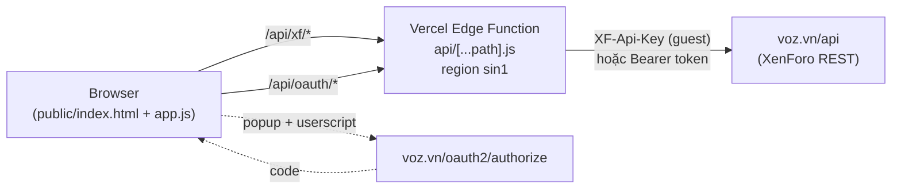
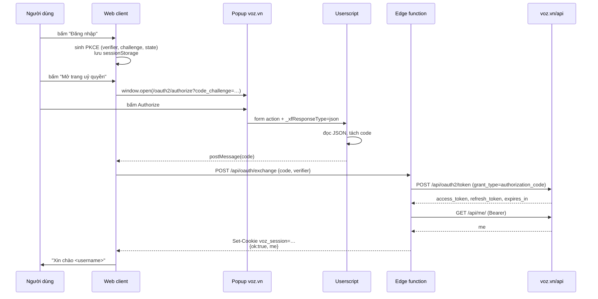

# voz-forum — web forum dựng trên API voz.vn

Website diễn đàn theo phong cách voz.vn, chạy trên Vercel Edge (region **sin1 — Singapore**),
dùng REST API của voz.vn làm backend. Không có database riêng: mọi dữ liệu đọc/ghi trực tiếp
qua API, phiên đăng nhập lưu trong cookie mã hoá base64url.

```
vtest/voz-forum/
├── api/
│   ├── [...path].js      # Edge Function: proxy /api/xf/* + OAuth endpoints
│   └── index.js          # re-export cho route /api
├── public/
│   ├── index.html        # shell (History API router)
│   ├── assets/
│   │   ├── style.css     # theme lấy từ voz.vn
│   │   ├── api.js        # client gọi /api/xf/*
│   │   └── app.js        # router + toàn bộ view
│   └── userscript/
│       └── voz-oauth-helper.user.js
├── dev-server.mjs        # server local (không deploy)
├── package.json
└── vercel.json
```

---

## 1. Kiến trúc



Vì sao phải có lớp edge:

| Vấn đề | Lý do |
|---|---|
| `User-Agent: VOZ/MA26` | Thiếu UA này **mọi** request trả `403`. Trình duyệt không set được UA tuỳ ý. |
| `XF-Api-Key` | Nếu để trong JS thì ai cũng đọc được; giữ ở server. |
| Bearer token | Không nhét token vào `localStorage`; lưu trong cookie `HttpOnly`. |
| CORS | `voz.vn/api` không trả `Access-Control-Allow-Origin`, nên gọi trực tiếp từ browser bị chặn. |
| Region | `sin1` để Cloudflare thấy IP Singapore thay vì IP Việt Nam. |

---

## 2. Deploy

### 2.1 Chuẩn bị

```powershell
cd "D:\Data 2\Github-Clone\siritami\vtest\voz-forum"
npm i -g vercel      # hoặc dùng npx vercel
vercel login
```

### 2.2 Deploy

```powershell
vercel            # preview
vercel --prod     # production
```

Không cần biến môi trường nào — mọi hằng số (client id, guest key, scope) nằm trong
`api/[...path].js`.

### 2.3 Ép region Singapore

Đã khai báo ở hai chỗ, cả hai đều cần:

```js
// api/[...path].js
export const config = {
  runtime: 'edge',
  regions: ['sin1'],
};
```

```json
// vercel.json
{
  "version": 2,
  "regions": ["sin1"]
}
```

Kiểm tra sau khi deploy:

```powershell
curl.exe -s https://<project>.vercel.app/api/config
# {"siteUrl":"https://voz.vn", ...}
```

Header `x-vercel-id` trong response cho biết region thực tế, ví dụ
`hkg1::sin1::xxxx` — phần thứ hai là region chạy function.

### 2.4 Chạy local

```powershell
node dev-server.mjs 3111
# → http://localhost:3111
```

`dev-server.mjs` chỉ để phát triển: nó serve `public/` và chuyển `/api/*` vào đúng
handler edge. Vercel không dùng file này.

---

## 3. Đăng nhập OAuth2 + PKCE

### 3.1 Vấn đề: redirect URI bị khoá

Ứng dụng OAuth `VOZ chính chủ` (`client_id=2424906941304717`) chỉ đăng ký **một**
redirect URI duy nhất:

```
vozma26://oauth
```

Đã thử và bị từ chối (`400 The provided redirect URI is not valid or does not match a
registered redirect URI`):

```
vozma26://oauth/            vozma26://oauth/callback     vozma26://oauth?x=1
exp+voz-ma-26://oauth       exp://127.0.0.1:8081/--/oauth
https://voz.vn/oauth2/callback                          https://voz.vn/oauth/callback
http://localhost:3000/api/oauth/callback
https://<project>.vercel.app/api/oauth/callback
```

Hệ quả: sau khi bấm **Authorize**, trình duyệt nhận `303` tới `vozma26://oauth?code=…`.
Không có app nào đăng ký scheme đó trên máy người dùng, nên **mã uỷ quyền bị mất** —
trang web không đọc được URL đích.

### 3.2 Cách giải quyết: userscript bắt mã

Userscript chạy trong chính trang voz.vn nên đọc được phản hồi. Mấu chốt: XenForo trả
**JSON** thay vì `303` nếu request có `_xfResponseType=json`.

```js
// thêm vào action của form Authorize
form.setAttribute('action', action + '&_xfResponseType=json');
```

Khi đó response là:

```json
{
  "status": "ok",
  "message": "Your changes have been saved.",
  "redirect": "vozma26://oauth?code=<CODE>&state=<STATE>",
  "visitor": { "conversations_unread": "0", "alerts_unviewed": "0", "total_unread": "0" }
}
```

Userscript đọc `redirect`, tách `code`, rồi:

1. hiện panel góc phải với nút **Copy code**,
2. `postMessage({ type: 'voz-oauth-code', code, state })` về tab web client,
3. lưu vào `sessionStorage` để hiện lại khi cần.

Nó cũng hook `fetch` / `XMLHttpRequest` / `location.assign` để bắt trường hợp trang tự
redirect bằng JS.

### 3.3 Luồng đầy đủ



### 3.4 Vì sao đổi token phải ở server

`POST /api/oauth2/token` trả `403` (trang HTML Cloudflare) nếu thiếu
`User-Agent: VOZ/MA26`. Trình duyệt không set được header đó, nên bước đổi code lấy
token **bắt buộc** chạy ở edge function.

### 3.5 Endpoint OAuth của web client

| Method | Path | Body | Kết quả |
|---|---|---|---|
| GET | `/api/config` | – | `clientId`, `redirectUri`, `scopes`, `authorizeUrl` |
| GET | `/api/oauth/status` | – | `{ loggedIn, me }`; tự refresh nếu còn < 60 s |
| POST | `/api/oauth/exchange` | `{ code, verifier }` | set cookie, trả `{ ok, me }` |
| POST | `/api/oauth/token` | `{ accessToken, refreshToken?, expiresAt? }` | nhận token dán tay, set cookie |
| POST | `/api/oauth/logout` | – | revoke refresh token + xoá cookie |

Cookie:

```
voz_session=<base64url(JSON tokens)>; Path=/; HttpOnly; Secure; SameSite=Lax; Max-Age=2592000
```

Nội dung: `{ accessToken, refreshToken, expiresAt, scope, tokenType, obtainedAt }`.

### 3.6 Đăng nhập bằng token dán tay

Tab thứ hai của trang `/login` cho phép dán thẳng access token (hoặc cả file
`tokens.json`). Server gọi `/api/me/` để xác thực trước khi set cookie — token sai
trả `401 token_rejected`.

Dùng khi không muốn cài userscript, hoặc để test nhanh.

### 3.7 Refresh token

Edge function tự refresh khi `expiresAt - now < 60_000`, và refresh một lần khi upstream
trả `401`. Token mới được ghi lại vào cookie qua `Set-Cookie` trên response đó.

```js
if (upstream.status === 401 && activeTokens) {
  refreshed = await refreshTokens(activeTokens);
  if (refreshed) {
    activeTokens = refreshed;
    upstream = await send(activeTokens);
  }
}
```

---

## 4. Proxy API

Mọi request của web client đi qua một tiền tố duy nhất:

```
GET /api/xf/<path>?<query>   →   https://voz.vn/api/<path>?<query>
```

Ví dụ:

| Web client | voz.vn |
|---|---|
| `/api/xf/nodes/` | `/api/nodes/` |
| `/api/xf/forums/13/threads?page=2` | `/api/forums/13/threads?page=2` |
| `/api/xf/threads/682181/?with_posts=true&page=1` | `/api/threads/682181/?with_posts=true&page=1` |
| `/api/xf/posts/` (POST) | `/api/posts/` (POST) |

Header do edge function gắn:

```js
headers.set('User-Agent', 'VOZ/MA26');
headers.set('Accept', 'application/json');
if (tokens) headers.set('Authorization', `Bearer ${tokens.accessToken}`);
else headers.set('XF-Api-Key', GUEST_KEY);
```

Body được chuyển nguyên `ArrayBuffer` nên `application/x-www-form-urlencoded` giữ đúng
encoding (kể cả tiếng Việt và `key[]=v`).

Response: giữ `status`, `content-type`, `xf-request-user`, `xf-request-user-extras`;
thêm `Cache-Control: private, no-store`.

---

## 5. Chức năng

### 5.1 Bảng route

| Route | View | API dùng |
|---|---|---|
| `/` | Danh sách node/forum (cây 61 node) | `GET /nodes/` |
| `/f/{slug}.{node_id}/` | Danh sách chủ đề trong forum | `GET /forums/{id}/`, `GET /forums/{id}/threads` |
| `/f/{slug}.{node_id}/page-{n}/` | Trang n của forum | `GET /forums/{id}/threads?page=n` |
| `/t/{slug}.{thread_id}/` | Bài viết trong chủ đề | `GET /threads/{id}/?with_posts=true` |
| `/t/{slug}.{thread_id}/page-{n}/` | Trang n của chủ đề | `GET /threads/{id}/?page=n` |
| `/t/{slug}.{thread_id}/page-{n}/#post-{post_id}` | Nhảy tới bài cụ thể | `scrollIntoView` |
| `/new/` | Bài mới toàn diễn đàn | `GET /threads/?order=post_date` |
| `/search?q=` | Tìm kiếm | `POST /search/` → `GET /search/{id}/` |
| `/direct-messages/` | Hộp thư | `GET /conversations/` |
| `/direct-messages/{slug}.{id}/` | Đọc + trả lời tin nhắn | `GET /conversations/{id}/?with_messages=true`, `POST /conversation-messages/` |
| `/direct-messages/new?to=` | Tạo tin nhắn mới | `GET /users/find-name`, `POST /conversations/` |
| `/alerts/` | Thông báo | `GET /alerts/` |
| `/bookmarks/` | Bài đánh dấu | `GET /voz/bookmarks` |
| `/watched/` | Chủ đề theo dõi | `GET /voz/watched-threads` |
| `/u/{slug}.{user_id}/` | Trang cá nhân | `GET /users/{id}/` |
| `/login` | Đăng nhập | `/api/oauth/*` |

### 5.1.1 Routing — giống hệt voz.vn

URL **không dùng hash** và có slug, đúng như voz.vn:

```
https://voz.vn/t/tong-hop-nhung-addon-chat-cho-firefox-chromium.682181/page-1581
https://voz.vn/f/phan-mem.13/page-2
https://voz.vn/u/frzzy.1/
https://voz.vn/direct-messages/test-test-test.11502686/
```

Quy tắc (đã kiểm tra bằng cách so 20 thread thật, khớp 20/20):

| Quy tắc | Chi tiết |
|---|---|
| Slug | lowercase, `đ→d`, bỏ dấu tiếng Việt (NFD + strip Mn), mọi ký tự không phải `[a-z0-9]` → `-`, trim `-` |
| Định dạng | `/{type}/{slug}.{id}/` — slug chỉ để đọc, **id số** mới là thứ API dùng |
| Trang | `/page-{n}/` trong path, **không** dùng `?page=`; trang 1 bỏ hẳn `/page-1` |
| Dấu `/` cuối | luôn có |
| Bài cụ thể | `#post-{post_id}` (fragment), không phải query |
| Legacy | `/t/682181/` (không slug) vẫn parse được — `idFromSegment()` lấy phần sau dấu `.` cuối |

Hàm tương ứng trong `app.js`:

```js
slugify(text)          // "Tổng hợp…" → "tong-hop-…"
idFromSegment(seg)     // "slug.682181" → 682181
threadPath(thread)     // → /t/slug.682181/
forumPath(forum)       // → /f/slug.13/
userPath(user)         // → /u/slug.1/
dmPath(conversation)   // → /direct-messages/slug.11502686/
withPage(path, n)      // → path + "page-n/" (bỏ khi n = 1)
```

Điều hướng:

| Thành phần | Chi tiết |
|---|---|
| `navigate(path)` | `history.pushState` + `route()` + scroll top |
| `parsePath()` | đọc `location.pathname`, tách `/page-{n}` khỏi segment cuối |
| Click interception | listener ở `document`; bỏ qua `target=_blank`, `download`, khác origin, `/api/`, `/assets/`, `/userscript/` |
| Fragment cùng trang | `#post-…` chỉ scroll + `replaceState`, không render lại |
| Back/forward | `popstate` → `route()` |
| Legacy hash | `#/t/123` được `history.replaceState` sang `/t/123` lúc boot |

Vercel cần SPA fallback để deep link không 404:

```json
"rewrites": [
  { "source": "/((?!api/|assets/|userscript/).*)", "destination": "/index.html" }
]
```

`dev-server.mjs` đã có fallback tương tự (mọi path không khớp file → `index.html`).

### 5.2 Ghi dữ liệu

| Hành động | API | Scope |
|---|---|---|
| Trả lời chủ đề | `POST /posts/` `{thread_id, message}` | `thread:write` |
| Trích dẫn + trả lời | như trên, message có `[QUOTE=…]` | `thread:write` |
| Sửa bài | `POST /posts/{id}/` `{message}` | `thread:write` |
| Xoá bài | `DELETE /posts/{id}/` | `thread:write` |
| Thả cảm xúc | `POST /posts/{id}/react` `{reaction_id}` | `thread:write` |
| Báo cáo | `POST /voz/posts/{id}/report` `{message}` | login |
| Gửi DM | `POST /conversations/` `{recipient_ids[], title, message}` | `conversation:write` |
| Trả lời DM | `POST /conversation-messages/` `{conversation_id, message}` | `conversation:write` |

### 5.3 Trích dẫn

Không có endpoint quote riêng. Web client dựng BBCode giống app:

```
[QUOTE="<author>, post: <post_id>, member: <user_id>"]
<nội dung, đã bỏ quote lồng>
[/QUOTE]

<nội dung bạn gõ>
```

`stripQuotes()` là bộ đếm độ sâu trên `/\[(\/?)quote(?:=[^\]]*)?\]/gi` — chỉ giữ text khi
depth = 0, nên quote lồng không bị nhân bản.

### 5.4 Cảm xúc

Là **toggle**, không có endpoint xoá riêng:

| Trạng thái | Gọi | Kết quả |
|---|---|---|
| chưa có | `reaction_id=1` | `action: "insert"`, score +1 |
| đang Ưng | `reaction_id=1` | `action: "delete"`, score 0 |
| đang Ưng | `reaction_id=2` | `action: "insert"`, score −1 (đổi, không cộng dồn) |

Danh mục lấy từ `GET /voz/reactions` (guest được). Chỉ `1 Ưng` và `2 Gạch` là `active`.

UI chỉ hiện hai nút `Ưng` / `Gạch` (icon + nhãn), không hiện `reaction_score` tổng và
không hiện số lượng từng loại. Nút đang chọn có class `.is-active`.

### 5.5 Xoá bài

`DELETE /posts/{id}/` là **xoá mềm**: bài biến mất khỏi danh sách, `reply_count` giảm 1,
`position` của các bài sau dồn lên, `post_id` **không đổi**. Gọi lần hai trả `404`
(không idempotent). Không có endpoint undelete qua REST.

> Tài khoản moderator xoá được bài của người khác mà không cần xác nhận. Web client chỉ
> hiện nút **Xoá** khi `can_soft_delete === true` và luôn hỏi `confirm()` trước khi gọi.

### 5.6 Phân quyền theo bài

Mỗi post trả về cờ quyền cho user hiện tại:

| Cờ | Dùng để |
|---|---|
| `can_edit` | hiện nút Sửa |
| `can_soft_delete` | hiện nút Xoá |
| `can_react` | bật/tắt nút cảm xúc |
| `can_view_attachments` | hiện ảnh đính kèm |

Thread có `can_reply` — `false` thì ẩn form trả lời.

---

## 6. Giao diện

Bảng màu lấy trực tiếp từ voz.vn bằng `getComputedStyle`:

| Thành phần | Giá trị |
|---|---|
| Header / nav | `#363d45` |
| Nav active | `#ff6600` |
| Block header | `#5c7099`, chữ `#ebecED` |
| Link | `#23497b`, hover `#ff6600` |
| Nền trang | `#373d43` |
| Nền block | `#f4f5f5` |
| Quote | nền `#eaeaeb`, viền trái `#ff944c` |
| Footer | `#102138` |
| Font | `"Be Vietnam", "Segoe UI", Roboto, sans-serif` |
| Bề rộng | `1058px` |

Cấu trúc giống XenForo: `.p-header` → `.p-nav` → `.p-body` → `.block` →
`.structItem` (danh sách) / `.message` (bài viết) → `.p-footer`.

Nội dung bài viết render từ `message_parsed` (HTML server trả về), được lọc qua
`sanitizeHtml()`: bỏ `script/style/iframe/object/embed/form/input/button`, bỏ mọi thuộc
tính `on*`, chặn `javascript:` trong `href`/`src`, thêm `target="_blank" rel="noopener
nofollow ugc"` cho link.

### 6.1 Ảnh trong bài — API làm mất kích thước

`message_parsed` **bỏ toàn bộ thuộc tính kích thước ảnh**. Ví dụ post `44240084`:

```
BBCode : [IMG size="80x80"]https://5.pik.vn/….webp[/IMG]
HTML   : 
```

Ảnh gốc 512×512 nên render full-size, trong khi voz.vn hiển thị đúng 80×80. Các biến thể
gặp trong thực tế (quét 3 trang của thread `682181`):

| BBCode | Số lần | Kích thước bị mất |
|---|---|---|
| `[IMG]url[/IMG]` | 27 | không có (giữ nguyên) |
| `[ATTACH type="full" alt="…"]id[/ATTACH]` | 7 | không có |
| `[ATTACH=full]id[/ATTACH]` | 4 | không có |
| `[IMG width="172px"]url[/IMG]` | 4 | `width` |
| `[IMG alt="…"]url[/IMG]` | 3 | không có |
| `[ATTACH type="full" width="578px"]id[/ATTACH]` | 1 | `width` |
| `[ATTACH type="full" width="578px" alt="…"]id[/ATTACH]` | 1 | `width` |

Cách xử lý: `applyImageSizes()` đọc lại BBCode gốc, dựng map `src → {width, height}`, rồi
gán lại `width`/`height` lên `` tương ứng trong HTML đã parse.

```js
// [IMG size="80x80"]url[/IMG]      → width 80, height 80
// [IMG width="150px"]url[/IMG]     → width 150
// [ATTACH type="full" width="150px"]3823398[/ATTACH] → width 150
```

Khoá so khớp: URL ảnh thường bị chuẩn hoá khác nhau giữa BBCode và HTML
(`/attachments/3823398/` so với `/attachments/1791259834896-webp.3823398/`), nên
`normalizeImgSrc()` quy cả hai về `attach:<id>`; ảnh ngoài thì bỏ scheme/host
`voz.vn`, query và dấu `/` cuối.

CSS đi kèm để không méo ảnh:

```css
.bbWrapper .bbImage { max-width: 100%; height: auto; }
.bbWrapper img:not(.smilie) { max-width: 100%; height: auto; }
```

Kết quả so với voz.vn (cùng post `42513430`):

| Ảnh | BBCode | voz.vn | Web client |
|---|---|---|---|
| imgchest 1 | `[IMG]` | 725×453 | 860×538 (khung rộng hơn) |
| imgchest 2 | `width="150px"` | 150×29 | 150×29 |
| attach 3823398 | `width="150px"` | 150×33 | 150×33 |
| attach 3804175 | `width="345px"` | 345×158 | 345×158 |
| attach 3775137 | không size | 725×1036 | 840×1200 (khung rộng hơn) |

### 6.2 Bố cục bài viết

| Vị trí | Nội dung |
|---|---|
| Góc trên phải | `#<số bài>` (API trả `position` **0-based**, hiển thị `position + 1`) |
| Dưới `#` | `Sửa` / `Xoá` (chỉ khi `can_edit` / `can_soft_delete`) |
| Đáy trái | icon báo cáo (cờ) |
| Đáy phải | `Ưng` / `Gạch` → icon trích dẫn → icon trả lời |
| Dải xám dưới đáy | icon cảm xúc + tên thành viên đã thả |

`.message-content` là flex column và `.message-footer` có `margin-top: auto`, nên với bài
ngắn (nội dung 1 dòng trong khi cột thông tin user cao 234px) footer vẫn bám đáy thay vì
lơ lửng giữa bài.

Cảm xúc hiện icon + nhãn `Ưng` / `Gạch` kèm **số lượng** (`Ưng 2`), không hiện điểm tổng
(`+2`). Trạng thái đang chọn đánh dấu bằng `.has-reaction` (màu cam).

### 6.3 Thanh trên cùng của chủ đề

Sao chép từ voz.vn:

| Thành phần | Chi tiết |
|---|---|
| `.block-header` | thanh xanh `#5c7099`, chứa tiêu đề + số trả lời/lượt xem |
| Nút theo dõi | **icon con mắt** trong thanh xanh, góc phải; bật = nền cam `#ff6600` |
| `.block-outer` | hàng riêng ngay dưới thanh xanh, chứa `.pageNav` |
| `.pageNav` | `‹ Trước` + `ul.pageNav-main` (các số trang) + `Sau ›` + tên tác giả bên phải |

Phân trang dùng `ul/li` giống XenForo: mỗi số là một `li.pageNav-page`, trang hiện tại là
`span.current` (nền `#5c7099`, chữ trắng), các trang khác nền `#dfe7f6`. Dấu `…` là
`li.pageNav-skip` — bấm vào sẽ đổi thành ô nhập số trang (Enter để đi, Esc/blur để huỷ).

Nút theo dõi gọi `POST /voz/threads/{id}/watch` với `state=watch` / `state=unwatch`; trạng
thái ban đầu đọc từ `thread.is_watching` (chỉ có khi đã đăng nhập).

### 6.4 Dải cảm xúc (tên thành viên)

API **không** trả danh sách người đã thả cảm xúc — chỉ có `reaction_counts`. Danh sách
nằm ở route web `/p/{post_id}/reactions` (HTML), và route này:

| Cách gọi | Kết quả |
|---|---|
| `curl` với UA trình duyệt | `200` |
| `fetch` từ browser (cross-origin) | `200` nhưng **CORS chặn đọc body** |
| `fetch` từ Node / Vercel Edge | `403` — Cloudflare challenge (TLS fingerprint) |

Vì vậy dải này hiện là **placeholder**: `reactionSummary()` render
`<div class="reactionsBar" data-reaction-list="<post_id>">` với chữ "Đang tải thành viên…",
`hydrateReactionLists()` gọi `loadReactionUsers()` để lấy tên. Khi cả hai đường đều bị
chặn, dải tự xoá khỏi DOM (`strip.remove()`) nên không hiện khung rỗng.

Số lượng cảm xúc vẫn hiển thị đầy đủ trên nút `Ưng` / `Gạch` vì lấy từ `reaction_counts`
trong response API.

Ảnh trong bài (`voz.vn/attachments/…`) hotlink được — đã kiểm tra trả `200 image/webp`
kể cả khi `Referer` là domain khác.

### 6.5 Danh sách chủ đề (`structItem`)

Bảng chủ đề dùng đúng cấu trúc bảng của XenForo — `display: table` + `table-layout: fixed`,
5 ô:

| Ô | Rộng | Nội dung |
|---|---|---|
| `--icon` | 52px | avatar người lập chủ đề (36px) |
| `--main` | auto | `ul.structItem-statuses` (float phải) + tiêu đề + `structItem-minor` |
| `--meta` | 135px | 2 dòng `dl.pairs--justified`: `Trả lời` / `Lượt xem` |
| `--latest` | 190px | thời gian bài cuối + tên người gửi cuối, canh phải |
| `--iconEnd` | 40px | avatar người gửi cuối (24px) |

`dl.pairs--justified` đặt `dt` float trái và `dd` float phải, nên **mọi con số trong cột
thẳng hàng nhau** bất kể độ dài nhãn.

**Trạng thái** dùng mask SVG của Font Awesome 5 (nhúng dạng data-URI, không phụ thuộc
mạng): `structItem-status--sticky` = thumbtack, `structItem-status--locked` = ổ khoá.
Chủ đề ghim có tiêu đề màu cam (`--link-hover`), giống voz.vn.

**Tiền tố** (`prefix_id`) map sang class màu của XenForo — bảng lấy trực tiếp từ
`<option data-prefix-class>` trong form đăng bài của từng forum:

| id | nhãn | class |
|---|---|---|
| 4 | góp ý | `green` |
| 5 | báo lỗi | `red` |
| 6 | thắc mắc | `royalBlue` |
| 7 | chú ý | `orange` |
| 8 / 9 / 10 / 11 | HN / SG / ĐN / khác | `green` / `red` / `royalBlue` / `orange` |
| 12 | thảo luận | `primary` |
| 13 | tin tức | `accent` |
| 14 | đánh giá | `red` |
| 15 | khoe | `green` |
| 16 | thắc mắc | `orange` |
| 17 | kiến thức | `royalBlue` |
| 18 | TQ | `gray` |
| 19 | download | `olive` |
| 20 / 21 | tuyển dụng / tìm việc | `red` / `green` |
| 22 | Dịch | `royalBlue` |

**Avatar** dùng `avatarMarkup()`: một `<span>` nền màu + chữ cái đầu, ảnh thật phủ lên
trên. Nếu ảnh 404 (`onerror="this.remove()"`) thì lộ ra avatar chữ cái — đúng như
`avatar--default--dynamic` của XenForo. Bảng màu chữ cái lấy từ voz.vn
(`#66cc66/#206020`, `#669966/#1f2e1f`, …), chọn theo `user_id % 7`.

Với user chỉ có `user_id` + `username` (không có `avatar_urls`), ảnh được đoán theo quy
tắc thư mục của voz.vn: `https://data.voz.vn/avatars/{size}/{floor(id/1000)}/{id}.jpg`.
Nếu `avatar_urls` tồn tại nhưng toàn `null` thì user thật sự không có avatar → chỉ hiện
chữ cái, không đoán (tránh 404).

**Số liệu** làm tròn giống voz.vn: `12301 → 12K`, `443764 → 444K`, `1274095 → 1M`
(`Math.round`, không có phần thập phân).

---

## 7. Userscript

File: `public/userscript/voz-oauth-helper.user.js`

```
@match  https://voz.vn/oauth2/*
@match  https://voz.vn/*
@grant  GM_setClipboard, GM_getValue, GM_setValue
@run-at document-start
```

Cài bằng Tampermonkey / Violentmonkey, hoặc mở trực tiếp
`https://<project>.vercel.app/userscript/voz-oauth-helper.user.js`.

Cơ chế:

| Bước | Việc làm |
|---|---|
| 1 | Patch `location.assign` / `location.replace` để chặn `vozma26://` |
| 2 | Hook `window.fetch` — đọc response của `/oauth2/authorize` |
| 3 | Hook `XMLHttpRequest` — XenForo submit form bằng XHR |
| 4 | Thêm `&_xfResponseType=json` vào `action` của form Authorize |
| 5 | Đọc `<body>` nếu nó là JSON (trường hợp form submit điều hướng thật) |
| 6 | Hiện panel + `postMessage` về tab opener |

Panel hiện `code`, nút **Copy code**, nút **Gửi về web client**, và nhắc rằng code chỉ
dùng được một lần.

---

## 8. Giới hạn đã biết

| Giới hạn | Chi tiết |
|---|---|
| Không tạo chủ đề mới | `POST /threads/` tồn tại (`node_id`, `title`, `message`) nhưng chưa từng chạy thử; UI không có nút tạo thread. |
| Không upload file | `POST /api/attachments/` luôn `404` dù có scope `attachment:write`. Đường duy nhất là route web `/attachments/upload` cần cookie session + `_xfToken`, không dùng được với bearer token. |
| Không đăng ký tài khoản | API không có endpoint register. |
| Không sửa profile | `POST /me/avatar`, `/me/password`, `/me/email` tồn tại nhưng chưa chạy thử (đổi thông tin đăng nhập). |
| Không tìm user theo danh sách | `GET /users/` trả `403`. Chỉ tìm được bằng `find-name` (khớp chính xác username). |
| `order` của `/threads/` | Chỉ `post_date` thay đổi kết quả; các giá trị khác trả về mặc định. |
| Bookmark / watch | Chỉ có dưới tiền tố `/voz/`, không có ở đường XenForo chuẩn. |
| Không có thông báo realtime | Phải tải lại trang; API không có SSE/WebSocket. |
| Cookie không mã hoá | `voz_session` là base64url của JSON token, không phải JWT ký. Ai có cookie là có token — chấp nhận được vì cookie `HttpOnly` + `Secure`, nhưng không phải giải pháp bảo mật cao. |

---

## 9. Kiểm thử đã chạy

Tất cả trên `http://localhost:3111` với tài khoản thật, sau đó dọn dẹp.

| Chức năng | Kết quả |
|---|---|
| Trang chủ | 61 node render đúng cây |
| Forum `/f/13` | 24 item (4 sticky + 20), pager `1/490` |
| Thread `/t/1251511` | 20 bài, BBCode + quote render, 40 nút cảm xúc |
| `?page=last` | nhảy đúng trang `1581/1581` của thread `682181` |
| Đăng nhập OAuth | popup → code → exchange → cookie → "Xin chào" |
| Trả lời | `alo test web client` → post mới, nhảy tới đúng bài |
| Trích dẫn | sinh đúng 1 block `[QUOTE="…, post: …, member: …"]` |
| Sửa bài | modal → lưu → nội dung đổi, vẫn ở trang cuối |
| Xoá bài | confirm → biến mất, `reply_count` giảm |
| Cảm xúc | Ưng: `insert` → `.has-reaction`; bỏ: `delete` → mất `.has-reaction` |
| Số bài | `position` 0-based → hiển thị `#1`, `#2`, `#3`… |
| Theo dõi | icon con mắt trong thanh xanh, `watch`/`unwatch` đổi màu + tooltip |
| Phân trang trên | `ul.pageNav-main`, trang hiện tại chữ cam, không vỡ layout |
| Icon trích dẫn / trả lời | SVG, click vẫn chèn quote và focus textarea |
| Ảnh có size | `[IMG size="80x80"]` render đúng 80×80 (trước đó 512×512) |
| Ảnh `width=` | `[IMG width="150px"]` và `[ATTACH width="345px"]` đúng |
| Footer bài ngắn | `margin-top: auto` → gap đáy = 0 trên cả 16 bài của trang |
| DM trả lời | 1 → 2 tin nhắn |
| DM mới | tìm `salin1810` → gửi → mở conversation mới |
| Tìm kiếm | `firefox` → 184 kết quả, 10 trang |
| Alerts / Bookmarks / Watched | 22 / 20 / 2 mục |
| Trang cá nhân | `fRzzy`, 12.7K bài, nút "Gửi tin nhắn" |
| Đăng xuất | cookie xoá, DM và form trả lời bị chặn |
| Mobile 420px | footer không tràn, mọi nút vẫn hiện |
| URL sạch | `/t/slug.682181/page-1581/`, không còn `#`; reload deep link OK |
| Slug khớp voz.vn | so 20 thread thật → 20/20 khớp `view_url` |
| Back/forward | `popstate` khôi phục đúng trang |
| Legacy hash | `/#/t/682181?page=5` → `/t/682181/page-5/` |
| Legacy không slug | `/t/682181/` vẫn parse đúng |
| Fragment `#post-` | click `#31601` → scroll tới bài, URL giữ `#post-44234456` |
| Breadcrumb | màu `#d1d4d6` giống tên tác giả, đọc được trên nền tối |
| Avatar thread | `/l/` (192×192) cho khung 96px, `srcset` thêm `/o/` cho 2x |

Dữ liệu test đã dọn: bài `alo test web client` đã xoá, conversation `web client test`
đã leave, cảm xúc đã bỏ.

---

## 10. Ghi chú triển khai

- `package.json` có `"type": "module"` — bắt buộc để Vercel hiểu `api/*.js` là ESM.
- Tên file `api/[...path].js` là catch-all của Vercel: mọi `/api/<bất kỳ>` vào cùng một
  function. `api/index.js` chỉ re-export để `/api` (không có sub-path) cũng chạy.
- `vercel.json` không rewrite gì — Vercel tự phục vụ `public/` và route `api/`.
- Không commit `tokens.json` hay bất kỳ file chứa token thật.
- Token trong cookie hết hạn sau `expires_in` (thường 1 giờ); edge tự refresh, nhưng nếu
  refresh token cũng hết hạn thì người dùng phải đăng nhập lại.
