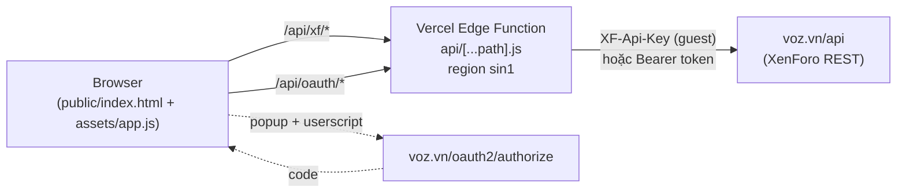
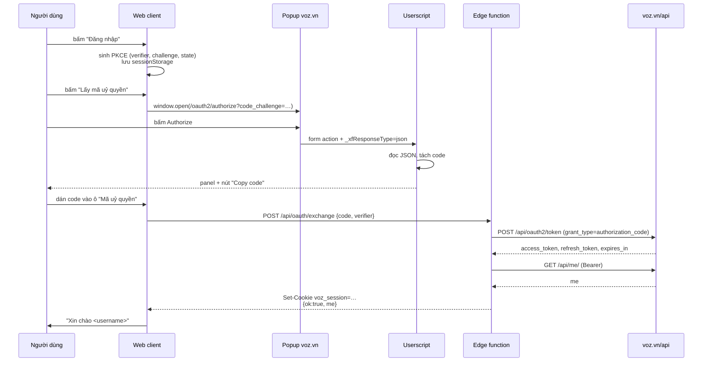

# voz-forum — web forum dựng trên API voz.vn

Website diễn đàn theo phong cách voz.vn, chạy trên Vercel Edge (region **sin1 — Singapore**),
dùng REST API của voz.vn làm backend. Không có database riêng: mọi dữ liệu đọc/ghi trực tiếp
qua API, phiên đăng nhập lưu trong cookie mã hoá base64url.

> **Ghi chú về dữ liệu cá nhân.** Tài liệu này **không** chứa username, user id, member id,
> conversation id, thread id, post id, attachment id hay nội dung bài viết thật của bất kỳ
> thành viên nào. Mọi ví dụ dùng placeholder dạng `<slug>`, `<thread_id>`, `<post_id>`,
> `<user_id>`, `<conversation_id>`, `<attach_id>`. Khi thêm ví dụ mới, giữ nguyên quy tắc
> này: không dán URL voz.vn thật, không dán id thật, không dán nội dung bài viết thật.
> Hằng số kỹ thuật của ứng dụng (`client_id`, guest API key, region, scope) **được giữ lại**
> vì cần cho việc deploy và không phải thông tin cá nhân.

```
vtest/
├── api/
│   ├── [...path].js      # Edge Function: proxy /api/xf/* + OAuth endpoints
│   └── index.js          # re-export cho route /api
├── public/
│   ├── index.html        # shell (History API router)
│   ├── assets/
│   │   ├── app.js        # entry: global listeners + boot
│   │   ├── api.js        # client gọi /api/xf/*
│   │   ├── core/         # hạ tầng dùng chung
│   │   │   ├── dom.js        # handle DOM + state toàn cục
│   │   │   ├── icons.js      # SVG inline
│   │   │   ├── utils.js      # esc / num / timeAgo / fullDate
│   │   │   ├── paths.js      # slug + URL giống voz.vn
│   │   │   ├── nav.js        # navigate / currentPage
│   │   │   └── router.js     # parsePath + route
│   │   ├── lib/          # logic thuần, không đụng DOM
│   │   │   ├── avatar.js     # avatarMarkup + fallback chữ cái
│   │   │   ├── bbcode.js     # sanitize + khôi phục size ảnh + quote
│   │   │   ├── postLinks.js  # link voz.vn trong bài → route nội bộ
│   │   │   ├── signature.js  # chữ ký (BBCode thô) → HTML
│   │   │   ├── editorCodec.js # BBCode ⇄ HTML cho trình soạn
│   │   │   ├── media.js      # khôi phục iframe/media + resize Reddit + Facebook SDK + Flickr oEmbed + Douyin
│   │   │   ├── imageFallback.js # data-onerror (hide-parent/hide) — sự kiện error pha capture
│   │   │   ├── prefix.js     # prefix_id → class màu
│   │   │   ├── quotes.js     # khôi phục link nguồn của quote
│   │   │   ├── attachments.js # [ATTACH]id → URL thật cho trình soạn
│   │   │   ├── smilies.js    # danh mục /voz/smilies → 
│   │   │   ├── stickers.js   # album sticker + recent (localStorage)
│   │   │   ├── imgurImport.js # tách album id + tải album imgur
│   │   │   ├── pikUpload.js  # nén + tải ảnh lên pik.vn qua proxy
│   │   │   ├── spoilers.js   # parser BBCode → details/summary
│   │   │   ├── unread.js     # bài chưa đọc đầu tiên (visitor_read_date → page/id)
│   │   │   └── userBadges.js # User.banners → badge màu
│   │   ├── ui/           # component render HTML
│   │   │   ├── chrome.js     # header account / breadcrumbs / nav
│   │   │   ├── headerMenus.js # dropdown tìm kiếm / hộp thư / thông báo
│   │   │   ├── forumNodes.js # nhóm diễn đàn, khối diễn đàn con + bài mới nhất
│   │   │   ├── feedback.js   # toast / loading / errorBox
│   │   │   ├── pagination.js # pageNav + ô nhảy trang
│   │   │   ├── infiniteScroll.js # cuộn liên tục (Bật / Theo yêu cầu / Tắt)
│   │   │   ├── threadRow.js  # 1 dòng danh sách chủ đề
│   │   │   ├── post.js       # 1 bài viết (.message)
│   │   │   ├── reactions.js  # nút cảm xúc + dải tên
│   │   │   ├── editor.js     # textarea BBCode + toolbar
│   │   │   ├── editorTools.js # bảng chèn (URL/ảnh/media/bảng/smilie/sticker)
│   │   │   ├── stickerPicker.js # popup chọn sticker (tab album + gần đây)
│   │   │   ├── memberTooltip.js # thẻ thành viên hover/chạm
│   │   │   ├── titleHold.js  # giữ tiêu đề 1,5 s để theo dõi
│   │   │   ├── unreadCounts.js # badge hộp thư / thông báo
│   │   │   ├── inlineEdit.js # sửa bài tại chỗ (không modal)
│   │   │   ├── postNumberPopup.js # menu chia sẻ của số bài (link voz.vn / link web)
│   │   │   ├── modal.js      # modal shell + báo cáo
│   │   │   ├── theme.js      # áp data-theme (sáng/tối/auto) + cỡ chữ + nạp font lười
│   │   │   ├── chromeAutoHide.js # ẩn/hiện header + nav theo hướng cuộn
│   │   │   └── session.js    # loadSession / requireLogin
│   │   ├── views/        # 1 file / nhóm route
│   │   │   ├── forum.js      # trang chủ + danh sách chủ đề + bài mới
│   │   │   ├── thread.js     # chủ đề + trả lời + mọi action
│   │   │   ├── compose.js    # tạo chủ đề + chọn tiền tố
│   │   │   ├── search.js
│   │   │   ├── dm.js         # hộp thư / hội thoại / soạn mới
│   │   │   ├── lists.js      # thông báo / đánh dấu / theo dõi
│   │   │   ├── user.js
│   │   │   ├── settings.js  # /cai-dat-tuivoz — giao diện + phím tắt nav + sticker + JSON backup
│   │   │   └── login.js
│   │   ├── fonts/        # woff2 (roboto / be-vietnam-pro / be-vietnam / sf-pro-display / segoe-ui) + OFL.txt, OFL-BeVietnam.txt
│   │   │                 # (SF Pro + Segoe UI: no OFL file — proprietary, see css/fonts.css)
│   │   ├── img/          # voz-lockup.svg — logo header, chép từ voz.vn
│   │   └── css/          # theme, tách theo khu vực
│   │       ├── base.css      # bảng màu sáng + bảng tối + reset + utility + token cỡ chữ
│   │       ├── theme.css     # color-scheme, giảm sáng ảnh, selection
│   │       ├── layout.css    # header / nav / block / footer
│   │       ├── forum.css     # node list / structItem / pageNav
│   │       ├── avatar.css    # avatar + label tiền tố
│   │       ├── post.css      # .message + bbWrapper (chữ trong bài theo --post-scale)
│   │       ├── media.css     # unfurl (ghim chặt ảnh/icon) + iframe media
│   │       ├── reaction.css
│   │       ├── forms.css     # button / input / tabs
│   │       ├── editor.css    # trình soạn trực quan
│   │       ├── account.css   # DM / alert / profile / login
│   │       ├── misc.css      # toast / modal / loading
│   │       ├── responsive.css
│   │       ├── headerMenus.css
│   │       ├── home.css
│   │       ├── settings.css   # trang cài đặt + danh sách phím tắt + thanh trượt cỡ chữ
│   │       ├── stickers.css   # popup sticker + quản lý album
│   │       └── fonts.css      # @font-face của 5 họ không mặc định — chỉ link khi chọn
│   │       └── font-default.css  # face Be Vietnam 400, link thẳng từ <head> (mặc định)
│   └── userscript/
│       └── voz-oauth-helper.user.js
├── tools/
│   ├── build-fonts.py    # dựng woff2 từ font OFL gốc (instance + subset)
│   ├── build-be-vietnam.py      # [không còn dùng] bản 2.000, xem build-be-vietnam-gstatic.py
│   ├── build-be-vietnam-gstatic.py  # Be Vietnam + Be Vietnam Pro khớp voz.vn (merge gstatic)
│   ├── build-sf-pro-display.py  # dựng SF Pro Display (CFF/OTF, sửa usWeightClass)
│   ├── build-segoe-ui.py        # dựng Segoe UI từ C:/Windows/Fonts (Bold vào ô 600)
│   └── build-cantarell.py       # tải nguồn GNOME + fontmake + subset (KHÔNG dùng bản Google Fonts)
├── dev-server.mjs        # server local (không deploy)
├── package.json
├── vercel.json
├── LICENSE               # GPL-3.0
├── voz-app-api.md        # tài liệu API voz.vn (tham chiếu)
└── voz-forum-deploy.md   # tài liệu này
```

Thứ tự thẻ `<link>` trong `index.html` quan trọng: `base.css` (biến màu) phải đứng đầu,
ngay sau là `theme.css` (rule theo `data-theme`/`data-font`) và script chống nhấp nháy
(đặt `data-theme`/`--font`/`--post-scale`/`--ui-scale` trước lần vẽ đầu);
`responsive.css` chứa override chung; `headerMenus.css` và `home.css` đứng sau để giữ layout responsive riêng cho menu và trang chủ.
`editor.css` phải đứng **sau** `forms.css` vì nó ghi đè `.editor-toolbar`; `media.css`
đứng ngay sau `post.css` để style unfurl/iframe nằm cạnh style bài viết. `settings.css` và
`stickers.css` đứng cuối vì chỉ phục vụ `/cai-dat-tuivoz` và popup sticker.

### Giao diện trang chủ và header

- `ui/forumNodes.js` dựng nhóm diễn đàn, icon hội thoại/tìm kiếm, số chủ đề/bài viết và chủ đề mới nhất cùng người bình luận cuối. SearchForum (Tin tức iNet, Review sản phẩm, Chia sẻ kiến thức) trỏ về route nội bộ `/s/<slug>.<id>/` giống voz.vn, không mở sang voz.vn nữa. Trên trang một diễn đàn, `subForumBlock()` còn dựng **khối diễn đàn con** — voz.vn xếp các node con thành một `.block` **không có tiêu đề** ngay trên danh sách chủ đề, tái dùng đúng `nodeRow()` của trang chủ (icon, tiêu đề, số chủ đề/bài viết, avatar + chủ đề mới nhất). `/forums/{id}` không trả node con nên khối này lấy từ `/nodes/` (`tree_map`), tận dụng cache `state.nodes`. Diễn đàn không có node con thì không render gì.
- `ui/headerMenus.js` quản lý menu tìm kiếm, hộp thư và thông báo; tải tối đa 6 mục khi mở, có liên kết xem tất cả. Escape/click bên ngoài đóng menu. Menu tài khoản chứa hồ sơ, đánh dấu, theo dõi và nút Đăng xuất kèm icon nguồn; không còn nút đăng xuất riêng trên thanh header.
- `ui/unreadCounts.js` hiển thị badge đỏ trên icon hộp thư/thông báo, lấy tổng từ `GET /conversations/?unread=true` và `GET /alerts/?unviewed=true` (không đếm riêng trang đầu). Số 0 ẩn badge, trên 99 hiện `99+`; accessible label giữ số đầy đủ. Cập nhật khi render tài khoản, chuyển trang xong, tải menu xong, quay lại tab và mỗi 60 giây khi tab hiển thị. Mở menu thông báo gọi `POST /alerts/mark-all` với `viewed=true`; mở hộp thư đánh dấu các hội thoại chưa đọc đang hiển thị qua `POST /conversations/{id}/mark-read` tới `last_message_date` (không đánh dấu hội thoại ngoài preview). Mục mới có nền cam nhạt suốt lần mở đó, mở lại dùng trạng thái API mới. Sau thao tác đọc, bắt buộc tải lại count sau request count đang chạy để tránh số cũ; API lỗi không giả lập xóa badge.
- Tìm kiếm hỗ trợ từ khoá **hoặc** bài viết của một thành viên. API không áp dụng `title_only`/`users` trên tìm từ khoá; tìm nâng cao đầy đủ mở voz.vn, không giả lập bộ lọc bị bỏ qua.
- `views/compose.js` xử lý `/f/<slug>.<id>/post-thread`, kiểm tra quyền và lấy tiền tố từ API. Nút đăng gửi dữ liệu thật lên voz.vn; không dùng nút này để kiểm tra trên dữ liệu thật. Diễn đàn yêu cầu trường đặc biệt mở composer trên voz.vn.
- Nút Tạo chủ đề mới nằm cùng hàng breadcrumb của diễn đàn, kể cả trên mobile; breadcrumb dài tự xuống dòng trong phần bên trái.
- Trên mobile ≤620px, thống kê Bài viết / Điểm / Tham gia hiển thị bên phải tên và badge tác giả; số lượng rút gọn K/M, ngày tham gia hiển thị năm.
- Phân trang cuối danh sách chủ đề dùng `.block-outer` trong suốt giống trang chủ đề.
- Chủ đề có bài mới chưa đọc in đậm tiêu đề (`font-weight: 600`), đọc rồi trở về 400 — giống voz.vn. API `/forums/{id}/threads` trả sẵn `is_unread` (kèm `first_unread_snippet`, `visitor_read_date`) theo tài khoản đang đăng nhập, nên không cần gọi thêm endpoint: `ui/threadRow.js` thêm class `is-unread` và `css/forum.css` lo phần in đậm, nhãn tiền tố vẫn giữ 400. Cơ chế `is-unread` này dùng chung với trang chủ (`node-row`) và hộp thư (`dm-row`).
- **Nhảy tới bài chưa đọc.** Tiêu đề của chủ đề `is_unread` trỏ `/t/<slug>.<id>/unread` — đúng dạng link voz.vn đặt trong `structItem-title` — rồi `router.js` phân giải thành `/t/…/page-N/#post-<id>` và `replaceState`, y như redirect phía server của voz.vn. API **không** có "id bài chưa đọc đầu tiên": `/threads/{id}/posts` không lọc theo trạng thái đọc và `/threads/{id}/?unread=1` bị bỏ qua. Bù lại `GET /threads/{id}/` trả `visitor_read_date` + `pagination` **mà không** đánh dấu đã đọc, nên `lib/unread.js` (`resolveUnread`) đi ngược từ trang cuối, gặp trang đầu tiên có bài mới hơn `visitor_read_date` là dừng — chủ đề dài thường chỉ tốn 1–2 request. `visitor_read_date: null` (chưa từng mở) ⇒ về trang 1, không gắn fragment. Chặn trần `MAX_PAGE_WALKS` 12 lần để chủ đề bất thường không nối request vô hạn; lỗi mạng giữ kết quả trang đã phân giải được. Thread đã đọc hết ⇒ về trang 1, không fragment (không sinh `#post-null`).
- Trạng thái đọc chỉ được xoá khi mở bài ở **trang cuối** (`viewThread` gọi `POST /threads/{id}/mark-read` với `date` hiện tại, bỏ qua lỗi); mở trang giữa không đánh dấu đã đọc. Chỉ chạy khi đã đăng nhập và thread đang `is_unread`. Lưu ý `GET /threads/{id}/` **không** tự đánh dấu đã đọc — chỉ POST `mark-read` mới đổi `is_unread`.
- Avatar mặc định giữ bảng màu hiện tại; chữ cái bằng 60% chiều rộng avatar (`60cqi`).
- Thời gian đăng bài trong chủ đề dùng dạng tương đối đến hết ngày thứ 7; từ 8 ngày hiển thị ngày giờ đầy đủ. Hover thời gian luôn xem được ngày giờ chính xác. Trên mobile ≤620px, chạm thời gian sẽ đổi thành ngày giờ đầy đủ tại chỗ, không chuyển đến permalink bài viết; liên kết số bài vẫn hoạt động. Các định dạng thời gian ở khu vực khác giữ nguyên.
- API thay nội dung spoiler bằng `Spoiler content hidden.`; `lib/spoilers.js` lấy lại nội dung từ BBCode gốc bằng parser stack, dựng `details/summary` hỗ trợ spoiler lồng nhau. Giữ các định dạng cơ bản, list, URL, ảnh/attachment, code, quote và media; EMBED chưa hỗ trợ giữ liên kết nguồn. Chỉ thay placeholder khi số spoiler ngoài cùng khớp, không tải HTML ngoài hay chạy BBCode như HTML. Nội dung phục hồi tiếp tục đi qua sanitizer, khôi phục quote/media/smiley và kích thước ảnh.
- `lib/quotes.js` khôi phục liên kết bài gốc trong tên tác giả quote từ BBCode (bao gồm quote lồng nhau); quote không có post ID giữ tên thường. Route `/p/<id>/` lấy bài gốc và pagination API để chuyển đến đúng thread/trang rồi cuộn tới bài, không giả định 20 bài/trang. Cùng file này còn **gấp quote dài**: quote cao quá 800px được cắt, làm mờ dần và hiện nút *Bấm để mở rộng...*, đúng như `.bbCodeBlock--expandable` + `.bbCodeBlock-expandLink` của voz.vn (bài #1 thread 1296038 có quote cao 13.700px).
- `css/media.css` định dạng preview URL (`bbCodeBlock--unfurl`) từ HTML API: thumbnail, tiêu đề, mô tả, favicon; ảnh preview không nhận class ảnh bài viết. Không tự fetch URL tùy ý để lấy metadata. Khối embed (`.media-embed`) canh giữa bằng `margin: 12px auto` để video không dạt trái so với voz.vn.
  - **Bẫy specificity (đã sửa).** `.bbWrapper img:not(.smilie)` ở `post.css` đặt `height: auto` với specificity (0,2,1), thắng `.bbCodeBlockUnfurl-icon` (0,2,0). Favicon tải lỗi có `naturalHeight = 0`, nên `height: auto` + `width: 16px` biến alt text (`discord.com`) thành một cột chữ 16px cao hàng trăm pixel: card từ ~130px phình lên ~400px, và vì chữ trong bài co giãn theo `--post-scale` nên lỗi nặng dần khi tăng cỡ chữ (100% → 397px, 150% → 397px, 200% → lớn hơn nữa). Hai ảnh của card giờ được ghim qua chính hàng của chúng — `.contentRow-figure .bbCodeBlockUnfurl-image` và `.contentRow-minor .bbCodeBlockUnfurl-icon`, đều (0,3,0) — nên thắng rule chung mà **không** phụ thuộc tổ tiên `.bbWrapper` (card vẫn đúng khi render ngoài `.bbWrapper`). Icon còn có `max-height: 16px` làm lớp bảo hiểm. Đo lại: card 131px ở 100%, 206px ở 150%, 306px ở 200% — chênh lệch chỉ do chữ, không do ảnh.
  - **`data-onerror="hide-parent"` (đã hiện thực).** HTML của voz.vn gắn thuộc tính này lên favicon; bản thân nó là **trơ** — XenForo bind bằng JavaScript mà app không tải — nên favicon chết vẫn chiếm chỗ và hiện alt text. `lib/imageFallback.js` (`wireImageFallbacks()`, gọi một lần trong `app.js`) bắt `error` ở **pha capture** trên `document` (sự kiện `error` không bubble) và ẩn phần tử cha (`hide-parent`) hoặc chính ảnh (`hide`). Ảnh không có `data-onerror` không bị đụng tới. Chỉ favicon chết mới ẩn; ảnh preview 1×1 vẫn được kéo đầy khung 80/60px với `object-fit: cover`.
- `lib/media.js` khôi phục wrapper media của API: YouTube, X/Twitter, TikTok, Reddit (`subreddit/comments/id`), Imgur (`[MEDIA=imgur]<album_id>[/MEDIA]` → `https://imgur.com/<id>/embed`) và **Facebook** được dựng iframe từ ID đã kiểm tra, có liên kết mở nguồn. Iframe sẵn có chỉ được giữ khi khớp HTTPS host/path cho YouTube, Vimeo, Dailymotion, Facebook plugins, Spotify, SoundCloud, TikTok, Twitter hoặc Imgur (`/^\/[\w-]+\/embed\/?$/`). Mọi thuộc tính iframe được dựng lại, loại `srcdoc`/event handler và áp sandbox; script bên ngoài không được chèn. Provider chưa hỗ trợ giữ nội dung/link fallback của API. Không sao chép mã plugin XenForo. Reddit và Imgur tự điều chỉnh chiều cao từ message của provider — Reddit dùng `resize.embed` (origin `embed.reddit.com`/`www.redditmedia.com`), Imgur dùng `resize_imgur` (origin `https://imgur.com`); cả hai đều kiểm tra `event.source` đúng iframe và giới hạn 100–3000px. Ảnh Imgur đơn lẻ không bị đổi: `i.imgur.com` vẫn là `` bình thường. X dùng khung cao cố định có cuộn; nội dung bị xóa, giới hạn vùng/đăng nhập hoặc chặn embed phụ thuộc provider.
  - **Facebook.** Đây **không** phải provider dựng-iframe-từ-ID như các provider trên: XenForo trả về markup plugin (`<div class="fb-video" data-href="https://www.facebook.com/video.php?v=…" data-show-text="true" data-show-captions="true">`) và **Facebook JS SDK** (`connect.facebook.net/vi_VN/sdk.js#xfbml=1`) mới là thứ thay nó bằng iframe thật — đúng cách voz.vn làm. Bốn điểm phải giữ: (1) nhánh `site === 'facebook'` chỉ chạy khi có `.fb-video`; (2) **không** `replaceChildren()` — SDK đọc `data-href`/`data-show-text`/`data-show-captions` từ chính div đó; (3) điều kiện bỏ class fallback là `!frame && !pendingFacebook`, nếu không thì plugin **và** link fallback cùng hiện; (4) gọi `FB.XFBML.parse()` trên **DOM thật**, không phải `root` của `restoreMedia()`.
    - **Bẫy document tách rời (dễ sai nhất).** `sanitizeHtml()` `DOMParser` một chuỗi rồi trả `innerHTML`, nên node mà `restoreMedia()` thấy sẽ bị vứt đi và parse lại trên trang; parse trên `root` sẽ render một iframe không bao giờ tới DOM. `waitForFacebookEmbeds()` poll `document.querySelectorAll('.fb-video')` (~4 s) rồi mới parse, y như `hydrateOembed()` làm cho Flickr.
    - **Vì sao không dựa vào `#xfbml=1`?** Nó **chỉ tự quét một lần lúc load**. Embed đến sau (bài trả lời mới, trang nối khi cuộn liên tục, xem trước trích dẫn) sẽ nằm im vĩnh viễn. Đã kiểm chứng: vào `/f/phan-mem.13/` (không có embed, `sdk: false`) rồi điều hướng SPA sang thread Facebook → **2/2 embed render**. Ngược lại re-parse an toàn vì poll lọc bỏ `.fb_iframe_widget` đã render.
    - **Chỉ một thẻ script, và không poll khi vô ích.** `facebookSdkPromise` cache ở cấp module (mỗi bài gọi `restoreMedia()` một lần nhưng chỉ nạp SDK một lần) + kiểm tra `#facebook-jssdk`. `scheduleFacebookHydration(sawFacebook)` chỉ poll khi lần render đó thật sự sinh `.fb-video`, nên trang 20 bài không có Facebook không để lại 20 timer 4 giây và **không nạp SDK**. SDK hỏng thì `script.onerror` resolve `null` → về link fallback, không unhandled rejection. Không cần file nào trong repo: SDK nạp từ CDN Facebook.
    - **CSS.** `media-embed--facebook` **không** áp `aspect-ratio: 16/9` như `media-frame` — SDK tự đo và tự đặt kích thước (video dọc ra ~9:16, bài viết lùn hơn nhiều); chỉ cần `max-width: 560px` và bỏ viền iframe.
    - **Đối chiếu voz.vn.** Cùng thread, cùng plugin: voz.vn dùng `v2.7` với iframe 223px (hẹp vì SDK đo lúc viewport nhỏ), trang này `v21.0` 560px — cùng nội dung. Cả hai sinh **đúng hai class lỗi giống nhau** trong console (`Cookie "d79fa363-…" bị từ chối vì cross-site` và `ErrorUtils caught an error … Cannot listen to an undefined element` từ `static.xx.fbcdn.net`), tức lỗi thuộc plugin Facebook chứ không phải tích hợp này.
  - **Flickr qua oEmbed.** `[MEDIA=flickr]<short_id>[/MEDIA]` không có iframe để dựng: voz.vn để XenForo tự phân giải (`data-xf-init="oembed"`) và kết quả cuối cùng là **một ảnh**, không phải khung. Trang này làm tương tự: `restoreMedia()` thấy provider trong `OEMBED_SITES`, đánh dấu `media-embed--oembed` (giữ link fallback của API trong lúc chờ) rồi gọi `hydrateOembed()`. Hàm này `fetch('/api/xf/oembed?site=flickr&key=…')` — proxy vì Flickr **không gửi header CORS** — chờ placeholder xuất hiện trong DOM thật (`sanitizeHtml()` trả về chuỗi nên node lúc parse không phải node được chèn) rồi thay bằng `<a></a>` + link "Xem trên Flickr". Ảnh chỉ được nhận khi host nằm trong `OEMBED_IMAGE_HOSTS` (`live.staticflickr.com` và các `farm*.staticflickr.com`), phải HTTPS và không có credentials; sai host thì bỏ ảnh và quay về fallback có viền. Giới hạn hiển thị `max-width: min(100%, 683px)`, giữ đúng tỉ lệ, canh trái như ảnh thường.
    - **Douyin (抖音) từ liên kết trần (mới).** Người dùng dán link douyin dạng trần trong bài (post 32957522, thread 979840: hai link `https://v.douyin.com/iMQxf2vB/` và `https://v.douyin.com/iMQCJ3SA/`). **voz.vn cũng không nhúng** hai link này — đã kiểm tra DOM thật, chúng chỉ là `<a class="link link--external">` trong `.bbWrapper`. Nên đây là tính năng mới, làm theo gợi ý của userscript *Douyin embedded videos on voz* (kylyte) nhưng khác userscript ở **hai** điểm quan trọng:
      - **Short link không tự phân giải được ở trình duyệt.** `v.douyin.com/<code>/` chỉ lộ ra aweme id qua header `Location` khi redirect sang `www.iesdouyin.com/share/video/<id>/`; douyin.com **không gửi CORS** nên trang không đọc được redirect bằng `fetch`. Userscript dùng `GM_xmlhttpRequest` (đặc quyền), trang web thường không có. Vì vậy bước nhảy redirect do **`/api/xf/douyin?url=…`** làm phía server: nó đi tối đa 4 hop với `redirect: 'manual'`, kiểm tra host/path ở **từng** hop (chỉ `v.douyin.com` cho short link, `www.douyin.com`/`douyin.com`/`www.iesdouyin.com`/`iesdouyin.com` cho link đầy đủ), rồi trả `{ id, embed, page }`. Id luôn được kiểm tra `\d{6,25}` trước khi dựng URL, nên endpoint không thể bị trỏ sang host khác và không thể trả về một URL tùy ý.
      - **`restoreMedia()` chạy trên document tách rời.** Link tìm thấy lúc parse **không phải** node được chèn lên trang (cùng bẫy như Facebook/Flickr), nên phải quét lại `document` sau khi có id. `hydrateDouyinLinks()` chạy ở đầu `restoreMedia()`: link đầy đủ có sẵn id thì thay **ngay** (không cần mạng), short link gom theo `href` để **một** request dùng chung cho mọi bản sao (bài gốc + trích dẫn). `douyinIds` cache theo `href` ở cấp module; **request lỗi không được cache** (`douyinIds.delete(href)`) nên lần render sau tự thử lại.
      - **Player.** `https://open.douyin.com/player/video?vid=<id>&autoplay=0` dựng qua `configureFrame()` nên thừa hưởng nguyên sandbox/allow/referrer-policy như mọi embed khác. Đã xác minh endpoint trả **200**, không `X-Frame-Options`, không CSP → nhúng được.
      - **Link nằm trong card unfurl.** Link trần thường bị XenForo bọc trong `.bbCodeBlock--unfurl`, mà card này xếp link vào cột `.contentRow-figure` rộng 80px → player 9:16 bị bóp dẹt. `DOUYIN_WRAPPER = 'p, .bbCodeBlock--unfurl'` nên **cả card** bị thay, không phải chỉ cái link.
      - **CSS.** `.media-embed--douyin > .media-frame { aspect-ratio: 325 / 735 }` — đúng khung 325×735 của userscript, `.media-embed--portrait` lo `max-width: 325px`. **Không** đặt `max-height` theo viewport: bản đầu dùng `max-height: 80vh` và trên viewport 443px nó kẹp khung còn 354px, bóp méo player. Test `douyin-embed.test.mjs` có ca `assert.doesNotMatch` chặn việc thêm lại.
      - **Hai lỗi thật đã tìm ra khi tự kiểm chứng (quan trọng, đừng xoá).** Cả hai chỉ lộ ra khi **gọi lại** `restoreMedia()` trên một thân bài **đã có embed** — tức đúng tình huống SPA điều hướng / render lại / nối thêm trang, còn lần render đầu thì hoàn toàn bình thường:
        1. **Nhân bản player.** `hydrateDouyinLinks()` lọc `a[href]` mà không loại link đã nằm trong `.media-embed`, nên mỗi lần render lại thêm một player nữa. Đo trên trang thật: **2 → 6** player sau hai lần gọi thêm (3 lớp cho mỗi link). Sửa: thêm `!a.closest('.media-embed') &&` vào **chính** filter đồng bộ, không chỉ ở nhánh async. Nay `before: 2 → after: 2`.
        2. **`frameRules` thiếu `open.douyin.com` → iframe bị xoá.** `restoreMedia()` mở đầu bằng `safeMediaUrl(frame.getAttribute('src'))` và **`frame.remove()`** khi trả `null`. URL player `https://open.douyin.com/player/video?vid=…` không nằm trong `frameRules`, nên nó sống sót qua lần render đã tạo ra nó nhưng bị lần render **sau** xoá sạch. Đo trên trang thật: **2 iframe → 0**, và `iframe.media-frame` mồ côi = **0** — tức bị **huỷ**, không phải bị di chuyển (triệu chứng dễ chẩn đoán sai thành lỗi CSS hoặc lỗi `replaceWith`). Sửa: thêm `['open.douyin.com', /^\/player\/video$/]`. Đây cũng là lý do test có ca khẳng định URL mà endpoint trả về **phải khớp** hình dạng của entry `frameRules`: đổi đường dẫn player mà quên sửa allow-list sẽ làm embed biến mất trong im lặng.
      - **Đã kiểm chứng trong Firefox thật.** 4 embed (`media-embed--douyin`) với đúng `vid=`, `0` link `link--external` còn sót, khung đúng 325×735, và đọc trực tiếp trong iframe cho thấy **video phát thật**: `readyState: 4`, `videoWidth` 1080/720, `duration` 8.4s / 33.09s, có phụ đề + nút chia sẻ của xgplayer. Ca tổng hợp (một link đầy đủ trong `<p>`, một link short trong card unfurl, một link `example.com/video/<id>` làm nhiễu) cho: **2** player đúng src, card unfurl **bị thay cả card**, link ngoài **không bị đụng**, và **không** wrapper rỗng nào. Log lỗi trong console (telemetry `mcs.zijieapi.com`, `wss://open.douyin.com/player/Create WebSocket`) đến từ **SDK chống bot của chính douyin bên trong iframe**, không phải từ mã này, và không cản video phát.
- Trang chủ đề tải danh mục `/voz/smilies` qua `lib/smilies.js`, đổi mã smiley trong văn bản thành ảnh đúng kích thước/2x. Không thay mã trong liên kết hoặc khối code. Trình soạn cũng hiển thị smiley ngay khi chọn hoặc gõ mã, không cần bấm Xem trước; ảnh nằm trong `contenteditable` nên `data-smilie` giữ mã gốc để serialize về BBCode, caret được đặt lại theo độ dài mã khi ảnh thay thế text.- `ui/memberTooltip.js` hiện thẻ thông tin khi hover/focus tên hoặc avatar tác giả trên desktop; trên mobile ≤620px hoặc thiết bị không hỗ trợ hover, chạm tên/avatar để mở, chạm lại hoặc bên ngoài để đóng, dùng liên kết Hồ sơ trong thẻ để vào trang thành viên: avatar, chức danh, ngày tham gia, hoạt động, thống kê và liên kết hồ sơ/tin nhắn. Chi tiết được tải khi mở và cache theo thành viên; Escape, cuộn hoặc rời thẻ sẽ đóng.
- Tiêu đề trang chủ đề dùng nền trong suốt; các tiêu đề nhóm diễn đàn vẫn giữ màu xanh. Mobile ≤620px ẩn số trả lời/lượt xem, icon theo dõi và liên kết tác giả cạnh phân trang để tiết kiệm không gian; thông tin tác giả từng bài viết vẫn hiển thị. `ui/titleHold.js` bật/tắt theo dõi khi giữ tiêu đề 1,5 giây (hoặc Enter/Space khi focus); thả sớm, di chuyển quá 10px hoặc pointercancel sẽ hủy. Desktop giữ nút theo dõi và thống kê; yêu cầu theo dõi đang chạy được khóa để tránh gửi trùng.
- Thả/bỏ/đổi cảm xúc chỉ cập nhật nút và số đếm tại bài viết, không tải lại thread; giữ vị trí đọc và bản nháp trả lời. Các nút của cùng bài bị khoá khi đang gửi; lỗi giữ trạng thái cũ.
- Mỗi bài viết có icon đánh dấu cạnh số bài, dùng `POST /voz/posts/{id}/bookmark` với `state=bookmark|unbookmark`. Icon tô đầy khi đã lưu, khoá trong lúc gửi, giữ trạng thái cũ nếu lỗi. Khách được chuyển đến đăng nhập; danh sách đã lưu nằm trong menu tài khoản → Đánh dấu.
- `lib/userBadges.js` hiển thị mọi badge trong `User.banners` ở bài viết và thẻ thành viên, kiểm tra giá trị màu trước khi đưa vào CSS. Mobile (≤620px) dùng avatar 48px bên trái, tên phía trên, chức danh và badge cùng hàng có xuống dòng khi thiếu chỗ; desktop giữ avatar 96px và bố cục dọc.

---

## 1. Kiến trúc



Vì sao phải có lớp edge:

| Vấn đề | Lý do |
|---|---|
| `User-Agent: VOZ/MA26` | Thiếu UA này **mọi** request trả `403`. Trình duyệt không set được UA tuỳ ý. |
| `XF-Api-Key` | Nếu để trong JS thì ai cũng đọc được; giữ ở server. |
| Bearer token | Không nhét token vào `localStorage`; lưu trong cookie `HttpOnly`. |
| CORS | `voz.vn/api` không trả `Access-Control-Allow-Origin`, nên gọi trực tiếp từ browser bị chặn. |
| Region | `sin1` để Cloudflare thấy IP Singapore thay vì IP Việt Nam. |

---

## 2. Deploy

### 2.1 Chuẩn bị

```powershell
cd "D:\Data 2\Github-Clone\siritami\vtest"
npm i -g vercel      # hoặc dùng npx vercel
vercel login
```

### 2.2 Deploy

```powershell
vercel            # preview
vercel --prod     # production
```

Không cần biến môi trường nào — mọi hằng số (client id, guest key, scope) nằm trong
`api/[...path].js`.

### 2.3 Ép region Singapore

Đã khai báo ở hai chỗ, cả hai đều cần:

```js
// api/[...path].js
export const config = {
  runtime: 'edge',
  regions: ['sin1'],
};
```

```json
// vercel.json
{
  "version": 2,
  "regions": ["sin1"]
}
```

Kiểm tra sau khi deploy:

```powershell
curl.exe -s https://<project>.vercel.app/api/config
# {"siteUrl":"https://voz.vn", ...}
```

Header `x-vercel-id` trong response cho biết region thực tế, ví dụ
`hkg1::sin1::xxxx` — phần thứ hai là region chạy function.

### 2.4 Chạy local

```powershell
cd "D:\Data 2\Github-Clone\siritami\vtest"
node dev-server.mjs 3111
# → http://localhost:3111
```

`dev-server.mjs` chỉ để phát triển: nó serve `public/` và chuyển `/api/*` vào đúng
handler edge. Vercel không dùng file này.

### 2.5 `outputDirectory`

`vercel.json` khai báo `"outputDirectory": "public"`. Cần thiết vì gốc project còn chứa
`voz-app-api.md`, `voz-forum-deploy.md`, `LICENSE` — nếu không khai báo, Vercel sẽ coi
`public/` là thư mục con thường và các file `.md` có thể bị serve công khai.

---

## 3. Đăng nhập OAuth2 + PKCE

### 3.1 Vấn đề: redirect URI bị khoá

Ứng dụng OAuth `VOZ chính chủ` (`client_id=2424906941304717`) chỉ đăng ký **một**
redirect URI duy nhất:

```
vozma26://oauth
```

Đã thử và bị từ chối (`400 The provided redirect URI is not valid or does not match a
registered redirect URI`):

```
vozma26://oauth/            vozma26://oauth/callback     vozma26://oauth?x=1
exp+voz-ma-26://oauth       exp://127.0.0.1:8081/--/oauth
https://voz.vn/oauth2/callback                          https://voz.vn/oauth/callback
http://localhost:3000/api/oauth/callback
https://<project>.vercel.app/api/oauth/callback
```

Hệ quả: sau khi bấm **Authorize**, trình duyệt nhận `303` tới `vozma26://oauth?code=…`.
Không có app nào đăng ký scheme đó trên máy người dùng, nên **mã uỷ quyền bị mất** —
trang web không đọc được URL đích.

### 3.2 Cách giải quyết: userscript bắt mã

Userscript chạy trong chính trang voz.vn nên đọc được phản hồi. Mấu chốt: XenForo trả
**JSON** thay vì `303` nếu request có `_xfResponseType=json`.

```js
// thêm vào action của form Authorize
form.setAttribute('action', action + '&_xfResponseType=json');
```

Khi đó response là:

```json
{
  "status": "ok",
  "message": "Your changes have been saved.",
  "redirect": "vozma26://oauth?code=<CODE>&state=<STATE>",
  "visitor": { "conversations_unread": "0", "alerts_unviewed": "0", "total_unread": "0" }
}
```

Userscript đọc `redirect`, tách `code`, rồi:

1. hiện panel góc phải với nút **Copy code**,
2. lưu vào `sessionStorage` để hiện lại khi cần.

Mã **không** được gửi sang web client — người dùng tự copy rồi dán vào ô "Mã uỷ quyền".

Nó cũng hook `fetch` / `XMLHttpRequest` / `location.assign` để bắt trường hợp trang tự
redirect bằng JS.

### 3.3 Luồng đầy đủ



### 3.4 Vì sao đổi token phải ở server

`POST /api/oauth2/token` trả `403` (trang HTML Cloudflare) nếu thiếu
`User-Agent: VOZ/MA26`. Trình duyệt không set được header đó, nên bước đổi code lấy
token **bắt buộc** chạy ở edge function.

### 3.5 Endpoint OAuth của web client

| Method | Path | Body | Kết quả |
|---|---|---|---|
| GET | `/api/config` | – | `clientId`, `redirectUri`, `scopes`, `authorizeUrl` |
| GET | `/api/oauth/status` | – | `{ loggedIn, me }`; tự refresh nếu còn < 60 s |
| POST | `/api/oauth/exchange` | `{ code, verifier }` | set cookie, trả `{ ok, me }` |
| POST | `/api/oauth/logout` | – | revoke refresh token + xoá cookie |

Cookie:

```
voz_session=<base64url(JSON tokens)>; Path=/; HttpOnly; Secure; SameSite=Lax; Max-Age=2592000
```

Nội dung: `{ accessToken, refreshToken, expiresAt, scope, tokenType, obtainedAt }`.

`expiresAt` là **epoch ms** (`Date.now() + expires_in * 1000`), không phải giây. Cookie
không ký: `b64uEncode(JSON.stringify(tokens))` rồi `b64uDecode` khi đọc, lỗi parse thì coi
như chưa đăng nhập. `sessionCookie(null, 0)` tạo cookie rỗng `Max-Age=0` để đăng xuất.

### 3.6 Trang `/login`

Chỉ có một luồng: lấy mã uỷ quyền rồi đổi lấy token (PKCE). Đã gỡ tab dán access token
thủ công cùng endpoint `/api/oauth/token`.

### 3.7 Refresh token

Edge function tự refresh khi `expiresAt - now < 60_000`, và refresh một lần khi upstream
trả `401`. Token mới được ghi lại vào cookie qua `Set-Cookie` trên response đó.

```js
if (upstream.status === 401 && activeTokens) {
  refreshed = await refreshTokens(activeTokens);
  if (refreshed) {
    activeTokens = refreshed;
    upstream = await send(activeTokens);
  }
}
```

---

## 4. Proxy API

Mọi request của web client đi qua một tiền tố duy nhất:

```
GET /api/xf/<path>?<query>   →   https://voz.vn/api/<path>?<query>
```

Ví dụ:

| Web client | voz.vn |
|---|---|
| `/api/xf/nodes/` | `/api/nodes/` |
| `/api/xf/forums/13/threads?page=2` | `/api/forums/13/threads?page=2` |
| `/api/xf/threads/{id}/?with_posts=true&page=1` | `/api/threads/{id}/?with_posts=true&page=1` |
| `/api/xf/posts/` (POST) | `/api/posts/` (POST) |

Header do edge function gắn:

```js
headers.set('User-Agent', 'VOZ/MA26');
headers.set('Accept', 'application/json');
if (tokens) headers.set('Authorization', `Bearer ${tokens.accessToken}`);
else headers.set('XF-Api-Key', GUEST_KEY);
```

Body được chuyển nguyên `ArrayBuffer` nên `application/x-www-form-urlencoded` giữ đúng
encoding (kể cả tiếng Việt và `key[]=v`).

Response: giữ `status`, `content-type`, `xf-request-user`, `xf-request-user-extras`;
thêm `Cache-Control: private, no-store`.

Nếu upstream trả `401` và request có session, edge gọi `refreshTokens()` rồi gửi lại
**một lần**; token mới được ghi vào cookie bằng `Set-Cookie` trên chính response đó.
`redirect: 'manual'` nên `3xx` của voz.vn được trả nguyên trạng cho client.

### 4.1 Toàn bộ endpoint của edge function

`api/[...path].js` là một handler duy nhất, phân nhánh theo `url.pathname`:

| Method | Path | Xử lý |
|---|---|---|
| `OPTIONS` | bất kỳ | `204` + `corsHeaders()` |
| `GET` | `/api/config` | `{ siteUrl, clientId, redirectUri, scopes, authorizeUrl }` |
| `GET` | `/api/oauth/status` | đọc cookie, refresh nếu còn < 60 s, `fetchMe()`, trả `{ loggedIn, me }` |
| `POST` | `/api/oauth/exchange` | `{ code, verifier }` → `tokenRequest(grant_type=authorization_code)` → set cookie → `{ ok, me }` |
| `POST` | `/api/oauth/logout` | revoke refresh token (best-effort) + `Set-Cookie` rỗng `Max-Age=0` |
| `POST` | `/api/pik/upload` | chuyển tiếp multipart sang `https://pik.vn/api/upload`, trả nguyên `{ url, deleteUrl, exists }`; cần `Content-Type: multipart/form-data` |
| `GET` | `/api/image-download?url=…` | relay ảnh HTTPS cho nút tải khi host nguồn không cho CORS; chỉ trả `image/*` |
| `GET` | `/api/xf/oembed?site=…&key=…` | phân giải oEmbed (hiện chỉ `flickr`) qua `OEMBED_TARGETS`, chỉ trả các trường an toàn (`url`, `title`, `width`, `height`, `web_page`); provider không gửi CORS nên phải đi qua proxy |
| `GET` | `/api/xf/douyin?url=…` | theo redirect `v.douyin.com/<code>/` phía server để lấy aweme id (trình duyệt không đọc được `Location`, douyin.com không gửi CORS); chỉ trả `{ id, embed, page }`, từ chối mọi host không phải douyin; `Cache-Control: max-age=86400` |
| `*` | `/api/xf` hoặc `/api/xf/…` | `handleProxy()` |
| `*` | còn lại | `404 { error: 'not_found', path }` |

`corsHeaders()` chỉ cho phép `https://voz.vn`, `*.vercel.app` và `http://localhost*`;
origin khác nhận `Access-Control-Allow-Origin: https://voz.vn`. Header gồm
`Allow-Methods: GET, POST, PUT, DELETE, PATCH, OPTIONS`,
`Allow-Headers: Content-Type, Accept`, `Allow-Credentials: true`, `Max-Age: 86400`,
`Vary: Origin`.

`json()` luôn gắn `Content-Type: application/json; charset=utf-8` và
`Cache-Control: private, no-store, max-age=0`.

Hằng số trong file: `SITE`, `API_BASE`, `GUEST_KEY`, `CLIENT_ID`, `REDIRECT_URI`,
`UA = 'VOZ/MA26'`, `SCOPES` (11 scope, gồm `attachment:read` nhưng **không** có
`attachment:write`), `SESSION_COOKIE = 'voz_session'`, `SESSION_MAX_AGE = 30 ngày`.

### 4.2 Lớp client (`public/assets`)

Bốn tầng, import một chiều: `views` → `ui` → `lib` → `core`. `api.js` đứng riêng, được
`core/router.js`, `ui/*` và `views/*` cùng dùng. Ngoại lệ duy nhất là `core/router.js`
import mọi `views/*` để phân nhánh route — vì vậy `core/nav.js` giữ `setRouteHandler()`
để view gọi `navigate()` mà không phải import router (tránh vòng import).

**`core/` — hạ tầng, không phụ thuộc tầng trên**

| File | Export | Việc làm |
|---|---|---|
| `dom.js` | `app`, `breadcrumbsEl`, `accountEl`, `navEl`, `toastEl`, `modalRoot`, `state` | giữ handle DOM lấy một lần lúc load + state toàn cục `{ me, loggedIn, reactions, nodes, config }` |
| `utils.js` | `esc`, `num`, `unix`, `timeAgo`, `postDate`, `fullDate` | escape HTML; rút gọn số kiểu voz (`12K`, `444K`, `1M`); đổi giây → ms; thời gian tương đối |
| `paths.js` | `slugify`, `idFromSegment`, `threadPath`, `threadUnreadPath`, `forumPath`, `searchForumPath`, `userPath`, `dmPath`, `withPage` | dựng URL có slug giống voz.vn; `threadUnreadPath` = `threadPath` + `unread` |
| `nav.js` | `setRouteHandler`, `navigate`, `currentPage` | `pushState`/`replaceState` + gọi router; đọc `?page=` (hỗ trợ `last`) |
| `router.js` | `parsePath`, `route` | tách `/page-{n}` khỏi segment cuối, phân nhánh theo segment đầu, gọi view, bắt lỗi bằng `errorBox()`, cuối cùng `refreshUnreadCounts()` |
| `icons.js` | `ICON_*` | SVG inline, không icon font, không request thêm |

`postDate()` là biến thể riêng cho bài viết: tương đối đến hết ngày thứ 7, từ 8 ngày dùng
`fullDate()`. Các chỗ khác dùng `timeAgo()`.

**`lib/` — logic thuần, chỉ đụng DOM qua tham số `root`**

| File | Export | Việc làm |
|---|---|---|
| `avatar.js` | `avatarUrlById`, `avatarMarkup` | đoán `data.voz.vn/avatars/{size}/{floor(id/1000)}/{id}.jpg`; chồng `` lên chữ cái màu, `onerror="this.remove()"` để lộ fallback |
| `bbcode.js` | `sanitizeHtml`, `bbcodeToPlain`, `stripQuotes`, `quoteBlock` | pipeline sanitize 7 bước (xem §6); `stripQuotes()` đếm độ sâu quote; `quoteBlock()` dựng `[QUOTE="…, post: …, member: …"]` |
| `postLinks.js` | `localPathFor`, `rewriteVozLinks`, `isVozUrl`, `VOZ_ORIGIN` | đổi link `https://voz.vn/…` trong nội dung bài thành đường dẫn nội bộ (xem §6) |
| `signature.js` | `signatureHtml` | chữ ký trả về dạng **BBCode thô** (xem §6.0b) nên phải render trước khi hiển thị; nhận `[URL=…]`, `[B]`, `[COLOR]`, `[SIZE]`, `[FONT]`, `[LIST]`, `[IMG]`…, tag lạ hiện nguyên văn |
| `editorCodec.js` | `safeEditorUrl`, `parseEditorCode`, `editorCodePlain`, `editorCodeHtml`, `editorDomCode` | BBCode ⇄ HTML cho trình soạn; tag lạ giữ nguyên dạng `data-bb-raw` (atomic, `contenteditable=false`); `[IMG size=…]` và `[ATTACH]` đã đăng ký được vẽ thành `` thật, thuộc tính giữ qua `data-bb-attrs` |
| `attachments.js` | `registerAttachments`, `getAttachment`, `attachmentIdForUrl`, `clearAttachments`, `attachmentImage` | API trả `[ATTACH]id[/ATTACH]` trong `message` còn URL thật nằm ở `post.Attachments[].direct_url`; view đăng ký danh sách này để codec vẽ được ảnh. Không đăng ký thì giữ nguyên `data-bb-raw` (không mất dữ liệu) |
| `media.js` | `safeMediaUrl`, `restoreMedia`, `douyinVideoId`, `isDouyinLink` | allowlist host/path cho iframe; dựng lại `[MEDIA=…]`; nghe `resize.embed` của Reddit; phân giải Flickr qua `/api/xf/oembed` thành ảnh (`OEMBED_SITES`, `OEMBED_IMAGE_HOSTS`); nạp Facebook JS SDK một lần và `FB.XFBML.parse()` trên DOM thật cho `[MEDIA=facebook]` (`loadFacebookSdk`, `waitForFacebookEmbeds`, `scheduleFacebookHydration`); **Douyin**: tìm link `v.douyin.com`/`douyin.com/video/<id>` trong thân bài, nhờ `/api/xf/douyin` phân giải short link rồi thay bằng player `open.douyin.com` (`hydrateDouyinLinks`, `embedDouyin`, `resolveDouyinShortLink`) |
| `imageFallback.js` | `wireImageFallbacks` | hiện thực `data-onerror` mà HTML voz.vn giả định có: bắt `error` pha **capture** trên `document` (sự kiện không bubble), `hide-parent` ẩn phần tử cha, `hide` ẩn ảnh. Gọi một lần ở `app.js`; không có `data-onerror` thì không đụng gì |
| `imageDownload.js` | `wireImageDownloads`, `resolveAttachment`, `fetchImageBlob` | bọc ảnh lớn trong `.downloadable-image` (inline-block, baseline — đúng như `.bbImageWrapper` của voz.vn) + nút tải 26px trong suốt; bỏ qua smilie/sticker/favicon và ảnh dưới 96px **và** 20.000px²; `resolveAttachment()` đổi `/attachments/{id}/` thành URL canonical qua REST (tránh challenge Cloudflare + lấy đúng tên file); `fetchImageBlob()` đi proxy trước cho ảnh khác origin; WebP **tĩnh** → JPEG, WebP **động** giữ nguyên `.webp` (chunk `ANIM`+`ANMF`); một `MutationObserver` + listener `load` pha capture, throttle bằng `requestAnimationFrame`; gọi một lần ở `app.js` |
| `postScreenshot.js` | `wirePostScreenshots` | nút chụp bài viết; nhân bản `.message`, chèn dải tiêu đề chủ đề, inline ảnh + CSS rồi dựng qua SVG `<foreignObject>` → canvas → PNG (tỉ lệ 2×, tự giảm cho bài dài, không cắt nội dung); dùng chung `resolveAttachment`/`fetchImageBlob`; gọi một lần ở `app.js` |
| `avatarStatic.js` | `wireStaticAvatars`, `gifFrameCount`, `isAnimatedWebp`, `isApng`, `isAnimated` | đóng băng avatar động ở khung đầu khi bật `staticAvatars`; nhận dạng định dạng từ **byte** (đuôi `.jpg` của `data.voz.vn` là GIF thật); `gifFrameCount()` đi theo cấu trúc block vì `0x2C` nằm cả trong dữ liệu LZW; giải mã khung 1 từ **blob** (`createImageBitmap`) chứ không từ `` đang chạy; ảnh tĩnh giữ nguyên URL voz.vn; hai pha `?limit=65536` (Range) → chỉ tải đủ khi prefix xác nhận động; chỉ xử lý avatar đã vào màn hình (`isOnScreen`, `WeakSet`); cache giữ **promise** đang bay để một thành viên xuất hiện nhiều lần chỉ tải một lần; gọi một lần ở `app.js` |
| `prefix.js` | `prefixLabel` | `prefix_id` → `label--{green,red,royalBlue,orange,primary,accent,gray,olive}` |
| `quotes.js` | `restoreQuoteLinks`, `wireQuoteExpansion`, `wireAllQuoteExpansion`, `MAX_QUOTE_HEIGHT` | ghép `[quote=…, post: N]` với `blockquote.xfBb-quote` theo thứ tự + `data-name`, chèn link `↑` về `/p/N/`; gấp quote cao hơn `MAX_QUOTE_HEIGHT` (800px) vào `.quote-expand-content` + nút `.quote-expand-link` (bỏ qua quote ngắn); `wireAllQuoteExpansion()` đo trong `requestAnimationFrame` vì phải có layout mới biết chiều cao, và đo lại khi ảnh trong quote tải xong |
| `smilies.js` | `smilieChoices`, `loadSmilies`, `smiliesReady`, `splitSmilieText`, `renderSmilies` | tải `/voz/smilies` một lần, dựng regex từ mã đã escape, chỉ thay trong text node không nằm trong `a/code/pre/script/style`, chỉ nhận ảnh `https://data.voz.vn/`; trả `true` khi có thay đổi để editor biết khi nào cần đặt lại caret |
| `settings.js` | `loadSettings`, `saveSettings`, `addShortcut`, `updateShortcut`, `removeShortcut`, `moveShortcut`, `exportSettingsJson`, `importSettingsJson`, `normalizeShortcut`, `normalizeUrl`, `getInfiniteScroll`, `setInfiniteScroll`, `SCROLL_MODES`, `SCROLL_LABELS`, `getTheme`, `setTheme`, `THEME_MODES`, `THEME_LABELS`, `getFont`, `setFont`, `FONTS`, `FONT_LABELS`, `FONT_STACKS`, `getFontScale`, `setFontScale`, `normalizeFontScale`, `FONT_SCALE_MIN/MAX/STEP/DEFAULT`, `DEFAULT_SHORTCUTS`, `getImageDownload`, `setImageDownload`, `IMAGE_DOWNLOAD_DEFAULT`, `getPostScreenshot`, `setPostScreenshot`, `POST_SCREENSHOT_DEFAULT`, `getStaticAvatars`, `setStaticAvatars`, `STATIC_AVATARS_DEFAULT` | thiết lập lưu ở `localStorage['voz-settings:v1']`; chưa có key thì trả về `DEFAULT_SHORTCUTS` (F33, F17) chỉ để hiển thị, lần ghi đầu tiên mới lưu; `infiniteScroll` (`on`/`manual`/`off`, mặc định `manual`), `theme` (`auto`/`light`/`dark`, mặc định `auto`), `font` (`be-vietnam`/`be-vietnam-pro`/`system`/`segoe-ui`/`cantarell`/`roboto`/`sf-pro-display`, mặc định `be-vietnam`), cỡ chữ (`postSize`/`uiSize`, % 80–200 bước 5, mặc định `100`), `imageDownload`, `postScreenshot` và `staticAvatars` (boolean, mặc định `false`, chỉ nhận đúng `true`) đi kèm trong cùng JSON backup; chỉ nhận URL http(s) tuyệt đối hoặc đường dẫn bắt đầu bằng `/`, chặn `javascript:`/credentials; `normalizeFontScale()` chỉ nhận number hoặc chuỗi số (vì `Number(null)`/`Number('')`/`Number([])` đều là `0` và sẽ kẹp về sàn 80%); phát event `voz:settings` mỗi lần ghi. `exportSettingsJson({albums, recent})` gộp cả dữ liệu sticker vào cùng file JSON (không còn khoá `clientId` — imgur Client-ID là hằng số) |
| `stickers.js` | `getAlbums`, `addAlbum`, `updateAlbum`, `renameAlbum`, `removeAlbums`, `moveAlbum`, `setAlbumImages`, `getRecentStickers`, `addRecentSticker`, `removeRecentSticker`, `clearRecentStickers`, `getClientId`, `imageFileToBase64`, `downscaleDataUrl`, `urlToBase64`, `downloadImagesInParallel`, `DEFAULT_CLIENT_ID` | album sticker trong `localStorage['voz-stickers:v1']`, gần đây ở `voz-stickers:recent:v1` (tối đa 30); `getClientId()` luôn trả `DEFAULT_CLIENT_ID` (không còn override lưu localStorage); ảnh thu nhỏ ≤ 400px, mã hoá WebP 0.8 (GIF giữ nguyên); chỉ nhận `https:` hoặc `data:image/…;base64,` |
| `views/settings.js` | `viewSettings` (+ `applyImported` nội bộ) | `applyImported(result)` dùng chung cho ô "Nhập album từ JSON" và mục Sao lưu: file `addOnly` chỉ thêm album mới (bỏ qua trùng tên), file đầy đủ thay thế album + gần đây; khoá `clientId` trong file cũ bị bỏ qua |
| `imgurImport.js` | `extractAlbumId`, `fetchImgurAlbumImages`, `importImgurAlbum`, `clearImgurCache` | tách album id từ `imgur.com/a/<slug>-<id>`, gọi qua proxy `/api/xf/imgur/album/{id}/images`, tải base64 song song 5 ảnh/lô |
| `spoilers.js` | `parseBbcode`, `restoreSpoilers` | parser stack; chỉ thay khi **số placeholder khớp số spoiler ngoài cùng** |
| `userBadges.js` | `userBadges` | `User.banners` → `.user-badge`, validate `#rgb`/`#rrggbb` trước khi đưa vào CSS |

**`ui/` — render HTML + wire sự kiện**

| File | Export | Việc làm |
|---|---|---|
| `chrome.js` | `renderAccount`, `renderNavShortcuts`, `wireNavShortcuts`, `setBreadcrumbs`, `setActiveNav` | header account (menu hồ sơ/đánh dấu/theo dõi/**cài đặt**/đăng xuất + 3 menu tiện ích), vẽ lại phím tắt ở thanh nav khi `voz:settings` hoặc `storage` đổi, breadcrumb có nút CTA, tô nav active |
| `title.js` | `setTitle`, `setBrandTitle`, `setThreadTitle` | ghi `document.title` theo đúng cách voz.vn ghép: `<tên> \| VOZ`, chèn `\| Page N` **giữa** tên và thương hiệu ở trang 2+, và đặt tiền tố chủ đề **sau** tiêu đề (`<tiêu đề> - <tiền tố>`). Xem mục "Tiêu đề trang" bên dưới |
| `headerMenus.js` | `closeHeaderMenus`, `wireHeaderMenus` | mở/đóng dropdown, tải 6 mục đầu, đánh dấu đã xem, Escape/click ngoài, submit form tìm kiếm nhanh |
| `forumNodes.js` | `nodeTree`, `nodeRow`, `nodeLink`, `childNodes`, `subForumBlock` | dựng cây node từ `nodes` + `tree_map`, `SearchForum` trỏ `/s/…` nội bộ; `subForumBlock` dựng khối diễn đàn con không tiêu đề cho trang `/f/…` |
| `feedback.js` | `toast`, `loading`, `errorBox` | toast 3,2 s; spinner; hộp lỗi đọc `ApiError.message` + `code` |
| `pagination.js` | `pagination`, `wirePageJump`, `wireScrollArm` | `ul.pageNav-main` XenForo; `…` đổi thành `<input type=number>` (Enter đi, Esc/blur huỷ); ở chế độ `manual` thêm nút icon `⇣` (`.pageNav-scrollBtn`, chỉ icon, `title`/`aria-label` giải thích). Nút `⇣` chỉ bật cuộn; nút dừng nổi `.infinite-stop` do `infiniteScroll.js` lo |
| `threadRow.js` | `threadRow`, `postRow` | 5 ô `structItem`; `postRow` cho bookmark/search, link dạng `?post={id}`. `is_unread` của API thêm class `is-unread` để CSS in đậm tiêu đề (đọc rồi thì hết đậm), giống voz.vn; tiêu đề của chủ đề chưa đọc trỏ `/unread` để nhảy tới bài chưa đọc |
| `unread.js` | `resolveUnread`, `threadLastPage`, `MAX_PAGE_WALKS`, `POSTS_PER_PAGE` | phân giải bài chưa đọc đầu tiên từ `visitor_read_date` bằng cách đi ngược từ trang cuối; dùng bởi `router.js` cho route `/unread` và bởi `threadRow.js` để tính số trang |
| `post.js` | `postHtml` | 1 `.message`: cột user (avatar 96px, tên, chức danh, badge, 3 thống kê), attribution (thời gian, `#position+1`, bookmark), body, signature, actionBar, dải cảm xúc |
| `reactions.js` | `reactionBar`, `invalidateReactionUsers`, `reactionSummary`, `hydrateReactionLists` | nút Ưng/Gạch + số lượng; dải tên best-effort từ `/p/{id}/reactions` |
| `editor.js` | `editorHtml`, `clearEditorDraft`, `wireEditor` | textarea là nguồn sự thật; visual `contenteditable`; undo/redo 100 bước; nháp localStorage 30 ngày; override `.value` để handler quote gán trực tiếp vẫn cập nhật visual |
| `stickerPicker.js` | `renderStickerPicker`, `STICKER_BBCODE` | popup chọn sticker dùng chung panel với emoji: tab album + "Gần đây", chèn `[IMG size="80x80"]<url>[/IMG]`, panel không đóng sau khi chọn |
| `pikUpload.js` | `isPikImage`, `supportsWebp`, `sha256Hex`, `preparePikImage`, `uploadPikBlob`, `uploadImageFile`, `uploadImageFiles`, `pikBbcode`, `PIK_MAX_SIZE`, `PIK_QUALITY`, `PIK_ORIGINAL_MAX`, `PIK_PARALLEL`, `PIK_PROXY` | tải ảnh lên pik.vn qua proxy `/api/pik/upload`: nén còn ≤1920px WebP 0.85, `hash` = SHA-256 của bytes gửi lên, 3 ảnh song song, chèn `[IMG]<url>[/IMG]`; dùng cho dải upload trong panel *Ảnh từ URL*, Ctrl+V và kéo thả |
| `infiniteScroll.js` | `mountInfiniteScroll`, `teardownInfiniteScroll`, `armInfiniteScroll`, `disarmInfiniteScroll`, `infiniteScrollActive`, `infiniteScrollMode` | cuộn liên tục cho danh sách chủ đề và chủ đề: `mountInfiniteScroll({ makeHref, currentPage, lastPage, after, fetchPage, insert })`, nối trang bằng `insertAdjacentHTML` rồi `replaceState` sang `page-N`. Chỉ tồn tại **một** `.infinite-stop` (nút tròn nổi `✕` góc phải dưới, `right: 16px`, `bottom: 64px`, mobile 38px/`72px`) mỗi khi đang bật; bấm nút gọi `disarmInfiniteScroll()` — dừng nạp nhưng **giữ nguyên** các trang đã nối và trả nút `⇣` trên thanh số trang về trạng thái chờ. `teardownInfiniteScroll()` gỡ luôn nút nổi |
| `editorTools.js` | `editorIcon`, `editorToolbar`, `showToolPanel`, `panelTools` | thanh công cụ 1 hàng + 3 menu nổi; panel chèn URL/ảnh/media/bảng/smilie/sticker |
| `memberTooltip.js` | `wireMemberTooltips` | thẻ thành viên hover (desktop) / chạm (≤620px hoặc `hover: none`), cache theo `user_id`, tự ẩn khi cuộn/Escape/rời DOM |
| `titleHold.js` | `wireTitleHold` | giữ tiêu đề 1,5 s (hoặc Enter/Space) để bật/tắt theo dõi; huỷ khi thả sớm, di chuyển > 10px, `pointercancel` |
| `unreadCounts.js` | `refreshUnreadCounts`, `wireUnreadCounts` | badge đỏ từ `pagination.total` của `?unread=true` / `?unviewed=true`; `99+`; refresh khi focus, đổi tab, mỗi 60 s; `force=true` chờ request đang chạy rồi mới tải lại |
| `inlineEdit.js` | `openInlineEdit`, `cancelInlineEdit` | sửa bài tại chỗ: thay `.message-main` bằng `.inline-edit` trong cùng `.message-cell--main.is-editing`, lưu xong vẽ lại thân bài + dòng attribution, huỷ thì trả DOM cũ | 
| `postNumberPopup.js` | `openPostNumberPopup`, `closePostNumberPopup`, `vozPostUrl`, `webPostUrl` | menu chia sẻ của số bài: hai mục **Sao chép liên kết voz.vn** (`https://voz.vn/t/<slug>.<id>/post-<postId>`) và **Sao chép liên kết web** (`location.origin` + trang hiện tại + `#post-…`); `position: fixed` neo dưới số bài; đóng khi bấm ra ngoài/Escape/cuộn/resize hoặc khi số bài bị gỡ khỏi DOM; bấm lần nữa vào cùng số bài thì đóng |
| `modal.js` | `openModal`, `openReportModal` | modal shell; báo cáo gọi `/api/xf/posts/{id}/report` |
| `session.js` | `loadSession`, `requireLogin` | boot session qua `/api/oauth/status`; chặn view khi chưa đăng nhập |

**`views/` — một file cho mỗi nhóm route**

| File | Export | Route |
|---|---|---|
| `forum.js` | `viewHome`, `viewForum`, `viewSearchForum`, `viewNewThreads` | `/`, `/f/…`, `/s/…`, `/new`; `viewForum` gọi `/nodes/` song song để lấy khối diễn đàn con |
| `thread.js` | `viewThread` | `/t/…` — render bài + toàn bộ handler (bookmark, react, quote, reply, edit, delete, report, watch, gửi trả lời) |
| `compose.js` | `viewCompose` | `/f/…/post-thread` |
| `search.js` | `viewSearch` | `/search` |
| `dm.js` | `viewDmList`, `viewDm`, `viewNewDm` | `/direct-messages…` |
| `lists.js` | `viewAlerts`, `viewBookmarks`, `viewWatched` | `/alerts`, `/bookmarks`, `/watched` |
| `user.js` | `viewUser` | `/u/…` |
| `login.js` | `viewLogin` | `/login` |

`api.js` xuất `ApiError`, `xf()`, object `api` và object `auth`. `api.createPost()` và
`api.stats()` có khai báo nhưng **không nơi nào gọi**: form trả lời trong `views/thread.js`
gọi `fetch('/api/xf/posts/')` trực tiếp.

### 4.3 Hành vi cần biết khi sửa code

| Chỗ | Chi tiết |
|---|---|
| `xf()` | `credentials: 'same-origin'`; body luôn `application/x-www-form-urlencoded`; mảng → `key[]=v`; boolean → `1`/`0`; giá trị rỗng/`null`/`undefined` bị bỏ |
| `ApiError` | `message` lấy từ `payload.errors[0].message`, fallback `payload.error`, fallback `HTTP {status}`; giữ `status`, `code`, `params`, `payload` |
| `parsePath()` | tách `/page-{n}` khỏi segment **cuối**; sau đó `?page=` ghi đè nếu có |
| `/p/{id}/` | `api.post(id)` → `api.thread(thread_id, 1)` → `floor(position / per_page) + 1` → `navigate(..., { replace: true })` + `#post-{id}`. Không giả định 20 bài/trang |
| `/t/…?post={id}` | `viewThread(id, page, focusPost)` cuộn tới `#post-{id}` sau khi render |
| `/t/…/unread` | `unreadTarget(id)` → `GET /threads/{id}/` lấy `visitor_read_date` → `resolveUnread()` đi ngược từ trang cuối → `navigate(page-N/#post-{id}, { replace: true })`. Chủ đề đã đọc / chưa từng mở ⇒ trang 1, không fragment |
| Gửi trả lời | `navigate()` sang trang rồi **gọi lại** `viewThread(threadId, 'last', post_id)` — render hai lần, lần hai mới đúng trang cuối |
| `page === 'last'` | `viewThread` tải trang 1, đọc `pagination.last_page`, rồi đệ quy gọi lại với số trang thật (API không có shortcut `last`) |
| `wireThreadActions()` | handler click gắn lên `#app` và lưu ở `app._threadHandler`; lần render sau `removeEventListener` handler cũ trước khi gắn mới, nên không bị nhân đôi |
| `wireEditor()` | đánh dấu `editor.dataset.wired`; gọi lại trên cùng container là no-op |
| `wireMemberTooltips()` | gọi `hide()` đầu tiên nên mỗi lần render chỉ có một thẻ mở |
| `refreshUnreadCounts(force)` | `force === true` chờ promise đang chạy rồi mới tạo request mới; `force` khác `true` thì trả luôn promise đang chạy |
| `state.nodes` | cache trong bộ nhớ; `viewHome()` chỉ gọi `/nodes/` lần đầu |
| `state.reactions` | cache trong bộ nhớ; `viewThread()` chỉ gọi `/voz/reactions` lần đầu, lỗi thì gán `[]` |
| Nháp editor | key `voz-editor:v1:{user_id|guest}:{pathname đã bỏ /page-N/}:{draftContext|textarea.id}`; TTL 30 ngày; `clearEditorDraft()` phát event `editor:clear-draft` |
| `reply-silent` | **Đã gỡ.** Không còn checkbox "Không đẩy chủ đề (silent)" trong form trả lời; `silent` không được gửi nữa. API vẫn hỗ trợ cờ này (`POST /posts/`) nếu muốn thêm lại |
| `dm` alias | router nhận cả `/dm/…` và `/direct-messages/…`; link trong UI luôn dùng `/direct-messages/` |
| `login.js` | không còn `message` listener; mã uỷ quyền do người dùng tự dán vào `#auth-code` |
| `PKCE` | verifier 48 byte ngẫu nhiên → base64url; challenge = SHA-256 → base64url; `state` 16 byte; lưu `sessionStorage['voz_pkce']` để reload không mất |
| `auth.exchange()` | trả `{ ok, data }` chứ không throw; view tự kiểm tra `ok` |
| `openReportModal()` | gọi thẳng `/api/xf/posts/{id}/report` bằng `fetch` + `URLSearchParams`, không qua `xf()` |

---

## 5. Chức năng

### 5.1 Bảng route

| Route | View | API dùng | Tiêu đề (`document.title`) |
|---|---|---|---|
| `/` | Danh sách node/forum (cây 61 node) | `GET /nodes/` | `VOZ` |
| `/f/{slug}.{node_id}/` | Danh sách chủ đề trong forum | `GET /forums/{id}/`, `GET /forums/{id}/threads` | `<tên forum> \| VOZ` |
| `/f/{slug}.{node_id}/page-{n}/` | Trang n của forum | `GET /forums/{id}/threads?page=n` | `<tên forum> \| Page n \| VOZ` |
| `/s/{slug}.{node_id}/` | Node tổng hợp (SearchForum): Tin tức iNet, Review sản phẩm, Chia sẻ kiến thức | `GET /search-forums/{id}/`, `GET /search-forums/{id}/threads` | `<tên node> \| VOZ` |
| `/s/{slug}.{node_id}/page-{n}/` | Trang n của node tổng hợp | `GET /search-forums/{id}/threads?page=n` | `<tên node> \| Page n \| VOZ` |
| `/t/{slug}.{thread_id}/` | Bài viết trong chủ đề | `GET /threads/{id}/?with_posts=true` | `<tiêu đề> - <tiền tố> \| VOZ` |
| `/t/{slug}.{thread_id}/page-{n}/` | Trang n của chủ đề | `GET /threads/{id}/?page=n` | `<tiêu đề> - <tiền tố> \| Page n \| VOZ` |
| `/t/{slug}.{thread_id}/page-{n}/#post-{post_id}` | Nhảy tới bài cụ thể | `scrollIntoView` | như trên |
| `/t/{slug}.{thread_id}/?post={post_id}` | Mở đúng trang chứa bài rồi cuộn tới | `GET /threads/{id}/?page=n` | như trên |
| `/t/{slug}.{thread_id}/unread` | Nhảy tới bài chưa đọc đầu tiên → `replaceState` sang `page-N/#post-{id}` | `GET /threads/{id}/` (đọc `visitor_read_date`) → `GET /threads/{id}/posts?page=n` đi ngược từ trang cuối | `<tiêu đề> - <tiền tố> \| Page n \| VOZ` (số trang đã phân giải, không phải chữ `unread`) |
| `/p/{post_id}/` | Permalink bài viết → redirect sang thread | `GET /posts/{id}/` → `GET /threads/{id}/` | do thread đích đặt |
| `/f/{slug}.{node_id}/post-thread` | Tạo chủ đề mới | `GET /forums/{id}/`, `POST /threads/` | `Post thread \| VOZ` |
| `/new/` | Bài mới toàn diễn đàn (mở trực tiếp bằng URL, không còn mục nav) | `GET /threads/?order=post_date` | `What's new \| VOZ` |
| `/search?q=` | Tìm kiếm theo từ khoá | `POST /search/` → `GET /search/{id}/` | `Search \| VOZ` (trang 2+: `Search \| Page n \| VOZ`) |
| `/search?member=` | Tìm bài của một thành viên | `GET /users/find-name` → `POST /search/member` | như trên |
| `/direct-messages/` (alias `/dm/`) | Hộp thư | `GET /conversations/` | `Direct messages \| VOZ` |
| `/direct-messages/{slug}.{id}/` | Đọc + trả lời tin nhắn | `GET /conversations/{id}/?with_messages=true`, `POST /conversation-messages/` | `<tiêu đề hội thoại> \| VOZ` |
| `/direct-messages/new?to=` | Tạo tin nhắn mới | `GET /users/find-name`, `POST /conversations/` | `Send direct message \| VOZ` |
| `/alerts/` | Thông báo | `GET /alerts/` | `Alerts \| VOZ` |
| `/bookmarks/` | Bài đánh dấu | `GET /voz/bookmarks` | `Bookmarks \| VOZ` |
| `/watched/` | Chủ đề theo dõi | `GET /voz/watched-threads` | `Watched threads \| VOZ` |
| `/u/{slug}.{user_id}/` | Trang cá nhân | `GET /users/{id}/` | `<tên thành viên> \| VOZ` |
| `/cai-dat-tuivoz` | Cài đặt (phím tắt nav + JSON backup) | không gọi API | `Cài đặt \| VOZ` |
| `/login` | Đăng nhập | `/api/oauth/*` | `VOZ` |
| route không khớp / lỗi | `errorBox()` | — | `Oops! We ran into some problems. \| VOZ` |

### 5.1.1 Routing — giống hệt voz.vn

URL **không dùng hash** và có slug, đúng như voz.vn:

```
https://voz.vn/t/<slug>.<thread_id>/page-<n>
https://voz.vn/f/<slug>.<node_id>/page-<n>
https://voz.vn/u/<slug>.<user_id>/
https://voz.vn/direct-messages/<slug>.<conversation_id>/
```

Quy tắc (đã kiểm tra bằng cách so 20 thread thật, khớp 20/20):

| Quy tắc | Chi tiết |
|---|---|
| Slug | lowercase, `đ→d`, bỏ dấu tiếng Việt (NFD + strip Mn), mọi ký tự không phải `[a-z0-9]` → `-`, trim `-` |
| Định dạng | `/{type}/{slug}.{id}/` — slug chỉ để đọc, **id số** mới là thứ API dùng |
| Trang | `/page-{n}/` trong path, **không** dùng `?page=`; trang 1 bỏ hẳn `/page-1` |
| Dấu `/` cuối | luôn có |
| Bài cụ thể | `#post-{post_id}` (fragment), không phải query |
| Legacy | `/t/{id}/` (không slug) vẫn parse được — `idFromSegment()` lấy phần sau dấu `.` cuối |

Hàm tương ứng trong `core/paths.js`:

```js
slugify(text)          // "Tiêu đề có dấu" → "tieu-de-co-dau"
idFromSegment(seg)     // "slug.123" → 123
threadPath(thread)     // → /t/slug.<thread_id>/
forumPath(forum)       // → /f/slug.<node_id>/
searchForumPath(node)  // → /s/slug.<node_id>/   (SearchForum)
userPath(user)         // → /u/slug.<user_id>/
dmPath(conversation)   // → /direct-messages/slug.<conversation_id>/
withPage(path, n)      // → path + "page-n/" (bỏ khi n = 1)
```

Điều hướng:

| Thành phần | Chi tiết |
|---|---|
| `navigate(path)` | `history.pushState` + `route()` + scroll top |
| `parsePath()` | đọc `location.pathname`, tách `/page-{n}` khỏi segment cuối |
| Click interception | listener ở `document`; bỏ qua `target=_blank`, `download`, khác origin, `/api/`, `/assets/`, `/userscript/` |
| Fragment cùng trang | `#post-…` chỉ scroll + `replaceState`, không render lại |
| Back/forward | `popstate` → `route()` |
| Legacy hash | `#/thread/123` được `history.replaceState` sang `/t/123` lúc boot |

### 5.1.2 Tiêu đề trang (`document.title`)

`ui/title.js` là **nơi duy nhất** ghi `document.title`. Mỗi view gọi một trong ba hàm ngay
lúc render; không view nào tự gán `document.title`.

```js
setTitle(name, page)          // "<name> | VOZ"  hoặc  "<name> | Page N | VOZ"
setBrandTitle()               // "VOZ"  (trang chủ và trang đăng nhập)
setThreadTitle(thread, page)  // "<tiêu đề> - <tiền tố> | [Page N | ]VOZ"
```

Ba quy tắc, **mỗi quy tắc đều đã đối chiếu với voz.vn thật**:

| Quy tắc | Chi tiết |
|---|---|
| Thương hiệu | `VOZ` là segment **cuối cùng**, luôn có. Trang chủ (`/`) và trang đăng nhập (`/login/`) chỉ có đúng chữ `VOZ`, không có `\| VOZ` |
| Số trang | `\| Page N` chèn **giữa** tên và thương hiệu ở trang **2 trở đi**. Trang 1 **không** có segment này — `/f/phan-mem.13/` và `/f/phan-mem.13/page-1` đều ra `Phần mềm \| VOZ` |
| Tiền tố chủ đề | Nằm **sau** tiêu đề, nối bằng ` - `: `Tất tần tật về dịch vụ nextDNS - thảo luận \| VOZ`. Trên trang thì ngược lại (nhãn hiện **trước** tiêu đề) — **đừng** lấy thứ tự trên trang |
| Trang lỗi | Route không khớp **và** mọi lỗi throw đều dùng `Oops! We ran into some problems. \| VOZ`, đúng tiêu đề trang lỗi của voz.vn |

Hai điểm dễ sai khi sửa:

- **Số trang phải là số đã phân giải, không phải segment thô.** `viewThread` nhận
  `page === 'last'` và route `/unread`; đọc thẳng `page` sẽ in ra `Page last`. Vì vậy
  `setThreadTitle` nhận `res.pagination.current_page`, và được gọi **sau** nhánh đệ quy
  `page === 'last'` (nhánh đó `return` sớm nên số trang đã là số thật ở lần vào sau).
- **`<title>VOZ</title>` trong `index.html` phải giữ nguyên.** Đó là tiêu đề cho lần vẽ đầu
  trước khi JS chạy; gỡ đi thì tab trắng tiêu đề cho tới khi view tải xong.

Guard: `vtesst1/page-title.test.mjs` (10 test cho ba hàm) và
`vtesst1/page-title-wiring.test.mjs` (5 test chặn việc thêm view mà quên đặt tiêu đề, chặn
`viewThread` truyền segment thô, và chặn gỡ `<title>` khỏi `index.html`).

Vercel cần SPA fallback để deep link không 404:

```json
"rewrites": [
  { "source": "/((?!api/|assets/|userscript/).*)", "destination": "/index.html" }
]
```

`dev-server.mjs` có fallback tương tự (path không khớp file → `index.html`) **nhưng chỉ cho
route, không cho asset**: mọi path bắt đầu `/assets/` hoặc `/userscript/` mà không có file
thật sẽ trả **404**. Trước đây nó trả `index.html` kèm `200` cho tất cả, nên một file đã xoá
trông như vẫn phục vụ được (đúng ca đã gặp: 3 file phông cũ đã xoá trên đĩa mà vẫn `200`), và
một đường dẫn script gõ sai biến thành lỗi khó hiểu `Unexpected token '<'` thay vì 404.

### 5.2 Ghi dữ liệu

| Hành động | API | Scope |
|---|---|---|
| Trả lời chủ đề | `POST /posts/` `{thread_id, message}` (+ `silent=1` tuỳ chọn) | `thread:write` |
| Trích dẫn + trả lời | như trên, message có `[QUOTE=…]` | `thread:write` |
| Sửa bài | `POST /posts/{id}/` `{message}` | `thread:write` |
| Xoá bài | `DELETE /posts/{id}/` | `thread:write` |
| Thả cảm xúc | `POST /posts/{id}/react` `{reaction_id}` | `thread:write` |
| Báo cáo | `POST /voz/posts/{id}/report` `{message}` | login |
| Đánh dấu bài | `POST /voz/posts/{id}/bookmark` `{state}` | login |
| Theo dõi chủ đề | `POST /voz/threads/{id}/watch` `{state}` | login |
| Đánh dấu đã xem thông báo | `POST /alerts/mark-all` `{viewed:true}` | `alert:read` |
| Đánh dấu DM đã đọc | `POST /conversations/{id}/mark-read` `{date}` | `conversation:write` |
| Tạo chủ đề | `POST /threads/` `{node_id, title, message, prefix_id}` | `thread:write` |
| Gửi DM | `POST /conversations/` `{recipient_ids[], title, message}` | `conversation:write` |
| Trả lời DM | `POST /conversation-messages/` `{conversation_id, message}` | `conversation:write` |

### 5.3 Trích dẫn

Không có endpoint quote riêng. Web client dựng BBCode giống app:

```
[QUOTE="<author>, post: <post_id>, member: <user_id>"]
<nội dung, đã bỏ quote lồng>
[/QUOTE]
```

`stripQuotes()` là bộ đếm độ sâu trên `/\[(\/?)quote(?:=[^\]]*)?\]/gi` — chỉ giữ text khi
depth = 0, nên quote lồng không bị nhân bản.

`quoteBlock()` trả về đúng khối trên, **không** kèm dòng trống; khoảng trắng cuối do
`insertQuote()` thêm: mỗi lần Trích dẫn/Trả lời nối thẳng block mới vào sau block cũ (không
dòng phân cách) rồi để lại **một** dòng trống để gõ tiếp — đúng như voz.vn. Bản cũ luôn phát
`\n\n` và chèn lên đầu, nên editor render ra `<br><br>` và tạo tận ba dòng trống dưới quote.

### 5.4 Cảm xúc

Là **toggle**, không có endpoint xoá riêng:

| Trạng thái | Gọi | Kết quả |
|---|---|---|
| chưa có | `reaction_id=1` | `action: "insert"`, score +1 |
| đang Ưng | `reaction_id=1` | `action: "delete"`, score 0 |
| đang Ưng | `reaction_id=2` | `action: "insert"`, score −1 (đổi, không cộng dồn) |

Danh mục lấy từ `GET /voz/reactions` (guest được). Chỉ `1 Ưng` và `2 Gạch` là `active`.

`reactionBar()` lọc danh mục `/voz/reactions` theo `r.active || counts[r.reaction_id]`, nên
thực tế chỉ hiện `Ưng` / `Gạch` (hai reaction `active`), cộng thêm bất kỳ reaction nào đã
có số đếm trên bài đó. Mỗi nút hiện icon + nhãn + **số lượng**, không hiện `reaction_score`
tổng. Nút đang chọn có class `.has-reaction` (màu cam); khi `post.can_react === false` thì
nút có `aria-disabled="true"` và handler bỏ qua click.

### 5.5 Xoá bài

`DELETE /posts/{id}/` là **xoá mềm**: bài biến mất khỏi danh sách, `reply_count` giảm 1,
`position` của các bài sau dồn lên, `post_id` **không đổi**. Gọi lần hai trả `404`
(không idempotent). Không có endpoint undelete qua REST.

> Tài khoản moderator xoá được bài của người khác mà không cần xác nhận. Web client chỉ
> hiện nút **Xoá** khi `can_soft_delete === true` và luôn hỏi `confirm()` trước khi gọi.

### 5.6 Phân quyền theo bài

Mỗi post trả về cờ quyền cho user hiện tại:

| Cờ | Dùng để |
|---|---|
| `can_edit` | hiện nút Sửa |
| `can_soft_delete` | hiện nút Xoá |
| `can_react` | bật/tắt nút cảm xúc |
| `can_view_attachments` | hiện ảnh đính kèm |

Thread có `can_reply` — `false` thì ẩn form trả lời.

---

## 6. Giao diện

Bảng màu lấy trực tiếp từ voz.vn bằng `getComputedStyle`:

| Thành phần | Giá trị |
|---|---|
| Header / nav | `#363d45` |
| Nav active | `#ff6600` |
| Block header | `#5c7099`, chữ `#ebecED` |
| Link | `#23497b`, hover `#ff6600` |
| Nền trang | `#373d43` |
| Nền block | `#f4f5f5` |
| Quote | nền `#eaeaeb`, viền trái `#ff944c` |
| Footer | `#102138` |
| Font | `"Be Vietnam", "Segoe UI", Roboto, sans-serif` |
| Bề rộng | `1058px` |

Cấu trúc giống XenForo: `.p-header` → `.p-nav` → `.p-body` → `.block` →
`.structItem` (danh sách) / `.message` (bài viết) → `.p-footer`.

### Logo header và footer

- Logo góc trái là **đúng tệp SVG của voz.vn**
  (`/styles/voz-xf-26/xenforo/voz-lockup-horizontal-reverse.svg`), chép về
  `public/assets/img/voz-lockup.svg` (1 KB) và nhúng bằng ``. Dùng `` thay vì
  inline `<path>` để chỉ có một tệp cache và giữ nguyên bản gốc không sửa.
- Artwork gốc màu trắng `#f2f4f7` nên hợp với header tối của cả hai chế độ; **không** áp
  filter hay đổi màu.
- Kích thước: `height: 26px; width: auto` → 51×26, đúng tỉ lệ `348 / 177.28`. voz.vn đặt
  `width: 98px` (cao ~50px) nhưng header bên này là dải mỏng nên scale theo chiều cao.
- Bấm logo vẫn về `/`; tên truy cập đọc được nhờ `aria-label="VOZ — về trang chủ"` trên thẻ
  `<a>` và `alt="VOZ"` trên ``.
- Footer chỉ còn **một dòng**: “Voz của tui, xài voz theo cách của tui”. Hai câu cũ (dữ liệu
  lấy từ voz.vn / không liên kết chính thức) đã bỏ theo yêu cầu.
- `vtesst1/chrome-branding.test.mjs` khoá lại: SVG phải tồn tại và đúng `viewBox`, logo phải
  có tên truy cập + `href="/"`, footer đúng một `<p>` với đúng câu trên, và không sót câu cũ.

### Thanh trên cùng tự ẩn khi cuộn xuống

`ui/chromeAutoHide.js` + `layout.css`. **Cả hai** thanh — header (logo + ô tài khoản) và thanh
điều hướng — là `position: sticky` và cùng trượt lên khi cuộn xuống, hiện lại ngay khi cuộn
lên, đúng kiểu nút dừng cuộn liên tục.

- Ẩn bằng `transform: translateY(...)`, **không** dùng `display: none`: nội dung không bị
  reflow và vị trí cuộn không nhảy.
- Header dịch lên đúng chiều cao của nó (`--header-h`); nav bắt đầu ở `--header-h` nên phải
  dịch lên bằng tổng hai thanh (`--chrome-h`). Cả hai biến do module đo và ghi vào `:root`,
  cập nhật qua `ResizeObserver` nên đúng cả khi phím tắt render xong muộn hoặc phông đổi.
- **Đo bằng `getBoundingClientRect().height`, không phải `offsetHeight`.** `offsetHeight` làm
  tròn thành số nguyên, nên header cao thật `44.5px` bị báo `45` và nav đứng thấp hơn **0.5px**;
  khe hở đó lộ nền trang (`#373d43`) giữa hai thanh cùng màu `#363d45`. Nay giá trị lẻ được giữ
  nguyên (làm tròn 3 chữ số thập phân để tránh `44.399999px`), `--header-h: 44.5px`.
- **Không có `border-top` trên `.p-nav`.** Trước đây có `1px solid var(--overlay-hairline)`
  (`rgba(255,255,255,.06)`) — đúng nghĩa một **đường trắng mảnh** cắt đôi hai thanh. Hai thanh
  dùng chung `--nav-bg` nên không cần vạch phân cách; ranh giới đã do gạch chân tab đang chọn
  đảm nhiệm. Kiểm chứng bằng cách lấy mẫu pixel: trước khi sửa có 2 hàng lệch màu
  (`#373d43` = nền trang lọt qua khe, `#40474e` = đường hairline), sau khi sửa **0 hàng lệch**,
  cột pixel liền một màu `#363d45` ở cả desktop lẫn mobile, cả hai chế độ sáng/tối.
- Ngưỡng `REVEAL_THRESHOLD` 8px giống nút dừng cuộn, để trackpad/rubber-band không nhấp nháy.
  Không bao giờ ẩn khi đang ở sát đầu trang (`y <= 4`) — phía trên không còn gì để cuộn lên,
  và logo là đường về trang chủ.
- Menu thả xuống nằm trong header sẽ **tự đóng** khi thanh ẩn (`closeHeaderMenus()`), nếu không
  nó sẽ lơ lửng trên nội dung.
- `z-index` tách lớp: nav **100**, header **110**. Cả hai đều tạo stacking context, nên nếu
  bằng nhau thì nav (đứng sau trong DOM) sẽ vẽ đè lên menu thả xuống của header — menu mở
  xuống và cắt ngang dải của nav, càng nhiều phím tắt (nav cao nhiều dòng) càng lộ rõ. Nav 100
  vẫn trên nội dung và nút dừng cuộn (40); header 110 vẫn dưới thẻ thành viên (150), toast
  (900) và modal (1000).
- **`html { scroll-padding-top: var(--chrome-h) }`** là bắt buộc: không có nó, mọi nhảy tới
  `#post-<id>` và `scrollIntoView()` sẽ chui xuống dưới thanh sticky (đã kiểm chứng: bài viết
  nằm ở `top: 82px` sau khi thêm, thay vì `top: 0`).
- Cuộn do chương trình (permalink, sửa bài tại chỗ) không bị hiểu nhầm là người dùng cuộn
  xuống: `suppressBriefly()` bỏ qua delta trong 250 ms, `suppressChromeAutoHide()` cho view gọi
  trước `scrollIntoView()` của mình. Khi mở trang bằng deep link có `#`, module khởi động ở
  trạng thái chưa "armed" và chờ cử chỉ thật (`wheel`/`touchmove`) rồi mới theo dõi hướng.
- `prefers-reduced-motion` tắt transition.
- Mobile 390px: `--header-h` 45px, `--chrome-h` 81px, `scroll-padding-top` khớp, không tràn
  ngang.

### Kích thước hai thanh

Đây là dải mỏng để nhường chỗ cho nội dung; cả desktop lẫn mobile dùng cùng một bộ số, chỉ khác
nhau ở chỗ nào bị ẩn.

| Phần | Desktop | Mobile ≤620px |
|---|---|---|
| `.p-header-inner` | `padding: 6px 12px`, `gap: 14px` | `gap: 4px` |
| logo `img` | `height: 26px` → 51×26 | 51×26 |
| `.header-icon` | 32×32 (`padding: 5px`, icon SVG 17px) | 30×30 |
| `.p-header-account .avatar` | 24×24 | 24×24 |
| `.p-nav-list a` | `padding: 6px 12px`, `font-size: 14px` → cao 36px | giống desktop → 36px |
| **Header** | **46px** | **45px** |
| **Nav** | **36px** | **36px** |

- Bề rộng thật của header do `.header-icon` quyết định (`min-height: 32px`), không phải padding
  của `.p-header-inner` — giảm padding mà không giảm icon thì thanh không thấp đi. Vì vậy cả
  hai phải chỉnh cùng lúc.
- `font-size` icon SVG đặt thẳng ở `.header-icon svg` để nút bấm nhỏ lại nhưng glyph không bị
  tràn ra ngoài hộp.
- **Không có ô tìm kiếm trên header.** Bản trước có một ô nhập chữ + nút *Tìm* đặt giữa logo
  và ô tài khoản, nhưng nó chiếm gần hết chiều ngang (input 375px) để rồi trùng chức năng với
  menu Tìm kiếm. Nay chỉ còn **icon kính lúp** trong cụm tiện ích bên phải (cùng chỗ với
  Hộp thư / Thông báo), bấm vào mở menu tìm kiếm — đúng một lối vào cho tìm kiếm ở mọi kích
  thước màn hình. CSS `.p-header-search` đã xoá hẳn (trước đó nó là CSS chết: chưa từng có
  phần tử nào trong DOM cho tới lần thêm rồi gỡ này).
- `.p-nav-list` vẫn giới hạn `max-height: 40vh; overflow-y: auto`; các phím tắt do người dùng
  thêm vẫn hiện đủ, chỉ cao hơn theo hàng khi cần.

CSS chia theo khu vực, nạp đúng thứ tự trong `index.html`:

| File | Phạm vi |
|---|---|
| `base.css` | biến màu `:root`, reset, utility (`.u-dimmed`, `.u-srOnly`, …) |
| `layout.css` | `.p-header`, `.p-nav`, `.p-body`, `.block`, `.p-footer` |
| `forum.css` | `.node-*`, `.structItem*`, `.pairs`, `.pageNav` |
| `avatar.css` | `.avatar`, `.avatar-fallback`, `.label--*` |
| `post.css` | `.message*`, `.inline-edit*`, `.member-card`, `.block-outer`, `.reactionsBar`, `.post-share-popup`, `.image-download-button`, BBCode |
| `media.css` | `.bbCodeBlock--unfurl`, `.media-embed`, `.media-frame`, `.media-embed--facebook` |
| `reaction.css` | `.reaction`, `.reaction-count` |
| `forms.css` | `.button`, `.input`, `.textarea`, `.tabs` |
| `editor.css` | `.rich-editor`, `.editor-toolbar`, `.editor-overflow`, `.editor-panel` |
| `account.css` | `.dm-*`, `.alert-*`, `.profile-*`, `.login-*`, `.code-box` |
| `misc.css` | `.loading`, `.empty`, `.error-box`, `.toast`, `.modal*` |
| `responsive.css` | override ≤900 / ≤860 / ≤650 / ≤620 px |
| `headerMenus.css` | `.header-menu*`, `.header-unread`, `.button--cta` |
| `home.css` | layout `.node-row` / `.node-extra` của trang chủ |

`editor.css` phải đứng sau `forms.css` vì nó ghi đè `.editor-toolbar`; `responsive.css`,
`headerMenus.css`, `home.css` phải đứng cuối để override thắng.

Nội dung bài viết render từ `message_parsed` (HTML server trả về), được lọc qua
`sanitizeHtml()`: bỏ `script/style/object/embed/form/input/button`, bỏ mọi thuộc
tính `on*`, chặn `javascript:` trong `href`/`src`, thêm `target="_blank" rel="noopener
nofollow ugc"` cho link. `iframe` **không** bị xoá ngay — `restoreMedia()` dựng lại toàn bộ
thuộc tính (xoá `srcdoc`, event handler, thêm `sandbox`) và chỉ giữ những host/path nằm
trong allowlist; iframe ngoài allowlist bị `remove()`.

Thứ tự xử lý trong `sanitizeHtml(html, bbcode)`:

1. `restoreSpoilers(root, bbcode)` — thay placeholder bằng `details/summary`.
2. Xoá thẻ nguy hiểm + thuộc tính `on*` + `javascript:`; mọi `<a>` nhận `target="_blank"`.
3. `rewriteVozLinks(root)` — đổi link `https://voz.vn/…` trỏ về route nội bộ (xem §6.0).
4. `restoreQuoteLinks(root, bbcode)` — thêm link `↑` về `/p/{post_id}/`.
5. `restoreMedia(root)` — dựng lại iframe/media.
6. `applyImageSizes(root, bbcode)` — gán lại `width`/`height` từ BBCode.
7. `renderSmilies(root)` — đổi mã smiley thành ``.

Thứ tự bước 2 → 3 là bắt buộc: bước 2 gán `target="_blank"` cho **mọi** link, còn bước 3
gỡ `target` khỏi những link đã thành nội bộ, nên link nội bộ không mở tab mới. Đổi thứ tự
sẽ khiến mọi link trong bài mở tab mới.

`sanitizeHtml` cũng được gọi cho `user.signature`, `user.about` và `message_parsed` của DM
— các chỗ này truyền **không** có `bbcode`, nên spoiler/quote-link/kích thước ảnh không
được khôi phục (chỉ sanitize + postLinks + media + smiley).

### 6.0 Link trong bài — không đá người đọc sang voz.vn

Bài viết trên voz.vn đầy link tuyệt đối về chính voz.vn
(`https://voz.vn/t/<slug>.<id>/page-4#post-44143309`). Giữ nguyên thì mỗi cú bấm sẽ đưa
người đọc ra khỏi app. `lib/postLinks.js` đổi phần origin thành đường dẫn nội bộ, giữ
nguyên path/query/hash nên router xử lý y hệt voz.vn:

| Tiền tố | Đích nội bộ |
|---|---|
| `/t/…`, `/f/…`, `/s/…`, `/u/…`, `/p/…`, `/search`, `/new` | giữ nguyên path, bỏ `https://voz.vn` |

Link **không** đổi (vẫn trỏ voz.vn, mở tab mới) khi:

- khác origin (`tuoitre.vn`, `data.voz.vn`, `youtube.com` — chú ý `data.voz.vn` khác origin),
- path không có route nội bộ: `/login/`, `/attachments/…`, `/misc/…`,
- là route **chỉ có trên web** của XenForo: `/u/<slug>.<id>/ignore`, `/unignore`, `/report`,
  `/warn`, `/follow`, `/unfollow`. Ngoại lệ này là bắt buộc vì các route đó cần **cookie
  session** + `_xfToken`, thứ app không có — xem §13.5 của `voz-app-api.md`. Nút Bỏ qua
  trong bài vì vậy mở sang voz.vn ở tab mới; API không có endpoint ignore
  (`/api/users/{id}/ignore`, `/api/voz/users/{id}/ignore`, `/api/me/ignored` đều `404`, và
  gọi thẳng `https://voz.vn/u/…/ignore` trả `403` khi không có cookie).

### 6.0b Chữ ký là BBCode thô, không phải HTML

`post.message_parsed` là HTML do server render, nhưng `User.signature` trả về **BBCode
chưa parse**. Chuyển thẳng vào `sanitizeHtml()` thì thẻ hiện nguyên văn — người đọc thấy
`Nhắn cho mình ở [URL='https://t.me/zerotrustai']telegram[/URL]` trong khi voz.vn hiện link.
`[B]…[/B]`, `[COLOR=…]`, `[SIZE=…]` cũng bị hỏng y như vậy.

`lib/signature.js` render trước rồi mới giao cho `sanitizeHtml()`:

- `[URL=<url>]nhãn[/URL]` và `[URL]<url>[/URL]` → `<a>`, URL qua `safeEditorUrl()` (chỉ
  http/https, không credentials).
- `[B] [I] [U] [S]`, `[LIST][*]`, `[COLOR]` (hex + tên màu voz.vn), `[SIZE]` (thang 1–7 hoặc
  px 8–40), `[FONT]` (các họ app có: Be Vietnam, Be Vietnam Pro, Roboto, SF Pro Display,
  Segoe UI), `[IMG]`.
- `[QUOTE]`/`[SPOILER]`: giữ chữ, bỏ khung.
- Tag lạ: hiện **nguyên văn** (không đoán, không mất nội dung).
- HTML thô trong chữ ký bị escape.

Vì `sanitizeHtml()` chạy sau, chữ ký cũng được hưởng `rewriteVozLinks` (§6.0) và toàn bộ
escape/target/rel — nên một link `https://voz.vn/t/…` trong chữ ký cũng thành link nội bộ.

### 6.1 Ảnh trong bài — API làm mất kích thước

`message_parsed` **bỏ toàn bộ thuộc tính kích thước ảnh**. Ví dụ một post thật:

```
BBCode : [IMG size="80x80"]https://<image-host>/….webp[/IMG]
HTML   : /….webp" alt="" />
```

Ảnh gốc 512×512 nên render full-size, trong khi voz.vn hiển thị đúng 80×80. Các biến thể
gặp trong thực tế (quét 3 trang của một thread):

| BBCode | Số lần | Kích thước bị mất |
|---|---|---|
| `[IMG]url[/IMG]` | 27 | không có (giữ nguyên) |
| `[ATTACH type="full" alt="…"]id[/ATTACH]` | 7 | không có |
| `[ATTACH=full]id[/ATTACH]` | 4 | không có |
| `[IMG width="172px"]url[/IMG]` | 4 | `width` |
| `[IMG alt="…"]url[/IMG]` | 3 | không có |
| `[ATTACH type="full" width="578px"]id[/ATTACH]` | 1 | `width` |
| `[ATTACH type="full" width="578px" alt="…"]id[/ATTACH]` | 1 | `width` |

Cách xử lý: `applyImageSizes()` đọc lại BBCode gốc, dựng map `src → {width, height}`, rồi
gán lại `width`/`height` lên `` tương ứng trong HTML đã parse.

```js
// [IMG size="80x80"]url[/IMG]      → width 80, height 80
// [IMG width="150px"]url[/IMG]     → width 150
// [ATTACH type="full" width="150px"]<attach_id>[/ATTACH] → width 150
```

Khoá so khớp: URL ảnh thường bị chuẩn hoá khác nhau giữa BBCode và HTML
(`/attachments/<id>/` so với `/attachments/<hash>-webp.<id>/`), nên
`normalizeImgSrc()` quy cả hai về `attach:<id>`; ảnh ngoài thì bỏ scheme/host
`voz.vn`, query và dấu `/` cuối.

CSS đi kèm để không méo ảnh:

```css
.bbWrapper .bbImage { max-width: 100%; height: auto; }
.bbWrapper img:not(.smilie) { max-width: 100%; height: auto; }
```

Kết quả so với voz.vn (cùng một post):

| Ảnh | BBCode | voz.vn | Web client |
|---|---|---|---|
| ảnh ngoài 1 | `[IMG]` | 725×453 | 860×538 (khung rộng hơn) |
| ảnh ngoài 2 | `width="150px"` | 150×29 | 150×29 |
| attach A | `width="150px"` | 150×33 | 150×33 |
| attach B | `width="345px"` | 345×158 | 345×158 |
| attach C | không size | 725×1036 | 840×1200 (khung rộng hơn) |

### 6.2 Bố cục bài viết

| Vị trí | Nội dung |
|---|---|
| Góc trên phải | icon đánh dấu (`data-bookmark`) + `#<số bài>` (API trả `position` **0-based**, hiển thị `position + 1`, in đủ chữ số có dấu phẩy như voz.vn: `#13,661`) |
| Đáy trái | icon báo cáo (cờ) → `Sửa` / `Xoá` (chỉ khi `can_edit` / `can_soft_delete`) |
| Đáy phải | `Ưng` / `Gạch` → icon trích dẫn → icon trả lời |
| Dải xám dưới đáy | icon cảm xúc + tên thành viên đã thả |

`.message-content` là flex column và `.message-footer` có `margin: auto 0 0`, nên với bài
ngắn (nội dung 1 dòng trong khi cột thông tin user cao 234px) footer vẫn bám đáy thay vì
lơ lửng giữa bài.

Cảm xúc hiện icon + nhãn `Ưng` / `Gạch` kèm **số lượng** (`Ưng 2`), không hiện điểm tổng
(`+2`). Trạng thái đang chọn đánh dấu bằng `.has-reaction` (màu cam).

Thời gian bài viết: `<time data-post-time title="<ngày giờ đầy đủ>">`. Trên mobile ≤620px,
chạm vào thời gian sẽ `preventDefault()` và thay `textContent` bằng `title` tại chỗ —
không nhảy tới permalink; liên kết `#post-…` cạnh đó vẫn hoạt động.

Sửa bài mở **tại chỗ** giống voz.vn (`/p/{id}/edit`): `.inline-edit` thay `.message-main`
trong cùng `.message-cell--main.is-editing`, không có modal. Editor dùng chung với
`draftContext = edit-post-{post_id}` nên nháp từng bài không trộn vào nháp trả lời. `Esc`
hoặc nút Huỷ trả DOM cũ nguyên vẹn; lưu xong chỉ vẽ lại thân bài + dòng attribution
(không reload trang). Chỉ mở một editor tại một thời điểm — mở bài khác tự đóng bài trước.
Xoá bài luôn hỏi `confirm()` trước khi gọi `DELETE /posts/{id}/`.

**Số bài là một menu chia sẻ.** Bấm vào `#13,661` vẫn nhảy tới bài như cũ (giữ nguyên
`href="#post-…"`, không `preventDefault`), đồng thời mở một menu neo bên dưới con số
(`.post-share-popup`, `position: fixed`) với hai lựa chọn:

| Mục | Nội dung sao chép |
|---|---|
| Sao chép liên kết voz.vn | `https://voz.vn/t/<slug>.<id>/post-<postId>` — permalink chính thức, XenForo tự phân giải sang đúng trang |
| Sao chép liên kết web | `<location.origin>/t/<slug>.<id>/page-<n>/#post-<postId>` — URL của chính site đang xem (localhost, bản preview, bản fork) |

Đóng menu khi: bấm lần nữa vào cùng con số, bấm ra ngoài, `Escape` (trả focus về con số),
cuộn hoặc đổi kích thước cửa sổ; sao chép thành công cũng đóng và hiện toast
*Đã sao chép liên kết*. Nếu cả hai URL rỗng (thiếu `thread_id`) thì mục đó bị lọc bỏ thay vì
hiện nút chết. `navigator.clipboard.writeText` chỉ chạy trong secure context, nên có nhánh
dự phòng `textarea` + `document.execCommand('copy')` cho bản deploy qua LAN.

Hai cái bẫy đã gặp khi làm việc này:

- **Không được gắn listener đóng menu ngay trong lúc mở.** `document` capture listener thêm
  giữa chừng sẽ chạy cho **chính** cú click vừa mở menu và đóng nó sau ~1 ms. Vì vậy listener
  được gắn ở task kế tiếp (`setTimeout(…, 0)`).
- **Không được đóng menu trong `viewThread`.** Một liên kết `#post-…` có thể khiến view render
  lại, và việc đóng theo mỗi lần render giết menu vừa mở. Thay vào đó menu tự theo dõi
  `trigger.isConnected` bằng `requestAnimationFrame` và tự đóng khi con số rời DOM.

`vtesst1/post-number-popup.test.mjs` khoá lại: hai URL, nhãn đúng chữ, `VOZ_ORIGIN` cứng,
việc tái dùng `slugify` từ `core/paths.js` (không chép lại logic slug), thời điểm gắn listener,
và `postNumber()` in đủ chữ số.

### 6.3 Thanh trên cùng của chủ đề

Sao chép từ voz.vn:

| Thành phần | Chi tiết |
|---|---|
| `.block-header` | thanh xanh `#5c7099`, chứa tiêu đề + số trả lời/lượt xem |
| Nút theo dõi | **icon con mắt** trong thanh xanh, góc phải; bật = nền cam `#ff6600` |
| `.block-outer` | hàng riêng ngay dưới thanh xanh, chứa `.pageNav` |
| `.pageNav` | `‹ Trước` + `ul.pageNav-main` (các số trang) + `Sau ›` + tên tác giả bên phải |

Phân trang dùng `ul/li` giống XenForo: mỗi số là một `li.pageNav-page`, trang hiện tại là
`span.current` (nền `#5c7099`, chữ trắng), các trang khác nền `#dfe7f6`. Dấu `…` là
`li.pageNav-skip` — bấm vào sẽ đổi thành ô nhập số trang (Enter để đi, Esc/blur để huỷ).

Nút theo dõi gọi `POST /voz/threads/{id}/watch` với `state=watch` / `state=unwatch`; trạng
thái ban đầu đọc từ `thread.is_watching` (chỉ có khi đã đăng nhập).

### 6.4 Dải cảm xúc (tên thành viên)

API **không** trả danh sách người đã thả cảm xúc — chỉ có `reaction_counts`. Danh sách
nằm ở route web `/p/{post_id}/reactions` (HTML), và route này:

| Cách gọi | Kết quả |
|---|---|
| `curl` với UA trình duyệt | `200` |
| `fetch` từ browser (cross-origin) | `200` nhưng **CORS chặn đọc body** |
| `fetch` từ Node / Vercel Edge | `403` — Cloudflare challenge (TLS fingerprint) |

Vì vậy dải này là **best-effort**: `reactionSummary()` render
`<div class="reactionsBar" data-reaction-list="<post_id>">` với chữ "Đang tải thành viên…",
`hydrateReactionLists()` gọi `loadReactionUsers()` — `fetch` trực tiếp
`https://voz.vn/p/{id}/reactions` từ browser, parse `.block-row--separated`, cache theo
post trong `reactionUsersCache` (xoá bằng `invalidateReactionUsers()` sau khi đổi cảm xúc).
Khi fetch lỗi hoặc CORS chặn đọc body, dải tự xoá khỏi DOM (`strip.remove()`) nên không
hiện khung rỗng.

`api/[...path].js` có thêm `fetchReactionUsers()` / `parseReactionList()` / `reactionCache`
(TTL 60 s) chạy phía edge, nhưng **hiện không được route nào gọi** — giữ lại làm tham chiếu
cho hướng xử lý server-side nếu Cloudflare ngừng chặn.

Số lượng cảm xúc vẫn hiển thị đầy đủ trên nút `Ưng` / `Gạch` vì lấy từ `reaction_counts`
trong response API.

Ảnh trong bài (`voz.vn/attachments/…`) hotlink được — đã kiểm tra trả `200 image/webp`
kể cả khi `Referer` là domain khác.

### 6.5 Danh sách chủ đề (`structItem`)

Bảng chủ đề dùng đúng cấu trúc bảng của XenForo — `display: table` + `table-layout: fixed`,
5 ô:

| Ô | Rộng | Nội dung |
|---|---|---|
| `--icon` | 52px | avatar người lập chủ đề (36px) |
| `--main` | auto | `ul.structItem-statuses` (float phải) + tiêu đề + `structItem-minor` |
| `--meta` | 135px | 2 dòng `dl.pairs--justified`: `Trả lời` / `Lượt xem` |
| `--latest` | 190px | thời gian bài cuối + tên người gửi cuối, canh phải |
| `--iconEnd` | 40px | avatar người gửi cuối (24px) |

`dl.pairs--justified` đặt `dt` float trái và `dd` float phải, nên **mọi con số trong cột
thẳng hàng nhau** bất kể độ dài nhãn.

**Trạng thái** dùng mask SVG của Font Awesome 5 (nhúng dạng data-URI, không phụ thuộc
mạng): `structItem-status--sticky` = thumbtack, `structItem-status--locked` = ổ khoá.
Chủ đề ghim có tiêu đề màu cam (`--link-hover`), giống voz.vn.

**Tiền tố** (`prefix_id`) map sang class màu của XenForo — bảng lấy trực tiếp từ
`<option data-prefix-class>` trong form đăng bài của từng forum:

| id | nhãn | class |
|---|---|---|
| 4 | góp ý | `green` |
| 5 | báo lỗi | `red` |
| 6 | thắc mắc | `royalBlue` |
| 7 | chú ý | `orange` |
| 8 / 9 / 10 / 11 | HN / SG / ĐN / khác | `green` / `red` / `royalBlue` / `orange` |
| 12 | thảo luận | `primary` |
| 13 | tin tức | `accent` |
| 14 | đánh giá | `red` |
| 15 | khoe | `green` |
| 16 | thắc mắc | `orange` |
| 17 | kiến thức | `royalBlue` |
| 18 | TQ | `gray` |
| 19 | download | `olive` |
| 20 / 21 | tuyển dụng / tìm việc | `red` / `green` |
| 22 | Dịch | `royalBlue` |

**Avatar** dùng `avatarMarkup()`: một `<span>` nền màu + chữ cái đầu, ảnh thật phủ lên
trên. Nếu ảnh 404 (`onerror="this.remove()"`) thì lộ ra avatar chữ cái — đúng như
`avatar--default--dynamic` của XenForo. Bảng màu chữ cái lấy từ voz.vn
(`#66cc66/#206020`, `#669966/#1f2e1f`, …), chọn theo `user_id % 7`.

Với user chỉ có `user_id` + `username` (không có `avatar_urls`), ảnh được đoán theo quy
tắc thư mục của voz.vn: `https://data.voz.vn/avatars/{size}/{floor(id/1000)}/{id}.jpg`.
Nếu `avatar_urls` tồn tại nhưng toàn `null` thì user thật sự không có avatar → chỉ hiện
chữ cái, không đoán (tránh 404).

**Số liệu** làm tròn giống voz.vn: `12301 → 12K`, `443764 → 444K`, `1274095 → 1M`
(`Math.round`, không có phần thập phân).

---

## 7. Userscript

File: `public/userscript/voz-oauth-helper.user.js`

```
@name        VOZ OAuth helper
@namespace   https://voz-forum.vercel.app/
@version     1.0.0
@match       https://voz.vn/oauth2/*
@match       https://voz.vn/*
@grant       GM_setClipboard, GM_getValue, GM_setValue
@run-at      document-start
@noframes
```

Cài bằng Tampermonkey / Violentmonkey, hoặc mở trực tiếp
`https://<project>.vercel.app/userscript/voz-oauth-helper.user.js`.

Cơ chế:

| Bước | Việc làm |
|---|---|
| 1 | Patch `location.assign` / `location.replace` để chặn `vozma26://` |
| 2 | Hook `window.fetch` — đọc response của `/oauth2/authorize` |
| 3 | Hook `XMLHttpRequest` — XenForo submit form bằng XHR |
| 4 | Thêm `&_xfResponseType=json` vào `action` của form Authorize |
| 5 | Đọc `<body>` nếu nó là JSON (trường hợp form submit điều hướng thật) |
| 6 | Hiện panel với mã và nút **Copy code** |

Panel hiện `code`, nút **Copy code**, và nhắc rằng code chỉ dùng được một lần.

Chi tiết triển khai:

| Mục | Giá trị |
|---|---|
| Panel id | `voz-oauth-helper-panel` (tạo lại thì xoá bản cũ trước) |
| Storage key | `voz_oauth_last_code` — ghi cả `GM_setValue` và `sessionStorage` |
| Trích code | `/[?&]code=([A-Za-z0-9._~-]+)/` trên chuỗi bất kỳ (URL, JSON, body) |
| Trích state | `/[?&]state=([A-Za-z0-9._~-]+)/` |
| `postMessage` | **Đã gỡ** — userscript không gửi mã sang web client nữa |
| Copy | `GM_setClipboard` → `navigator.clipboard.writeText` → `textarea` + `execCommand('copy')` |
| Hiện lại | Vào lại `/oauth2/*` mà chưa có panel thì dựng panel từ code đã lưu |
| `@noframes` | Không chạy trong iframe, tránh panel nhân bản |

Mã **không** đi qua `postMessage`; người dùng copy từ panel rồi dán vào `#auth-code`
trên `/login`. Nếu tab web client đã đóng thì vẫn copy tay được từ panel.

---

## 7.1 Trang cài đặt (`/cai-dat-tuivoz`)

Vào từ menu tài khoản (avatar góc phải) → **Cài đặt**. Trang không gọi API nào; mọi thứ
lưu trong `localStorage['voz-settings:v1']` của trình duyệt.

### Tab

Trang chia thành **5 tab** thay vì một chuỗi dài phải cuộn: `Giao diện` (sáng/tối, phông,
cỡ chữ), `Cuộn trang liên tục`, `Phím tắt`, `Sticker`, `Sao lưu / phục hồi`.

- Tab đang chọn nằm ở **fragment**: `/cai-dat-tuivoz#stickers`. Nhờ vậy F5 mở lại đúng tab,
  và link **Quản lý sticker** trong popup sticker (`ui/stickerPicker.js` →
  `/cai-dat-tuivoz#stickers`) mở thẳng tab Sticker. Fragment lạ/rỗng → tab đầu tiên.
- `history.replaceState` khi đổi tab, **không** `pushState`: bấm 5 tab rồi Back vẫn về
  trang trước đó chứ không phải lùi từng tab.
- Cả 5 panel **luôn nằm trong DOM**, panel không chọn chỉ có `[hidden]`. Lý do: phần wiring
  bên dưới (`wireStickerSettings()`, form phím tắt, sao lưu) tra `document.getElementById`
  một lần lúc mount — gỡ panel khỏi DOM sẽ để lại handler trỏ vào node đã tách. Đổi tab chỉ
  bật/tắt `hidden`, nên trạng thái form, album đang sửa dở, JSON đã dán… đều giữ nguyên.
- `.settings-panel { display: block }` cần đi kèm `.settings-panel[hidden] { display: none }`
  — `display` trên class thắng thuộc tính `hidden` của trình duyệt, thiếu rule thứ hai là
  mọi panel cùng hiện.
- Bàn phím: `role="tablist"`/`role="tab"`/`aria-selected`, roving `tabindex` (chỉ tab đang
  chọn nhận focus). `←`/`→` chạy vòng, `Home`/`End` nhảy hai đầu.
- Mobile ≤ 620px: dải tab tự xuống 2 hàng, không tràn ngang (`scrollWidth == innerWidth`).
- **Tab dùng màu xanh `--link`, không dùng `--nav-active` (cam thương hiệu).** Đây là tab
  trong nội dung, phải đọc như một phần của mặt đọc; `--nav-active` dành cho chrome (gạch
  chân thanh điều hướng, badge). Đo WCAG: tab đang chọn 7.95:1 (sáng) / 6.68:1 (tối),
  tab thường 5.16:1 / 5.4:1 — đều đạt AA.
- **Panel không có `<h2 class="block-header">` riêng.** Nhãn tab phía trên đã là tiêu đề;
  lặp lại tên tab trong panel chỉ chiếm thêm một thanh màu xanh đậm và trông như hai tiêu đề
  trùng nhau. Chỉ khối ngoài cùng của trang còn `<h1 class="block-header">Cài đặt</h1>`.
  Số đếm từng đi kèm tiêu đề đó (số phím tắt, số album) chuyển thành dòng
  `<p class="settings-count" id="shortcut-count">` / `id="sticker-count">` ngay dưới dòng tab,
  vẫn cập nhật khi thêm/xoá. (Ô đếm cũ bị tìm bằng `document.querySelector('.block-header-extra')`
  — selector đó sẽ trúng nhầm sau khi bỏ tiêu đề, nên đổi sang id riêng.)

### Phím tắt thanh điều hướng

- Mỗi phím tắt là một cặp `{ id, name, url }`. `name` tối đa 40 ký tự, `url` phải là
  **http(s) tuyệt đối** hoặc đường dẫn nội bộ bắt đầu bằng `/`. `javascript:`, `data:`
  và URL có credentials bị từ chối.
- Danh sách hiển thị trên thanh nav (mục **Bài mới** mặc định đã bỏ), đúng thứ tự trong
  danh sách, trái sang phải rồi xuống dòng. Không giới hạn số lượng trên giao diện (chặn
  an toàn 200).
- Khi localStorage chưa có `voz-settings:v1`, danh sách mặc định là **F33**
  (`/f/diem-bao.33/`) và **F17** (`/f/chuyen-tro-linh-tinh.17/`). Mặc định chỉ để hiển
  thị: lần sửa đầu tiên (thêm/xoá/sửa/đổi thứ tự) sẽ ghi danh sách thật, nên xoá hết vẫn
  giữ trạng thái rỗng sau khi tải lại. `/new` vẫn mở trực tiếp bằng URL.
- Kéo thả hàng trong danh sách để đổi thứ tự; vị trí thả tính theo nửa trên/nửa dưới của
  hàng đích. Thứ tự lưu ngay vào localStorage.
- Nút bút chì nạp lại phím tắt vào form để sửa, nút thùng rác xoá.
- Nav dùng `flex-wrap` + `max-height: 40vh` + cuộn dọc, mỗi link cắt bằng ellipsis ở
  240px. Đã thử 14–22 phím tắt: desktop 2–3 hàng, mobile ~9 hàng, không tràn ngang
  (`scrollWidth == clientWidth`).
- Đổi ở tab khác tự cập nhật qua event `storage`; đổi trong trang qua event `voz:settings`.

### Giao diện (sáng / tối / phông chữ / cỡ chữ)

`ui/theme.js` + `lib/settings.js` + `css/theme.css` + `css/fonts.css`. Ba thiết lập độc lập
trong `/cai-dat-tuivoz` → **Giao diện**.

**Chế độ màu** (`theme`: `auto` | `light` | `dark`, mặc định `auto`). Chỉ đổi vùng **nội
dung**; thanh trên cùng, thanh điều hướng và footer giữ nguyên kiểu voz.vn ở cả hai chế độ —
nên các điều khiển nằm *trên* chrome (ô tìm kiếm ở header, avatar, màu chữ nav) được đóng
băng bằng token riêng `--chrome-*`, không đi theo bảng màu nội dung. Nếu để chúng đi theo,
ô tìm kiếm sẽ sáng trên nền tối khi bật chế độ tối — và ngược lại, ở chế độ sáng nó mất độ
tương phản với nền chrome tối.

- Cơ chế: `base.css` khai báo bảng **sáng** trong `:root`, rồi `:root[data-theme="dark"]`
  trỏ lại **cùng tên token** sang giá trị tối. Thành phần chỉ dùng `var(--token)`, không
  hardcode màu, nên bật/tắt chỉ là đổi một thuộc tính trên `<html>`.
- `auto` theo `prefers-color-scheme` và **theo tiếp khi hệ điều hành đổi** lúc tab đang mở
  (listener `change` chỉ áp dụng ở chế độ `auto`). `light`/`dark` cố định, bỏ qua hệ thống.
- `color-scheme` được đặt theo chế độ đã phân giải để widget gốc (scrollbar, ô nhập, nền
  canvas) khớp thay vì loé trắng.
- **Chống nhấp nháy:** script inline rất nhỏ trong `index.html`, đặt ngay sau `base.css` và
  trước các stylesheet layout, đọc localStorage rồi ghi `data-theme`/`data-theme-mode`/
  `data-font` + `--font` trong cùng lần tính style đầu tiên. `ui/theme.js` (`wireTheme()`)
  chỉ lo phần sau đó: đổi listener, đồng bộ khi có `voz:settings` từ tab khác.
- Ảnh/video/iframe trong chế độ tối bị giảm nhẹ `filter: brightness(.92)` để đỡ chói —
  **không** đảo màu; avatar, smilie, sticker, reaction được miễn để không mất màu gốc.
- Ngoại lệ: màu do tác giả bài viết đặt bằng `[COLOR=…]` là `style` inline trên nội dung,
  không thuộc hệ token. Giữ nguyên (không viết lại nội dung người dùng) nên một màu chữ tối
  do tác giả chọn có thể chìm trên nền tối — giống voz.vn.

**Phông chữ** (`font`: `be-vietnam` | `be-vietnam-pro` | `system` | `segoe-ui` | `roboto` | `sf-pro-display`, mặc định `be-vietnam`).

Thứ tự trong `FONTS` **chính là thứ tự** radio group ở Cài đặt → Giao diện, nên mảng đó là
nguồn duy nhất cho cả hai. `be-vietnam` đứng đầu và là mặc định vì đó là họ voz.vn tự render
nội dung bài viết — khách mới vào là thấy ngay đúng kiểu chữ của trang, không phải vào cài đặt.
`system` nay có nhãn **"Hệ thống"** (trước là "Mặc định hệ thống").

| # | Key | Nhãn |
|---|---|---|
| 1 | `be-vietnam` | Be Vietnam *(mặc định)* |
| 2 | `be-vietnam-pro` | Be Vietnam Pro |
| 3 | `system` | Hệ thống |
| 4 | `segoe-ui` | Segoe UI |
| 5 | `cantarell` | Cantarell |
| 6 | `roboto` | Roboto |
| 7 | `sf-pro-display` | SF Pro Display |

- Phông nằm trong repo tại `public/assets/fonts/`: **3 file Roboto** + **5 file Be Vietnam Pro**
  dựng bằng `tools/build-fonts.py` (từ google/fonts), **1 file Be Vietnam** + 4 file Pro
  gốc voz.vn dựng bằng `tools/build-be-vietnam-gstatic.py`, **4 file của SF Pro Display**
  dựng bằng `tools/build-sf-pro-display.py`, **4 file Segoe UI** dựng bằng
  `tools/build-segoe-ui.py`, **2 file Cantarell** dựng bằng `tools/build-cantarell.py`,
  và ba tệp giấy phép `OFL.txt` + `OFL-BeVietnam.txt` + `OFL-Cantarell.txt`.
  (SF Pro và Segoe UI **không** có tệp giấy phép OFL — xem bên dưới.)
- Roboto và Be Vietnam Pro được dựng từ font gốc OFL của Google Fonts: mỗi họ cắt còn
  `latin` + `vietnamese`. Tổng ~186 KB thay vì ~1 MB bản đầy đủ, và
  dấu tiếng Việt (vốn là phần lớn nội dung) luôn được giữ đủ.

**Cách xếp mức đậm — đọc trước khi sửa `fonts.css`.** UI hỏi `font-weight: 600` ở **~24 chỗ**
(username, tiêu đề, tên mục, nút) và `700` ở ~11 chỗ; `500` chỉ xuất hiện **một lần**, ngay
trong `fonts.css`. Không họ nào có face 600 thật, nên trước đây `600` buộc trình duyệt lấy
file 700 — một bold thật — và mọi tiêu đề ra nặng hơn thiết kế. Cách sửa (đúng như voz.vn làm
với Be Vietnam Pro: chỉ có 400 + 600, **không** có 700):

| Họ | Face khai báo | Ghi chú |
|---|---|---|
| Roboto | 400, 500, **600** (`roboto-600.woff2`) | file 700 cũ được đặt vào ô 600; 700 dùng lại chính face đó |
| SF Pro Display | 400, 500, **600** (`sf-pro-display-600.woff2`), italic 400 | Apple khai cut "Bold" là `usWeightClass 600` sẵn |
| Be Vietnam Pro | 400, 500, **600**, italic 400, italic 600 | lấy nguyên từ voz.vn |
| Segoe UI | 400, **600**, italic 400, italic 600 | không có cut 500/600/700 thật → Bold vào ô 600 |
| Be Vietnam | **chỉ 400** | xem mục riêng bên dưới |

Vì vậy **đừng thêm face 700 trở lại**: nó sẽ khiến `600` nhảy sang face nặng hơn và tái hiện
đúng lỗi "chữ đậm quá" mà thay đổi này sửa. `vtesst1/settings-appearance.test.mjs` chặn việc
đó (`Roboto and SF Pro declare their bold file in the 600 slot, not 700`).

- Roboto ở upstream là variable font (`wght` 100–900, `wdth` 75–100) nên script
  **instance** ra ba mức tĩnh trước khi subset; Be Vietnam Pro upstream đã là file tĩnh.
- **Be Vietnam** (`be-vietnam`) là họ voz.vn thật sự render nội dung bài viết. Đây là họ duy
  nhất **khớp byte-for-byte** với voz.vn, và cũng là họ dễ sửa sai nhất — đọc kỹ mục này.
  - **voz.vn khai họ này ở ĐÚNG MỘT mức 400.** Ba `@font-face` của họ là ba dải
    `unicode-range` của *cùng* một face 400, không phải ba mức đậm. Đo trên voz.vn @32px với
    `Đặng Fioren ộữệĩ`: 400 = 500 = 255.12 (một face), 600 = 700 = 265.78 (bold do trình
    duyệt **tự tổng hợp**), italic = 255.12 (**nghiêng giả**, không có file nghiêng).
  - **Vì sao phải bỏ 500/700/italic cũ:** repo từng vendor cùng tên họ nhưng từ revision
    **2.000** của `bettergui/BeVietnam` với 400/500/700 + italic thật. Google phát hành
    revision **4.000**, và **thiết kế khác hẳn** — bề rộng glyph lệch tới ~10%:

    | glyph | gstatic v10 (voz.vn) | bản 2.000 cũ của repo |
    |---|---|---|
    | `Đ` U+0110 | **714** | 786 |
    | `ạ` U+1EA1 | **620** | 591 |

    Đó chính là lý do chữ trông "đậm và rộng hơn" voz.vn: không phải lỗi build, mà là **hai
    thiết kế khác nhau dưới cùng một tên họ**. Giữ face 500/700 thật sẽ tái hiện đúng sự
    lệch đó, nên chúng đã bị xoá.
  - **Cách dựng:** `tools/build-be-vietnam-gstatic.py` tải 3 file gstatic rồi **merge** lại
    thành một face 400 duy nhất (`be-vietnam-400.woff2`), thay cho pipeline `build-be-vietnam.py`
    cũ (script cũ vẫn còn trong repo nhưng không còn được dùng cho output này).
  - **Đã kiểm chứng trùng khớp:** nạp file build ra bằng `FontFace` tươi (bỏ qua cache HTTP)
    rồi đo — 400 = **255.12**, 500 = **255.12**, 600 = **265.78**, 700 = **265.78**,
    italic = **255.12**. Tức **cả năm giá trị trùng voz.vn từng số một**.
  - **Các ký hiệu `↑ ↓ ✓ ✕ ▲ ▼ ‐ ‑` KHÔNG có trong font này** — và cũng không có trong file
    của voz.vn. Chúng rơi xuống họ kế tiếp trong stack, giống hệt trên voz.vn. Script build
    cũ có liệt kê chúng trong dải subset nhưng điều đó **vô tác dụng**: subset chỉ giữ
    codepoint khi font gốc thật sự có glyph đó. Đừng "sửa" bằng cách thêm lại.
  - Bản quyền: `OFL-BeVietnam.txt` ghi "Copyright 2019 The Bevietnam Project Authors".
    **Khác** `OFL.txt` của Be Vietnam Pro ("2021 … Pro Project Authors"), nên hai tệp tồn
    tại song song chứ không ghi đè nhau.
- **Be Vietnam Pro** (`be-vietnam-pro`): face 400/400italic/600/600italic lấy nguyên từ
  chính voz.vn (`/styles/voz-xf-26/fonts/be-vietnam-pro/`), ghép cặp latin + vietnamese.
  Face 400 và 600 đã đối chiếu trùng khớp (`A` = 736 / 758, `a` = 642 / 652).
  - **Bẫy name table:** file 600 của voz.vn tự khai họ là `"Be Vietnam Pro SemiBold"` với
    subfamily `Regular`. Để nguyên thì `font-weight: 600` trên `"Be Vietnam Pro"` **không
    bao giờ khớp**, và trình duyệt sẽ tự tổng hợp bold từ face 400. Script chuẩn hoá lại
    nameID 1/2/4/6/16/17 + `usWeightClass` + bit `fsSelection`/`macStyle`, rồi đọc lại file
    woff2 thành phẩm để xác nhận.
  - `be-vietnam-pro-500.woff2` là file **giữ lại từ build google/fonts cũ**: voz.vn không có
    mức 500 nên không có gì để chép, và bỏ nó đi sẽ khiến `font-weight: 500` tụt về 400.
- **SF Pro Display** (`sf-pro-display`) là phông San Francisco của Apple, và **không** phải
  phông nguồn mở như các họ còn lại. Nguồn là bộ `.otf` CFF tĩnh (18 mức, Thin → Black, kèm
  nghiêng); `tools/build-sf-pro-display.py` dựng 4 mức mà CSS dùng tới.
  - **Giấy phép — đọc trước khi phát hành.** `name ID 13` trong chính file font ghi: chỉ được
    dùng "solely for creating mock-ups of user interfaces to be used in software products
    running on Apple's iOS, iPadOS, macOS or tvOS operating systems". Đây là phông độc quyền;
    repo **không** kèm `OFL.txt` cho nó (khác mọi họ khác) và `css/fonts.css` ghi rõ điều này.
    Bản dựng chỉ được thêm vào khi người dùng xác nhận đã có quyền dùng; hãy tự kiểm tra
    trước khi phát hành tiếp.
  - **Bẫy `usWeightClass`:** upstream khai `SF-Pro-Display-Bold.otf` là **600** (Apple để
    `Semibold` và `Bold` cùng 600, `Heavy` = 800). Đây hoá ra lại **thuận lợi**: UI hỏi 600
    nhiều hơn hẳn 700 và họ này không có 700 thật, nên cut Bold được đặt thẳng vào ô **600**
    — `font-weight: 600` chọn được face thật, `700` dùng lại chính face đó. Nếu khai ở ô 700
    như trước, `600` sẽ nhảy sang face nặng hơn và chữ trông quá đậm.
  - **Đây là CFF/OpenType, không phải TrueType.** Hai pipeline kia dựa vào `glyf`/`loca`;
    script này không. Subset vẫn ổn và bảng `CFF ` được giữ nguyên (đã đọc lại file woff2
    thành phẩm để xác nhận: `CFF=True`, 372 ký tự, đủ dấu tiếng Việt).
  - Chỉ dựng **4 mức** CSS có thể chạm tới; 14 mức còn lại của upstream không vendored (sẽ
    thêm ~40 MB mà không rule nào dùng tới).
  - Tổng **166.1 KB** cho 4 file (từ 8.8 MB file gốc): 400 = 39.6 KB, 500 = 47.6 KB,
    600 = 45.1 KB, italic 400 = 33.7 KB.
  - Stack đặt `"SF Pro Display"` trước rồi `-apple-system` để máy Apple dùng ngay San
    Francisco thật của hệ điều hành, sau đó mới tới `"Segoe UI"`/Roboto cho máy khác.
  - **Lưu ý:** đo @32px cho thấy 400 = 226.33 → 500 = 232.78 → 600 = 244.28 — bước nhảy
    500→600 là 4.9%, lớn hơn Roboto. Đây là đặc điểm thiết kế của San Francisco (Medium →
    SemiBold), không phải lỗi mapping.
- **Segoe UI** (`segoe-ui`) là phông giao diện của Windows, cũng **độc quyền** như SF Pro.
  `tools/build-segoe-ui.py` dựng 4 face từ bản **thật** trong `C:/Windows/Fonts`.
  - **Đừng build từ bản "Segoe UI" trôi nổi trên mạng.** Bản trên các trang tải font là bản
    cắt tỉa 19 năm tuổi: 199 glyph, cmap chỉ tới `U+02FF`, **0 dấu tiếng Việt**. Thử chuỗi
    `Đặng Fioren ộữệĩ Nền kinh tế kỳ quặc` thì **thiếu 9/24 ký tự** — gần như mọi dòng của
    diễn đàn sẽ gãy giữa chữ sang phông dự phòng. Bản thật trong `C:/Windows/Fonts` (5.70,
    5393 glyph) không thiếu ký tự nào. Script ghi rõ cảnh báo này ở docstring.
  - **Giấy phép.** `fsType = 8` (editable embedding — mức chặt nhất) và chuỗi licence chỉ cho
    nhúng theo đúng các hạn chế đó. Repo **không** kèm `OFL.txt` cho họ này; `css/fonts.css`
    ghi chú ngay cạnh khai báo. Bản dựng chỉ được thêm vào sau khi xác nhận có quyền dùng.
  - **Cố ý đặt tên family là `"Segoe UI Local"`, không phải `"Segoe UI"`.** Trên Windows tên
    `"Segoe UI"` vốn đã trỏ vào phông hệ điều hành; nếu khai bản nhúng trùng tên đó thì hai
    nguồn sẽ tranh nhau cùng một family và bản tải về có thể **che** bản local — khiến lựa
    chọn này làm thay đổi thứ đáng lẽ không đổi trên Windows. Tên riêng giữ hai bên tách
    biệt; stack xếp `"Segoe UI Local"` trước rồi mới tới `"Segoe UI"` của hệ điều hành.
  - **Không có cut Medium/Semibold** trên Windows (chỉ Regular / Bold / Italic / Bold Italic,
    còn Light và Semilight nằm dưới tên họ khác). UI hỏi `600` nhiều hơn hẳn `700`, nên cut
    Bold được đặt vào ô **600** — cùng cách xử lý như Roboto và SF Pro Display.
  - **Đây là TrueType** (`glyf`), không phải CFF; bảng `FFTM` (timestamp của FontForge) bị
    loại bỏ khi subset. Tổng **157.3 KB** cho 4 file (từ 2.9 MB file gốc).
  - **Trên Windows lựa chọn này gần như không đổi gì** — phông đã có sẵn trong máy. Nó chỉ có
    ý nghĩa trên macOS/Linux/Android.
- **Cantarell** (`cantarell`) là phông humanist sans của Dave Crossland, mặt chữ mặc định của
  GNOME. **OFL**, nên khác SF Pro/Segoe UI là có kèm giấy phép (`OFL-Cantarell.txt`).
  `tools/build-cantarell.py` tự tải nguồn từ `GNOME/cantarell-fonts` rồi dựng.
  - **TUYỆT ĐỐI không vendor bản trên Google Fonts.** Cantarell có trên fonts.google.com, nên
    phản xạ đầu tiên là copy các file woff2 mà `fonts.googleapis.com/css2?family=Cantarell`
    trỏ tới. Bộ đó **không render được tiếng Việt** — đã đo trực tiếp trên
    `cantarell-*-latin.woff2` và `*-latin-ext.woff2` (v18):
    - `U+01A0/01A1/01AF/01B0` (`Ơ ơ Ư ư`) **thiếu ở mọi file**;
    - cả **90/90** dạng xếp dấu `U+1EA0-1EF9` (`ấ ầ ắ ằ ệ ộ` …) **thiếu ở mọi file**;
    - **6/6** dấu tổ hợp (`U+0300/0301/0303/0309/0323/0327`) **thiếu**;
    - file **không có** bảng `GSUB`/`GPOS`/`GDEF`/`kern` — nên trình duyệt cũng **không thể**
      tự ghép dấu.
    Chỉ `ă`/`đ` sống sót, và chỉ trong dải `latin-ext`. Google chia theo `unicode-range` và
    nguồn Cantarell của họ chưa bao giờ map các codepoint đó, nên trình duyệt **tổng hợp dấu
    từ một phông dự phòng khác** — tiếng Việt hiện ra với dấu sai kiểu và nhảy chữ giữa dòng.
    Đây đúng cùng loại lỗi mà mục Segoe UI ở trên cảnh báo.
  - **Nguồn upstream thì có, nhưng chỉ phát hành source.** Gói phát hành chỉ chứa ba master
    `.ufo` + một `.designspace`; thư mục `prebuilt/` chỉ có `meson.build`. Nên script phải
    **dựng** bằng `fontmake` trước rồi mới subset. `Cantarell-Regular.ttf` dựng ra map 1223
    codepoint, gồm `ohorn`, `uhorn`, `acircumflexacute`, `abreveacute`, `ocircumflexdotbelow`,
    `ihookabove` cùng `ccmp`/`locl`/`mark`/`mkmk`/`GDEF` — tức tiếng Việt thật.
  - **Upstream là thiết kế 3 master** (Light 100 → Bold 700, thêm instance Extra Bold 800).
    UI hỏi `400/500/600/700` mà họ này không có cut 500 hay 600, nên master **Bold vào ô 600**
    và `700` dùng lại — đúng cách xử lý của Roboto/SF Pro/Segoe UI. Chỉ dựng 2 file (400/600);
    master Light/Thin và instance Extra Bold không rule nào với tới.
  - **Chốt chặn trong script.** `REQUIRED_VIETNAMESE` liệt kê `U+01A0/01A1/01AF/01B0` +
    `U+1EA5/1EAF/1EC7/1ED9/1EC9`; nếu bản subset mất bất kỳ codepoint nào, script **`raise
    SystemExit`** chứ không ship im lặng. Đây là bản bảo vệ chống tái phát đúng cái bẫy trên.
  - **Đã kiểm chứng trong Firefox thật.** `cantarell-400.woff2` / `-600.woff2` sau khi ship:
    cmap 356, `base_missing=none`, **90/90** dạng xếp dấu, **6/6** dấu tổ hợp,
    `GSUB`/`GPOS`/`GDEF` đều có. Trên trang thật: `data-font="cantarell"`, hai face
    `status: "loaded"`, `body` tính ra đúng stack Cantarell, và
    `document.fonts.check('16px Cantarell', …)` trả **`true`** cho cả `latin`, chữ Việt cơ bản,
    `ơ ư`, và dạng xếp dấu — chủ đề nextDNS thật có **14** codepoint xếp dấu khác nhau
    (`ế ữ ở ộ ậ ứ ẫ ầ ấ ố ủ ệ ừ ạ`), tất cả render bằng Cantarell.
  - **Dấu là do Cantarell vẽ, không phải phông dự phòng.** Đo trên canvas: dải dấu (22px trên
    cùng của ô 70px) có **155px mực** với Cantarell so với **104px** khi loại Cantarell khỏi
    stack; `â` và `ă` khác nhau **28px** ở dải dấu (bản fallback serif chỉ khác 5px, tức gần
    như không vẽ gì) — hai mặt chữ circumflex/breve riêng của Cantarell đang được dùng.
  - Tổng **25.3 KB** cho 2 file (từ 172.2 KB bản dựng).
- **Cách tải — mặc định nay tốn đúng một file.** Vì `be-vietnam` là mặc định, mặt chữ của nó
  **không thể** chờ `ui/theme.js` chèn stylesheet: chữ sẽ vẽ bằng phông dự phòng rồi mới đổi,
  thấy rõ một cú nhảy trên mỗi lần tải nguội. Nên:
  - `css/font-default.css` **chỉ khai báo đúng một face** (`be-vietnam-400`) và được
    `index.html` link thẳng trong `<head>`, ngay sau `base.css`. Nhờ vậy `--font` của `base.css`
    đã đúng **ngay lần vẽ đầu**, không nhấp nháy.
  - `css/fonts.css` giữ năm họ còn lại và vẫn được `ui/theme.js`
    (`ensureFontStylesheet()`) chèn **lazy** ở lần chọn đầu tiên. Nếu link cả `fonts.css` trong
    `<head>` thì một lượt khách chỉ đọc trang mặc định cũng tải hết mặt chữ của cả năm họ —
    mất hẳn tính "chỉ tải khi chọn".
  - Giá phải trả của mặc định mới: **~19.6 KB** (một file `be-vietnam-400.woff2`), đo bằng
    fetch `cache: no-store`. Năm họ kia vẫn 0 byte cho tới khi được chọn.
  - `theme.js` bỏ qua `ensureFontStylesheet()` khi lựa chọn là họ mặc định, và cả khi là
    `system` — cả hai đều không cần file nào.
- **`system` phải tự khai stack, không được để `null`.** Trước đây `system` là `null` và hoạt
  động bằng cách **gỡ** `--font` để `base.css` áp vào. Khi `base.css` đổi sang đặt
  `"Be Vietnam"` lên đầu (vì đó là mặc định), cách đó khiến `system` **render đúng mặt chữ
  vendored** — lựa chọn "Hệ thống" hoá thành nói dối. Nay `system` có stack OS riêng
  (`-apple-system, BlinkMacSystemFont, "Segoe UI", Roboto, …`). Đã kiểm chứng bằng bề rộng
  chuỗi `Đặng Fioren ộữệĩ` @32px: `system` = **243.38** (Segoe UI của hệ điều hành) vs
  `be-vietnam` = **255.12** — trước khi sửa thì cả hai đều ra 255.12.
  `vtesst1/settings-appearance.test.mjs` có test chặn việc để `system` trỏ về họ vendored.
- `FONT_STACKS` trong `lib/settings.js` là nguồn duy nhất cho stack chữ. `be-vietnam` là `null`
  (mặc định đã do `base.css` + `font-default.css` lo), mọi key khác đều có stack thật và mọi
  stack đều kết thúc bằng một họ generic để chữ vẫn hiện nếu woff2 lỗi. Test kiểm chéo
  `FONT_STACKS` với `base.css` để `base.css` không lỡ trỏ sang `Be Vietnam Pro`.
- Link phông không bị gỡ khi quay lại `system` (tránh tải lại nếu người dùng đổi qua đổi
  lại); chỉ `--font` đổi.
- Thêm phông mới phải sửa **ba** nơi: `FONTS`/`FONT_LABELS`/`FONT_STACKS` +
  `css/fonts.css`, và nhánh tương ứng trong script chống nhấp nháy ở `index.html` (test
  `theme-tokens.test.mjs` đọc `FONT_STACKS` để kiểm tra chéo, nên quên script là fail).
- Chi tiết dựng lại font (cần `fonttools` + `brotli`):
  - `python tuivoz/tools/build-fonts.py --src <thư mục .ttf> --out tuivoz/public/assets/fonts`
    — Roboto + Be Vietnam Pro từ google/fonts.
  - `python tuivoz/tools/build-sf-pro-display.py --src <thư mục SF-Pro-Display> --out tuivoz/public/assets/fonts`
    — SF Pro Display.
  - `python tuivoz/tools/build-segoe-ui.py --src "C:/Windows/Fonts" --out tuivoz/public/assets/fonts`
    — Segoe UI (dùng bản thật trong Windows, **không** dùng bản cắt tỉa tải trên mạng).
  - `python tuivoz/tools/build-cantarell.py --out tuivoz/public/assets/fonts`
    — Cantarell. Script **tự tải** nguồn GNOME về rồi dựng bằng `fontmake` (cần `pip install
    fontmake ufo2ft`, không phải phụ thuộc runtime), nên không có `--src`. Xem mục Cantarell
    bên dưới: bản trên Google Fonts **không dùng được** cho tiếng Việt.
  - `python tuivoz/tools/build-be-vietnam-gstatic.py --src vtest/_voz-font-probe --out tuivoz/public/assets/fonts`
    — Be Vietnam (merge 3 dải gstatic) + 4 face Be Vietnam Pro của voz.vn. Xem docstring
    của script để biết URL tải `--src` về; thư mục `_voz-font-probe` chỉ là chỗ để tạm và
    không cần commit.
  - `tools/build-be-vietnam.py` **không còn dùng** cho output hiện tại (nó dựng revision
    2.000, lệch thiết kế với voz.vn — xem mục Be Vietnam ở trên). Giữ lại chỉ để tham khảo
    cách chuẩn hoá name table.

**Căn ô chọn (radio) trong `.option-card`.** Mọi nhóm lựa chọn ở Cài đặt — theme, phông,
cỡ chữ, cuộn liên tục — đều render bằng `optionCards()` trong `views/settings.js`, dùng chung
hai class `.option-cards` / `.option-card` của `css/settings.css`. Đây là chỗ **dễ hỏng âm
thầm** nên đọc trước khi sửa:

- Ô radio là **điều khiển 14px cố định** (kích thước mặc định của trình duyệt, **không** co
  theo `--ui-scale`), còn dòng chữ có `line-height` = 1.5 × cỡ chữ, tức **24px** ở mức 1 và
  **32.4px** ở mức 1.35.
- Cách cũ — `align-items: start` + `margin: 2px 0 0` trên input — đặt tâm vòng tròn **lệch
  3px lên trên** so với tâm dòng chữ đầu, đúng như phản ánh "vòng tròn không thẳng với chữ".
  Đó là lỗi thật, đo được, chứ không phải cảm giác.
- **Đừng sửa bằng `margin-top` cứng.** Cần `(line-height − 14) / 2` = 5px ở mức 1, nhưng
  **9.2px** ở mức 1.35 — một con số cứng sẽ lệch lại ngay khi người dùng đổi cỡ chữ.
- Cách đúng: để lưới tự căn. `.option-card` dùng
  `grid-template-areas: "radio name" ". desc"` — ô `.` giữ cột 1 trống ở hàng mô tả nên mô tả
  vẫn thụt lề dưới tên, còn radio chỉ chiếm **hàng của tên**; `.option-card input` thêm
  `grid-row: 1 / 2; align-self: center; margin: 0` để tự căn giữa theo đúng dòng đó.
- Hai bẫy khiến cách này khác cách cũ:
  - Nếu để radio trải **cả hai hàng** (`"radio name" / "radio desc"` như trước) thì
    `align-self: center` sẽ căn giữa theo **toàn thẻ**, và vòng tròn lại trôi khỏi nhãn khi
    thẻ có mô tả dài.
  - Không được đặt `margin` cứng trên input: `margin` mặc định của `input[type=radio]` do
    trình duyệt thêm, phải ghi đè bằng `margin: 0`.
- Đã kiểm chứng ở **cả** `--ui-scale: 1` và `1.35`: 14/14 ô radio + checkbox trên toàn bộ
  5 tab đều lệch tâm **0.0px**; mô tả vẫn thụt lề đúng bằng nhãn (`descLeft == nameLeft`).
  Hàng `.settings-toggle` (checkbox "Tải ảnh", "Hiển thị nút chụp bài viết", "Tắt ảnh động ảnh đại diện") dùng `flex` +
  `align-items: center` nên vốn đã đúng — chúng căn giữa theo **cả khối hai dòng**, không
  phải theo riêng dòng tên.
- `vtesst1/settings-appearance.test.mjs` giữ lại ràng buộc này
  (`the radio in an option card is centred on the first text line, not the whole card`):
  nó đọc `css/settings.css` và chặn việc quay lại `grid-template-areas` cũ, thiếu
  `grid-row: 1 / 2` / `align-self: center`, hoặc dùng lại `margin` cứng.

**Tải ảnh** (`imageDownload`: boolean, mặc định `false`).

- Nằm trong tab **Giao diện**. Khi bật, ảnh lớn trong nội dung bài viết có nút tải bán trong suốt ở góc trên phải; smilie, sticker nhỏ, favicon preview và ảnh dưới ngưỡng 96px/20.000px² không có nút.
- Chạm/bấm nút tải ảnh ngay trên mobile và desktop. Ảnh WebP **tĩnh** được đọc qua canvas, nền trong suốt được lót trắng và lưu thành `.jpg`; ảnh định dạng khác giữ nguyên blob.
- WebP **động** (voz.vn lưu mọi GIF tải lên thành WebP động, có chunk `ANIM` + `ANMF`) được tải nguyên blob `.webp` — canvas chỉ vẽ được khung hình đầu nên chuyển sang JPEG sẽ làm mất chuyển động, đúng như lỗi "ảnh GIF tải về thành JPG". `isAnimatedWebp()` chỉ đọc 64KB đầu của blob nên không phải nạp cả file vào bộ nhớ.
- Ảnh khác origin đi thẳng qua `GET /api/image-download?url=…` (ảnh voz.vn/pik.vn/imgur không gửi header CORS nên gọi trực tiếp luôn thất bại — thử trực tiếp trước chỉ tốn thêm một vòng request vài giây trên mobile). Ảnh cùng origin được đọc thẳng. Proxy chỉ nhận URL HTTPS không credentials và chỉ trả response có `Content-Type: image/*`.
- `[ATTACH]` được phân giải qua `/api/xf/attachments/{id}/` trước khi tải: URL `/attachments/{id}/` là redirect mà Cloudflare trả challenge khoảng một nửa số lần, còn route REST trả `direct_url` + `filename` nên file lưu giữ đúng tên tác giả. Proxy có vòng retry cho 403/429.
- Lưu xong nút đổi sang dấu tích xanh kèm toast *Đã tải ảnh.*; lỗi hiện toast đỏ *Không tải được ảnh.* thay vì im lặng.
- Thiết lập được lưu trong `localStorage['voz-settings:v1']`, phát `voz:settings` để ảnh đang hiển thị cập nhật ngay, và đi cùng JSON sao lưu/phục hồi.
- Guard: `vtesst1/image-download.test.mjs` chạy lại `isAnimatedWebp()` trên header RIFF thật (động, tĩnh, và trường hợp `ANIM` không có `ANMF`) và chặn việc bỏ điều kiện phủ định `!await isAnimatedWebp(blob)` — đã thử đột biến, test fail đúng như mong đợi.

**Nút chụp bài viết** (`postScreenshot`: boolean, mặc định `false`).

- Cùng tab **Giao diện**. Khi bật, mỗi bài viết có nút icon máy ảnh trong hàng `#số` ở đầu bài; bấm để lưu cả bài **kèm tiêu đề chủ đề** thành một file PNG.
- Nút nằm **trong luồng** của `.message-attribution-opposite`, chèn trước `<li>` bookmark — không phải lớp phủ tuyệt đối, nên không bao giờ che số `#post` và tự nhường chỗ khi cỡ chữ đổi. Khi tắt, cả `<li>` bọc ngoài bị xoá (không để lại ô rỗng làm lệch khoảng cách flex).
- `lib/postScreenshot.js` nhân bản `.message` ra một sheet ngoài màn hình (`position: fixed; left: -100000px`), chèn dải tiêu đề, rồi dựng lại bằng SVG `<foreignObject>` + toàn bộ CSS hiện hành. Nhờ vậy chữ, xuống dòng, unfurl, spoiler, bảng, media… giữ nguyên bố cục mà không cần thư viện render nào.
- **Ảnh phải inline thành data URL** trước khi vẽ: canvas đọc ảnh khác origin sẽ bị "taint" và `toBlob` ném lỗi. Mỗi ảnh đi qua `resolveAttachment()` + proxy như trên; ảnh không đọc được thì bỏ khỏi bản chụp thay vì làm hỏng cả ảnh.
- Nhân bản sheet nằm ở `left: -100000px`; offset đó **không được lọt vào SVG**, nếu không cả bài render ra ngoài viewport của `foreignObject` và bitmap trắng trơn.
- Tỉ lệ gốc 2× cho chữ nét trên màn hình HiDPI; bài quá dài được **giảm tỉ lệ** cho vừa ngân sách 40 triệu pixel và trần 16.000px của Firefox — **không cắt bớt nội dung**.
- Sau khi chụp, vị trí cuộn được khôi phục để người đọc không mất chỗ trong chủ đề dài.

**Tắt ảnh động ảnh đại diện** (`staticAvatars`: boolean, mặc định `false`).

- Cùng tab **Giao diện**, ngay dưới *Hiển thị nút chụp bài viết*. Khi bật, avatar động (GIF/WebP động/APNG) chỉ hiện **khung hình đầu**; avatar tĩnh giữ nguyên URL của voz.vn nên không đổi gì về hình.
- **Phần mở rộng nói dối.** `data.voz.vn/avatars/l/15/15207.jpg` thực chất là GIF 53 khung, `Content-Type: image/gif`, 388.130 byte. Vì vậy định dạng phải đọc từ **byte**, không bao giờ từ đuôi file.
- **Đếm khung GIF phải đi theo cấu trúc block**, không quét byte: `0x2C` (image descriptor) cũng xuất hiện trong dữ liệu LZW, nên `indexOf(0x2c)` báo một GIF một khung thành "động". `gifFrameCount()` đi qua header + logical screen descriptor, bỏ global colour table nếu có, rồi lặp trên `0x21` (extension → nhảy sub-block), `0x2C` (khung → +10, bỏ local colour table, +1 LZW min code size, nhảy sub-block), `0x3B` (trailer).
- **Khung đầu phải giải mã từ blob, không phải từ `` đang chạy.** `drawImage(element)` luôn vẽ khung đang hiển thị tại thời điểm đó — không chắc là khung 1. `createImageBitmap(blob)` luôn trả khung mặc định = khung 1.
- Ảnh tĩnh dùng **PNG** chứ không JPEG: avatar có thể có nền trong suốt và JPEG sẽ tô đen. (Ngược với *Tải ảnh*, nơi WebP tĩnh → JPEG vì ở đó nền được lót trắng — hai quyết định khác nhau, đừng chép lẫn.)
- **Hai pha tải.** `data.voz.vn` không gửi header CORS nên phải đi qua proxy, nhưng nó **hỗ trợ Range** (`206 Partial Content`). Pha 1 xin `?limit=65536` (proxy gắn `Range: bytes=0-65535`, trả `X-Image-Total`); nếu prefix không phải ảnh động thì dừng — không tải cả file. Pha 2 chỉ chạy khi prefix xác nhận có animation. Một trang danh sách 42 avatar vì thế chỉ tốn 42 request 64KB thay vì 42 lần tải đủ.
- Prefix **không có trailer GIF**, nên "mới đếm được 1 khung" chưa phải kết luận — trường hợp đó rơi xuống đọc đủ file. WebP/PNG tự khai báo trong header nên prefix luôn đủ kết luận.
- **Chỉ avatar đã vào màn hình mới được xử lý** (`isOnScreen`, biên 200px) và mỗi phần tử chỉ một lần (`WeakSet`). Trang danh sách có 40+ avatar gần như đều tĩnh; quét hết là một request mỗi dòng cho ảnh không ai thấy chạy. Cuộn/resize kích hoạt lại nên avatar hiện ra sau vẫn được xử lý.
- **Cache giữ promise đang bay, không chỉ kết quả.** Cùng một thành viên xuất hiện nhiều lần trên một trang và các phần tử đó được xử lý trong cùng một tick, nên cache kết quả vẫn tải file 3 lần (đo được 19 request cho 16 URL → sau khi sửa còn 16/16).
- Trạng thái ba giá trị trên `dataset.avatarFreeze`: không có = chưa xử lý, `pending` = đang chờ, `static` = đã kết luận giữ nguyên. `dataset.avatarSource` giữ URL gốc để tắt thiết lập là trả lại ngay.
- Proxy đổi `Cache-Control` sang `private, max-age=86400`: avatar mang `?<mtime>` nên byte sau một URL không đổi, `private` giữ ảnh của thành viên ra khỏi cache chia sẻ.
- Guard: `vtesst1/avatar-static.test.mjs` dựng GIF/PNG/WebP tổng hợp để kiểm tra bộ nhận dạng, và đọc source để chặn việc bỏ pha prefix, bỏ cache promise, bỏ cổng "trong màn hình", hoặc đổi PNG thành JPEG — đã thử đột biến, test fail đúng như mong đợi.

**Cỡ chữ** (`postSize` + `uiSize`: phần trăm 80–200, bước 5, mặc định `100`).

Hai thanh trượt độc lập, đúng như tên gọi:

| Thiết lập | Field | Token | Áp cho |
|---|---|---|---|
| Cỡ chữ nội dung bài viết | `postSize` | `--post-scale` | `.message-body` (và chữ ký) |
| Cỡ chữ những chỗ khác | `uiSize` | `--ui-scale` | mọi thứ còn lại |

- **Cơ chế.** `base.css` khai báo `--ui-scale: 1` và `--post-scale: 1`. **Mọi** `font-size`
  dạng px trong `assets/css/*.css` được viết `calc(<px> * var(--ui-scale))`; riêng chữ
  trong bài dùng `calc(<px> * var(--post-scale))`. Thêm một `font-size: 14px` mới là bug —
  `vtesst1/font-scale.test.mjs` quét toàn bộ file CSS và fail nếu còn px trần.
- **Không đụng nhau.** `.message-body` đặt `font-size: calc(16px * var(--post-scale))`
  **và** `--ui-scale: var(--post-scale)` cho cây con của nó. Nhờ vậy một `<blockquote>` bên
  trong bài (`calc(15px * var(--ui-scale))`) đi theo thang của bài chứ không theo thang
  trang. Đo trên trang thật: 100% → body `16px`, quote `15px`; `postSize 150` → `24px` /
  `22.5px`, còn `.message-name` (chrome) vẫn `16px`.
- **Ranh giới.** Tên người gửi, ngày tháng, số bài, thanh nút hành động, dải cảm xúc, thẻ
  thành viên là **chrome** → `--ui-scale`. Chữ ký là văn bản do người dùng viết → `postSize`.
- **Sliders.** `min`/`max`/`step` lấy từ `FONT_SCALE_MIN/MAX/STEP` trong `lib/settings.js`.
  `input` áp ngay (xem trước khi kéo), `change` mới bắn toast — nếu không, một lần kéo sẽ
  bắn hàng chục toast.
- **Chống nhấp nháy.** Script inline ở `index.html` đặt `--post-scale`/`--ui-scale` trước
  lần vẽ đầu, cùng chỗ với `data-theme`/`--font`; `ui/theme.js` (`applyFontScale()`) chỉ lo
  phần sau đó. F5 ở 150% không thấy nhấp sang 100%.
- **Bẫy `Number()`.** `Number(null)`, `Number('')` và `Number([])` đều là `0` — sẽ kẹp về
  sàn 80% thay vì về mặc định. `normalizeFontScale()` chỉ nhận number hoặc chuỗi số, còn
  lại trả 100%. Test chặn đúng các giá trị này.
- **`--font` phải là alias.** Để `--font: <stack>` (giá trị trực tiếp) thì nó **thắng**
  `--font-post` ngay bên trong `.message-body`, và tùy chọn phông riêng cho bài sẽ chết
  lặng. Vì vậy `base.css` có `--font-post` và `--font-control` (cùng giá trị mặc định) và
  `--font: var(--font-control)` — `ui/theme.js` chỉ ghi `--font`, nội dung bài giữ nguyên
  `--font-post`. Phông chữ dùng chung cho cả site (một thiết lập), nhưng tách token để việc
  ghi đè không vô hiệu hoá nhánh bài viết.

**Độ tương phản.** Toàn bộ vùng nội dung được đo bằng công cụ chạy trong trình duyệt (đọc
`getComputedStyle`, tự tìm nền đục gần nhất ở tổ tiên, tính tỉ lệ WCAG, xét ngưỡng 4.5 cho
chữ thường và 3.0 cho chữ lớn). 13 view × 2 chế độ đều **0 lỗi**. Vài giá trị gốc của voz.vn
đã phải chỉnh để đạt AA:

| Token | Trước | Sau | Lý do |
|---|---|---|---|
| `--dimmed` (sáng) | `#8a8e93` (3.02 trên `#f4f5f5`) | `#606569` | chữ phụ trên 5 nền sáng khác nhau; đây là mức nhạt nhất còn đạt 4.5 ở mọi nền (xấu nhất 4.53) |
| `--dimmed-2` (sáng) | `#6b7075` (4.37 trên `#eef0f1`) | `#63686d` | số nhảy trang trên `--content-bg-alt` |
| `--link-hover` (sáng) | `#ff6600` (2.69) | `#a84300` | cam hover của voz.vn không đạt AA **khi dùng làm màu chữ**; sắc cam nguyên bản vẫn giữ cho `--nav-active` và badge/CTA trên chrome |
| `--accent-text` (mới) | — | `#a84300` / `#ffb070` | chữ ở trạng thái "đã thả cảm xúc" (`--nav-active` chỉ dùng trên chrome) |
| `--block-header-fg` (sáng) | `#ebecED` (4.19) | `#f2f4f8` | chữ trên nền header block |
| `--chrome-dimmed` (mới) | — | `#adb3bb` | `--dimmed` trước đây bị dùng cho breadcrumb/sentinel nằm trên **nền trang tối** ở cả hai chế độ |
| `.button--cta` | `#ff944c` (2.19) | `#c24d15` | nút "Tạo chủ đề mới", trắng trên nền quá sáng |
| `avatar.js` | `#206020`/`#1f2e1f`… | `#0d2b0d`/`#0a140a`… | chữ cái đầu trên avatar sinh tự động, đưa cả 7 cặp lên 5.3–7.9 |

`vtesst1/theme-tokens.test.mjs` khoá lại hợp đồng này: token trong bảng tối phải tồn tại ở
bảng sáng, mọi token thuộc vùng nội dung phải được trỏ lại ở chế độ tối (danh sách đóng băng
`--header-*`/`--nav-*`/`--footer-*`/`--chrome-*`/`--overlay-*` được miễn), thành phần không
được tham chiếu token không tồn tại, và script chống nhấp nháy phải phủ đủ mọi lựa chọn.

### Cuộn trang liên tục

`ui/infiniteScroll.js` + `lib/settings.js` (`infiniteScroll`: `on` | `manual` | `off`,
mặc định `manual`). Áp dụng cho **danh sách chủ đề** (`/f/…`, `/s/…`) và **trong chủ đề**
(`/t/…`) — hai nơi có phân trang thật.

- **Bật (`on`)** — khi cuộn tới cuối danh sách, trang kế được tải và **nối thêm** vào
  cuối (không render lại trang), nên vị trí cuộn và nội dung phía trên không nhảy.
  URL cập nhật bằng `replaceState` sang `page-N` của trang vừa nối, khớp với số trang
  đang hiển thị ở đáy.
- **Kích hoạt theo người dùng yêu cầu (`manual`)** — thanh số trang có thêm nút icon
  `⇣` (`.pageNav-scrollBtn`, cùng nền `#dfe7f6`/màu `--link` như các ô số trang bên
  cạnh, `title`/`aria-label` "Bật cuộn liên tục cho trang này"). Cuộn **không** tự tải gì
  cho tới khi bấm nút; sau khi bấm thì cuộn
  tiếp tục nối trang như chế độ `on`. Trạng thái "đã bật" chỉ sống trong trang hiện tại:
  **F5 hoặc sang trang khác đều phải bấm lại**, đúng yêu cầu "luôn cần thao tác người dùng".
  Đây là mặc định.
- **Tắt (`off`)** — không có sentinel, không có nút, không tự tải; chỉ dùng thanh số trang.
- Nối trang: danh sách chủ đề chèn vào `.structItemContainer-group` không-sticky (sticky
  chỉ ở trang 1); chủ đề chèn vào `#post-list` và đăng ký lại attachment + tooltip thành
  viên + thanh cảm xúc cho từng trang mới. Con trỏ click bài viết dùng `postIndex` cấp
  module nên bài ở trang nối vẫn sửa/trích dẫn/xoá được.
- Chống nối oan: observer chỉ hành động **sau khi người dùng đã cuộn** ít nhất một lần,
  nên cửa sổ cao không nối hàng loạt trang ngay khi mở. Lỗi tải trang dừng vòng lặp và
  hiện thông báo đỏ ở sentinel.
- Sentinel `.infinite-sentinel` nằm **sau** thanh số trang, hiện `Trang N / M` hoặc
  spinner khi đang tải. Chỉ tồn tại một sentinel; `teardownInfiniteScroll()` gọi ở đầu
  `route()` nên đổi trang không để lại rác.
- **Nút dừng nổi `.infinite-stop`.** Mỗi khi việc nối trang đang bật — cả chế độ `on`
  (bật sẵn từ đầu) lẫn `manual` (sau khi bấm `⇣`) — góc phải dưới hiện **một** nút tròn
  chỉ có icon `✕` (`right: 16px`, `bottom: calc(64px + safe-area)`, 40×40, nền
  `--block-header-bg`, `z-index: 40`; mobile ≤620px còn 38×38 và `bottom` 72px). Nút nằm
  ngoài thanh số trang nên vẫn với tới khi danh sách dài ra. Bấm nút gọi
  `disarmInfiniteScroll()`: **dừng nạp trang tiếp theo nhưng giữ nguyên các trang đã nối**
  và vị trí cuộn, đồng thời trả nút `⇣` trên pager về trạng thái chờ để bật lại. Không
  bao giờ có quá một nút: `showStopButton()` thoát sớm nếu nút đã tồn tại, và cả nút lẫn
  sentinel đều bị `teardownInfiniteScroll()` gỡ khi `route()` chuyển trang.
- **Nút dừng ẩn khi cuộn xuống.** Cuộn xuống ⇒ thêm class `is-hidden`
  (`opacity: 0`, `translateY(8px) scale(.9)`, `pointer-events: none`); cuộn lên ⇒ hiện
  lại. Ngưỡng `REVEAL_THRESHOLD` 8px để trackpad/rubber-band không nhấp nháy; không ẩn
  khi còn ở sát đầu trang (`y > 8`), và chỉ ẩn khi `delta > 0`. Nút **vẫn nằm trong DOM**
  và vẫn `focus-visible` được (khi focus thì hiện lại), chỉ là không vẽ ra. Nút ẩn **không**
  dừng việc nối trang — cuộn xuống vẫn tải tiếp, đó là mục đích của việc ẩn.
- Mobile ≤ 620px: pager thu gọn padding/cỡ chữ để vẫn một hàng cùng nút cuộn; ≤ 400px chỉ
  giữ số trang hiện tại và hai số kề, ẩn dấu `…`. Đã kiểm 390px: `scrollWidth == 390`,
  pager cao 26px (một hàng), nút nằm trong pager.

### Sticker

Port từ userscript "Voz Emoji" v2.3 (Fioren) — cùng bộ tính năng, nhưng lưu bằng
`localStorage` thay cho `GM_setValue` và dùng chung popup với emoji thay vì modal riêng.

- Nút **Sticker** nằm cạnh **Emoji** trên thanh công cụ. Popup có tab album +
  **Gần đây**; chọn sticker chèn `[IMG size="80x80"]<url>[/IMG]` và **không đóng popup**
  để chèn liên tiếp, giống emoji. Ô sticker phóng to 1.05 khi rê chuột; popup **Emoji**
  dùng cùng hiệu ứng (phóng 1.25 + nền xám nhạt) để hai picker có cảm giác giống nhau.
- Tab **Gần đây** có nút xoá tất cả dạng **chỉ icon 🗑️** (26×26px, `title`/`aria-label`
  "Xoá hết gần đây"), không còn chiếm cả một hàng chữ rộng.
- Khoá lưu: `voz-stickers:v1` (album), `voz-stickers:recent:v1` (tối đa 30, mới nhất
  trước, khử trùng theo URL). **Không còn** khoá `voz-stickers:clientId:v1`: imgur
  Client-ID là hằng số `66850c248e91c93` (`DEFAULT_CLIENT_ID`) và `getClientId()` luôn trả
  về nó — xem mục *imgur Client-ID cố định* bên dưới.
- Album có `{ id, name, type, preview, images[], savedAt }`; mỗi ảnh
  `{ url, base64, deleteUrl }`. `type` là `imgur` (nhập từ album imgur) hoặc `pikvn`
  (tạo từ ảnh tự chọn). Ảnh thu nhỏ tối đa 400px và mã hoá WebP 0.8; GIF giữ nguyên.
- Thêm album imgur: dán `https://imgur.com/a/<slug>-<id>` hoặc `https://imgur.com/a/<id>`,
  ảnh tải song song 5 cái một lô rồi lưu base64. Gọi qua proxy `/api/xf/imgur/album/{id}/images`
  (userscript dùng `GM_xmlhttpRequest` để né CORS; trang web không né được nên phải qua proxy).
- Tạo album từ ảnh: chọn nhiều tệp, mỗi tệp thu nhỏ rồi lưu base64 ngay trên máy.
- **📥 Nhập album từ JSON**: chọn một hoặc nhiều tệp `.json` (hoặc dán JSON trực tiếp).
  Nhận cả file do nút *Xuất album* của trang này tạo lẫn file export của userscript
  (`{ version, exportDate, addOnly, albums }`). File có `addOnly: true` (một album) chỉ
  **thêm** album mới và bỏ qua album trùng tên; file sao lưu đầy đủ
  (`{ albums, recent }`) thay thế album và sticker gần đây. Khoá `clientId` trong file cũ
  được **bỏ qua** (không còn khái niệm Client-ID tuỳ chỉnh), nên file backup cũ vẫn nhập được.
- Quản lý: kéo thả đổi thứ tự album, xoá từng album, chọn nhiều rồi **Xoá album đã chọn**,
  xuất riêng một album (file `addOnly` — nhập lại chỉ thêm, bỏ qua album trùng tên).
- **Sửa album** (`openAlbumEditor`): nút ✏️ và nút 🖼️ trong mỗi hàng mở **cùng một hộp thoại**
  — đổi tên và sắp xếp sticker là một việc, tách làm hai chỉ khiến phải mở hai lần. Hộp thoại
  có ô tên album và lưới toàn bộ sticker, **kéo thả** để đổi vị trí, `✕` để bỏ một ảnh, badge
  số thứ tự tự đánh lại. **Lưu thay đổi** ghi cả tên lẫn thứ tự; **Huỷ**/`✕`/bấm nền bỏ hết.
  Thứ tự lưu vào `album.images` chính là thứ tự hiển thị trong bảng chọn sticker và ảnh đầu
  tiên trở thành `preview` của hàng trong danh sách.
  - Thao tác trên **bản nháp cục bộ**: kéo thả chỉ đổi mảng trong bộ nhớ, không ghi
    localStorage cho tới khi bấm Lưu — nên Huỷ trả lại đúng thứ tự cũ (đã kiểm chứng).
  - Tên được chuẩn hoá khoảng trắng + `trim`; tên rỗng hiện lỗi ngay trong hộp thoại và
    **không** ghi gì. Album không còn ảnh nào cũng bị chặn (muốn xoá cả album thì dùng nút
    thùng rác ở danh sách).
  - Đổi tên chạy **trước** `setAlbumImages`; nếu tên bị từ chối thì ảnh cũng không bị lưu,
    tránh trạng thái nửa vời.
  - Trước đây hai chức năng này hỏng: nút ✏️ dùng `window.prompt`, còn nút 🖼️ dựng
    `.confirm-modal` / `.confirm-box` — **hai class này không hề có CSS nào**, nên hộp thoại
    render như một khối tĩnh nằm cuối trang, không nền, không `z-index`, không scrim. Nay dùng
    `openModal()` trong `ui/modal.js` (backdrop `fixed` + `z-index: 1000` + `var(--scrim)`),
    chỉ thêm tham số `{ className }` để mở rộng 780px cho vừa lưới ảnh.
  - Trên thiết bị cảm ứng (`@media (hover: none)`) nút `✕` luôn hiện; trên desktop nó hiện
    khi rê chuột hoặc focus bàn phím.
- Xoá album `pikvn` chỉ xoá dữ liệu trong trình duyệt; ảnh đã tải lên máy chủ vẫn còn
  (khác userscript ở chỗ không có mkdir/xoá server).

#### imgur Client-ID cố định

Trước đây panel Sticker có ô **imgur Client-ID** + hai nút *Lưu* / *Về mặc định*, lưu ở
`voz-stickers:clientId:v1`. Đã bỏ hoàn toàn:

- Người dùng thường không có app imgur riêng, nên nhập key bừa chỉ nhận `403` — trường đó chỉ
  tạo ra lỗi.
- **Proxy cũng không còn nhận `client_id` từ query string.** Trước đây `api/[...path].js`
  đọc `?client_id=` và gắn vào header `Authorization: Client-ID …`, nên bất kỳ ai cũng có thể
  mượn proxy của trang này để tiêu quota của một app imgur bất kỳ (và tham số đó nằm ngay
  trong URL nên lộ trong log). Nay proxy dùng hằng số `IMGBUR_CLIENT_ID` phía server; query
  `?client_id=` bị bỏ qua (đã kiểm chứng: gọi kèm `client_id=deadbeef` vẫn trả 200 như khi
  không kèm).
- `getClientId()` giữ lại dạng hàm để call site đọc như "key đang dùng" và để sau này đổi giá
  trị chỉ ở một chỗ, nhưng luôn trả `DEFAULT_CLIENT_ID`, kể cả khi localStorage còn rác từ
  bản cũ.

### Tải ảnh lên pik.vn

Port từ nhánh `5.pik.vn` của userscript, nhưng **không dùng iframe + `postMessage`** nữa.

- `pik.vn` đã đổi từ `5.pik.vn` sang `https://pik.vn` và bỏ Cloudflare Turnstile: uploader
  giờ chỉ là `POST /api/upload` multipart (`file` + `hash` + `format`), không cần token.
  Site vẫn **không gửi header CORS**, nên trang không gọi trực tiếp được → đi qua proxy
  riêng `POST /api/pik/upload` (`api/[...path].js`), proxy chuyển tiếp nguyên body multipart
  và trả lại JSON `{ url, deleteUrl, exists }`.
- Máy chủ pik.vn chỉ nhận **WebP** (GIF bị từ chối `not a webp image`), và trường `hash`
  phải là **SHA-256 của đúng bytes gửi lên**, nếu không trả `hash mismatch`. Ảnh được nén
  lại trước khi gửi: cạnh dài tối đa **1920px**, WebP **0.85** (JPEG 0.75 nếu trình duyệt
  không mã hoá được WebP — giống cách pik.vn tự chọn). Giới hạn ảnh gốc 16384px, 12 MB.
  GIF mất animation vì bị chuyển thành WebP.
- Ba đường vào: nút **Ảnh từ URL** trên thanh công cụ (panel có cả ô URL và dải
  *Chọn ảnh hoặc kéo thả vào đây*, nên không còn nút **Tải ảnh lên** riêng), **Ctrl+V**
  dán ảnh trong khung soạn, và **kéo thả** tệp ảnh vào khung soạn. Cả ba dùng chung
  `uploadImageFiles()` (3 ảnh song song) và chèn `[IMG]<url>[/IMG]`, ảnh hiện ngay trong
  editor như sticker.
- Panel ảnh **không tự đóng** sau khi tải ảnh để tải tiếp nhiều đợt, giống popup sticker;
  mỗi ảnh có một dòng trạng thái thành công/lỗi, tệp không phải ảnh bị bỏ qua và báo số lượng.
  Dải kéo thả chỉ cao ~30px (một dòng), danh sách kết quả hiện ra sau khi bắt đầu tải.
- Dán văn bản thường vẫn chèn text như cũ; chỉ khi clipboard có mục `image/*` mới upload.
  Ở chế độ BBCode (`textarea`) không upload, chỉ báo chuyển về chế độ soạn thảo.
- Ảnh đã tải lên vẫn còn trên pik.vn khi xoá khỏi bài viết; `deleteUrl` chỉ dùng được
  bằng một `POST` tới chính URL đó.

### Sao lưu / phục hồi

JSON có dạng (có album thì `version` là `"1.2"`, giống userscript):

```json
{
  "app": "voz-web",
  "version": "1.2",
  "exportedAt": "2026-11-07T15:18:42.433Z",
  "navShortcuts": [{ "id": "s1abcde", "name": "Overclock", "url": "https://voz.vn/f/…" }],
  "infiniteScroll": "manual",
  "albums": [
    {
      "id": "a1abcde",
      "name": "Pepe",
      "type": "imgur",
      "link": "https://imgur.com/a/xxxxxxx",
      "albumId": "xxxxxxx",
      "preview": "data:image/webp;base64,…",
      "images": [{ "url": "data:image/webp;base64,…", "base64": "data:image/webp;base64,…", "deleteUrl": null }],
      "savedAt": "2026-11-07T15:20:00.000Z"
    }
  ],
  "recent": [{ "url": "https://i.imgur.com/….png", "base64": "data:image/webp;base64,…" }]
}
```

| Nút | Việc làm |
|---|---|
| **Xuất JSON** | đổ JSON (phím tắt + album sticker + gần đây) vào ô textarea |
| **Tải tệp .json** | tải `voz-settings-YYYY-MM-DD.json` |
| **Phục hồi từ JSON** | đọc ô textarea, kiểm tra hợp lệ rồi ghi đè toàn bộ (báo số phím tắt + album đã nạp) |
| **Xoá toàn bộ thiết lập** | có `confirm()`, xoá cả phím tắt, album và gần đây |

File backup của userscript nhập được nguyên vẹn: JSON chỉ cần có mảng `albums` cũng chấp
nhận (không bắt buộc `navShortcuts`). Khoá `clientId` trong file userscript cũ bị bỏ qua.
File một album (`addOnly: true`) chỉ **thêm** album
mới, bỏ qua album trùng tên, không ghi đè.

Phục hồi bỏ qua mục không hợp lệ (tên rỗng hoặc URL sai) và báo lỗi khi JSON hỏng hoặc
không có mảng `navShortcuts` lẫn `albums`.

---

## 8. Giới hạn đã biết

| Giới hạn | Chi tiết |
|---|---|
| Không tạo chủ đề mới ở mọi diễn đàn | `views/compose.js` + `POST /threads/` đã nối cho `/f/{slug}.{id}/post-thread`, nhưng diễn đàn có `require_prefix` thiếu tiền tố, `min_tags > 0` hoặc `custom_fields` thì UI chặn và mở form trên voz.vn. Chưa chạy thử đăng thật. |
| Không upload file | `POST /api/attachments/` luôn `404` dù có scope `attachment:write`. Đường duy nhất là route web `/attachments/upload` cần cookie session + `_xfToken`, không dùng được với bearer token. |
| Không đăng ký tài khoản | API không có endpoint register. |
| Không sửa profile | `POST /me/avatar`, `/me/password`, `/me/email` tồn tại nhưng chưa chạy thử (đổi thông tin đăng nhập). |
| Không tìm user theo danh sách | `GET /users/` trả `403`. Chỉ tìm được bằng `find-name` (khớp chính xác username). |
| `order` của `/threads/` | Chỉ `post_date` thay đổi kết quả; các giá trị khác trả về mặc định. |
| Bookmark / watch | Chỉ có dưới tiền tố `/voz/`, không có ở đường XenForo chuẩn. |
| Không có thông báo realtime | Phải tải lại trang; API không có SSE/WebSocket. Badge chỉ cập nhật khi focus/đổi tab/mỗi 60 s. |
| Cookie không mã hoá | `voz_session` là base64url của JSON token, không phải JWT ký. Ai có cookie là có token — chấp nhận được vì cookie `HttpOnly` + `Secure`, nhưng không phải giải pháp bảo mật cao. |
| Dải cảm xúc phụ thuộc CORS | Tên người thả cảm xúc lấy từ HTML `/p/{id}/reactions`; nếu trình duyệt chặn đọc body thì dải tự biến mất, chỉ còn số lượng trên nút. |
| `api.createPost()` / `api.stats()` | Có khai báo trong `api.js` nhưng không dùng; form trả lời gọi `fetch` trực tiếp để gửi `silent`. |
| `fetchReactionUsers()` ở edge | Đã viết trong `api/[...path].js` (cache 60 s) nhưng chưa có route nào gọi — Cloudflare vẫn chặn fetch server-side. |
| `sanitizeHtml` cho chữ ký / about / DM | Gọi không kèm `bbcode`, nên spoiler, link quote và kích thước ảnh không được khôi phục ở các chỗ đó. Chữ ký thì được render BBCode trước (`lib/signature.js`, §6.0b) nên thẻ hiện đúng. `about` của hồ sơ là văn bản thuần ở các hồ sơ đã kiểm tra (URL trần, không có thẻ) nên chưa cần đổi. |
| Bỏ qua thành viên | Không làm được qua API — route `/u/<slug>.<id>/ignore` là web-only, cần cookie session + `_xfToken`. Link `…/ignore` trong bài được giữ nguyên và mở sang voz.vn ở tab mới. |
| Cuộn khi bấm link nội bộ trong bài | `navigate()` gọi `window.scrollTo(0)` rồi view `scrollIntoView({block:'center'})` sau khi render. Bài cao hơn màn hình thì `block:'center'` đặt mép trên ở `-(cao-màn)/2`; đúng chuẩn nhưng trông như chưa cuộn nếu chỉ đo mép trên. |
| `history.scrollRestoration` | Đặt `'manual'` trong `core/nav.js`: trình duyệt khôi phục vị trí cuộn **sau** các lệnh cuộn của app và sẽ đè lên vị trí bài được focus. |
| `views/thread.js` render hai lần khi gửi bài | `navigate()` đã gọi `route()`, sau đó code gọi thêm `viewThread(threadId, 'last', post_id)` để chắc chắn ở trang cuối. |
| `page === 'last'` | Không phải shortcut API: tải trang 1, đọc `last_page`, rồi gọi lại — tốn thêm một request. |
| Cờ "đã đọc" của alert | `views/lists.js` kiểm tra `a.read_date`, còn `ui/headerMenus.js` kiểm tra `!item.view_date` — hai chỗ dùng hai tên trường khác nhau cho cùng một khái niệm. Cần đối chiếu response thật trước khi sửa. |

---

## 9. Kiểm thử đã chạy

Tất cả trên `http://localhost:3111` với một tài khoản thử, sau đó dọn dẹp. Không ghi lại
username, user id, thread id hay post id thật của bất kỳ ai.

| Chức năng | Kết quả |
|---|---|
| Trang chủ | 61 node render đúng cây |
| Forum `/f/<id>` | 24 item (4 sticky + 20), pager `1/490` |
| Thread `/t/<id>` | 20 bài, BBCode + quote render, 40 nút cảm xúc |
| `?page=last` | nhảy đúng trang cuối của một thread nhiều trang |
| Đăng nhập OAuth | popup → code → exchange → cookie → "Xin chào" |
| Trả lời | post mới xuất hiện, nhảy tới đúng bài |
| Trích dẫn | sinh đúng 1 block `[QUOTE="…, post: …, member: …"]`, không kèm dòng trống; nhiều quote nối liền nhau, chỉ một dòng trống ở cuối (khớp voz.vn) |
| Quote dài | bài #1 thread 1296038: quote 13.737px → gấp còn **816px** (voz.vn 813px) kèm gradient `rgba(0,0,0,0) → var(--quote-bg)` cao 400px + nút *Bấm để mở rộng...*; bấm mở lại đủ 13.737px; 6 quote ngắn khác trên trang (106–331px) **không** bị đụng; editor xem trước vẫn hiện đủ, không lẫn nút |
| Sửa bài | editor tại chỗ trong bài (không modal) → lưu → thân bài + "Đã sửa" cập nhật, không reload |
| Chủ đề chưa đọc | danh sách in đậm tiêu đề; mở trang cuối → `POST /threads/{id}/mark-read` → quay lại danh sách hết đậm |
| Xoá bài | confirm → biến mất, `reply_count` giảm |
| Cảm xúc | Ưng: `insert` → `.has-reaction`; bỏ: `delete` → mất `.has-reaction` |
| Số bài | `position` 0-based → hiển thị `#1`, `#2`, `#3`…; chuỗi dài in đủ chữ số có dấu phẩy (`#13,661` khớp voz.vn, không bị rút gọn thành `#14K`) |
| Menu chia sẻ của số bài | thread 522718 trang 684: bấm `#13,661` mở `.post-share-popup` (1 popup, không bị đóng sau khi mở) với 2 mục; clipboard thật đọc lại đúng `https://voz.vn/t/…-nextdns.522718/post-44247485` và `http://localhost:3112/t/…-nextdns.522718/page-684/#post-44247485`; bấm lần nữa thì đóng, bấm ra ngoài đóng, `Escape` đóng, cuộn đóng; `location.hash` vẫn thành `#post-44247485` (không mất hành vi nhảy tới bài) |
| Theo dõi | icon con mắt trong thanh xanh, `watch`/`unwatch` đổi màu + tooltip |
| Phân trang trên | `ul.pageNav-main`, trang hiện tại chữ cam, không vỡ layout |
| Icon trích dẫn / trả lời | SVG; Trích dẫn chèn quote nhưng giữ vị trí đọc, Trả lời chèn quote rồi cuộn/focus editor |
| Nút chụp bài viết | icon máy ảnh nằm trong hàng số `#` ở đầu bài, bên trái nút bookmark (chỉ khi bật `postScreenshot`); không phủ, không che số bài; lưu PNG cả bài + tiêu đề chủ đề, ảnh/unfurl/embed giữ nguyên |
| Ảnh có size | `[IMG size="80x80"]` render đúng 80×80 (trước đó 512×512) |
| Ảnh `width=` | `[IMG width="150px"]` và `[ATTACH width="345px"]` đúng |
| Tải ảnh, WebP động | thread 1296207 post 44280673 (`[ATTACH]3864797[/ATTACH]`, voz.vn lưu WebP động 798.518 byte, có `ANIM`+`ANMF`): nút tải xuất hiện (512×512 > ngưỡng), bấm tải về `…file_3925890.webp` **nguyên blob 798.518 byte** — giữ đúng animation, không còn bị ép thành `.jpg` khung đầu |
| Tải ảnh, WebP tĩnh | thumbnail tuoitre trên cùng trang (WebP tĩnh 40.720 byte): vẫn chuyển và lưu thành `.jpg` như trước — nhánh chuyển đổi không bị bỏ |
| Tải ảnh, bỏ qua sticker/emoji | 21 ảnh trong thân bài: chỉ **2** ảnh lớn được bọc `.downloadable-image` (thumbnail 1200×630 + ảnh GIF); **19** smilie 48×48 không có nút |
| Tắt ảnh động avatar, đóng băng | thread 1279041 post 43691699 (thành viên `Kacee`, `data.voz.vn/avatars/l/15/15207.jpg` thực chất là GIF 53 khung, 388.130 byte): bật thiết lập → `src` thành `data:image/png;base64,…` 18.142 byte, kích thước hiển thị vẫn **96×96**; so pixel với `createImageBitmap(blob)` → **0 byte khác**, đúng khung 1 |
| Tắt ảnh động avatar, chứng minh tĩnh | chụp đúng vùng 96×96 hai lần cách nhau 900ms: bản đóng băng **giống hệt** (13.258 byte cả hai lần), bản `src` gốc **khác** (9.104 → 10.935 byte) → ảnh gốc chạy, ảnh đóng băng đứng |
| Tắt ảnh động avatar, ảnh tĩnh không đụng | cùng trang: **16** avatar tĩnh giữ nguyên URL `https://data.voz.vn/…`, **3** avatar động (cùng một thành viên) đóng băng, **0** pending, **0** failed |
| Tắt ảnh động avatar, hai pha tải | 16 URL duy nhất → **17** request: 16 lần `?limit=65536` (proxy trả `X-Image-Total: 388130`) + **1** lần tải đủ cho avatar động duy nhất; không tải đủ cho 15 ảnh tĩnh |
| Tắt ảnh động avatar, trang danh sách | `/f/phan-mem.13/` 42 avatar: lần đầu chỉ **25** avatar trong tầm màn hình được xử lý, cuộn hết trang → **41/41**; không có avatar nào bị đóng băng (tất cả tĩnh), bố cục giữ nguyên `24×24` và `36×36` |
| Tắt ảnh động avatar, bật/tắt | `setStaticAvatars(false)` → **0** ảnh còn `data:`, **19/19** trả về `https://data.voz.vn`; bật lại → avatar động đóng băng lại; giá trị lưu đúng trong `voz-settings:v1` |
| Tắt ảnh động avatar, giao diện | checkbox `#static-avatars` 18×18, lệch tâm **0.0px** so với nhãn, cùng hàng với "Tải ảnh" và "Hiển thị nút chụp bài viết"; mobile 390px: hàng rộng 342px, không tràn ngang |
| **Facebook embed** | `[MEDIA=facebook]5364524210439691[/MEDIA]` (post 44270761, thread 1295079): trước đây ra `media-embed--fallback` (chỉ link); nay `.fb-video` → `fb_iframe_widget`, iframe **560×495** trỏ `facebook.com/v21.0/plugins/video.php`, **không** còn class fallback, đúng **1** thẻ `#facebook-jssdk` |
| Facebook, 2 embed trên 1 trang | cả **2** render (`rendered 2/2`, `iframe 2`), không nhân bản, không chồng iframe |
| Facebook, điều hướng SPA | `/f/phan-mem.13/` (không embed: `fb 0`, `sdk false`) → điều hướng SPA sang thread Facebook → **2/2 embed render**; chứng minh poll DOM thật hoạt động, không phụ thuộc `#xfbml=1` chạy một lần |
| Facebook, trang không có embed | SDK **không** được nạp (`#facebook-jssdk` không tồn tại), 0 request tới `connect.facebook.net` — nhờ `scheduleFacebookHydration(sawFacebook)` |
| Facebook, so với voz.vn | cùng thread/plugin: voz.vn `v2.7` iframe 223px (SDK đo lúc viewport hẹp) vs `v21.0` 560px; **cùng nội dung**. Cả hai sinh **đúng hai class lỗi giống nhau** trong console (`Cookie "d79fa363-…" bị từ chối vì cross-site`, `ErrorUtils caught an error … Cannot listen to an undefined element` từ `static.xx.fbcdn.net`) → lỗi do plugin Facebook, không do tích hợp |
| Facebook, thuộc tính giữ nguyên | `data-href`, `data-show-text`, `data-show-captions` sống sót qua `sanitizeHtml` (chỉ `on*` và `javascript:` bị gỡ) |
| Douyin, endpoint phân giải | `GET /api/xf/douyin?url=…` với **cả hai** short link thật của bài 32957522 → `id=7329069669049027850` và `7262570651117047103`; link đầy đủ `www.douyin.com/video/<id>` → cùng id; `evil.example.com/video/123456789` → **404** `douyin_unresolved` (host lạ bị chặn trước khi fetch) |
| Douyin, player nhúng được | `HEAD https://open.douyin.com/player/video?vid=…` → `200`, **không** `X-Frame-Options`, **không** `Content-Security-Policy` |
| Douyin, render trên trang | thread 979840 page 87: **4** `.media-embed--douyin` (2 ở bài gốc + 2 trong trích dẫn quote), `vid=` đúng từng link, `sandbox`/`allow`/`referrerPolicy` như mọi embed khác, **0** link `link--external` còn sót |
| Douyin, khung đúng kích thước | cả 4 iframe đo được **đúng 325×735** (`getComputedStyle().aspectRatio === '325 / 735'`); bản đầu có `max-height: 80vh` bị kẹp còn 354px trên viewport 900px → đã bỏ |
| Douyin, video phát thật | đọc **bên trong** iframe: `readyState: 4`, `videoWidth` 1080 / 720, `duration` 8.40s / 33.09s, có phụ đề "@未来号 …" / "@锐猎姐姐讲射击 …", `.xgplayer` tồn tại → không phải trang lỗi |
| Douyin, re-render không nhân bản | gọi lại `restoreMedia()` trên thân bài đã embed: **2 → 2** player (trước khi sửa: **2 → 6**), giữ nguyên sau **3** lần gọi thêm |
| Douyin, re-render không xoá iframe | cùng phép thử: **2 → 2** iframe (trước khi sửa: **2 → 0**, `iframe.media-frame` mồ côi = 0 tức bị huỷ) — lỗi do thiếu `open.douyin.com` trong `frameRules` |
| Douyin, ca tổng hợp | link đầy đủ trong `<p>` + link short trong card unfurl + link `example.com/video/<id>` làm nhiễu: **2** player đúng `src`, card unfurl bị thay **cả card**, link ngoài không đụng, **0** wrapper rỗng |
| Douyin, so với voz.vn | cùng thread/post: voz.vn render **plain `<a class="link link--external">`**, không nhúng → đây là tính năng mới, không phải bản sao |
| Footer bài ngắn | `margin: auto 0 0` → gap đáy = 0 trên cả 16 bài của trang |
| DM trả lời | 1 → 2 tin nhắn |
| DM mới | tìm một thành viên → gửi → mở conversation mới |
| Tìm kiếm | một từ khoá phổ biến → nhiều trang kết quả |
| Alerts / Bookmarks / Watched | 22 / 20 / 2 mục |
| Trang cá nhân | render đúng thống kê, nút "Gửi tin nhắn" |
| Đăng xuất | cookie xoá, DM và form trả lời bị chặn |
| Mobile 420px | footer không tràn, mọi nút vẫn hiện |
| URL sạch | `/t/<slug>.<id>/page-<n>/`, không còn `#`; reload deep link OK |
| Slug khớp voz.vn | so 20 thread thật → 20/20 khớp `view_url` |
| Back/forward | `popstate` khôi phục đúng trang |
| Legacy hash | `/#/t/<id>?page=5` → `/t/<id>/page-5/` |
| Legacy không slug | `/t/<id>/` vẫn parse đúng |
| Fragment `#post-` | click link `#post-<id>` → scroll tới bài, URL giữ fragment |
| Nhảy bài chưa đọc | `/t/<slug>.<id>/unread` → `page-615/#post-44151561`, khớp đúng URL voz.vn cho cùng chủ đề |
| Unread, chủ đề chưa từng mở | `visitor_read_date: null` → về trang 1, không fragment |
| Unread, chủ đề đã đọc hết | về trang 1, không fragment (`#post-null` không xuất hiện) |
| Unread + Back | `replaceState` nên Back về danh sách, không quay lại URL `/unread` |
| Nút dừng nổi | bật cuộn → `.infinite-stop` xuất hiện (40×40, cách phải 16px, cách đáy 64px, mobile 38×38/72px); bấm → nút biến mất, **không** nối thêm trang, URL đứng yên, nút `⇣` trở lại trạng thái chờ |
| Nút dừng, ẩn/hiện | cuộn xuống ⇒ `is-hidden` (`opacity: 0`, `pointer-events: none`); cuộn lên ≥8px ⇒ hiện lại; rung 4px không đổi trạng thái |
| Nút dừng, ẩn vẫn nối trang | cuộn xuống liên tục ⇒ URL vẫn sang `page-N` dù nút đang ẩn |
| Nút dừng, không nhân bản | arm → FAB → disarm lặp 3 lần ⇒ luôn đúng 0 hoặc 1 nút |
| Nút dừng, chế độ `on` | nút có sẵn từ lúc mount (chế độ `on` không có nút `⇣`); bấm nút cũng dừng nạp |
| Nút dừng, số lượng | đúng 1 nút ở danh sách lẫn trong chủ đề (chủ đề render 2 pager) |
| Nút dừng, rời trang | điều hướng trong app → không còn `.infinite-stop` lẫn `.infinite-sentinel` |
| Giao diện, mặc định | `/cai-dat-tuivoz` → "Tự động theo hệ thống" được chọn, `data-theme` = light hoặc dark theo OS |
| Giao diện, `auto` theo OS | đổi `prefers-color-scheme` lúc tab đang mở → `data-theme` đổi ngay, không reload |
| Giao diện, Sáng/Tối | chọn Tối → `data-theme="dark"`, `color-scheme: dark`, lưu vào localStorage |
| Giao diện, không nhấp nháy | F5 khi đang Tối → `data-theme` có sẵn từ script inline, nền `#1b1f24` ngay lần vẽ đầu |
| Giao diện, tương phản | 13 view × 2 chế độ, đo WCAG bằng getComputedStyle → 0 lỗi (4.5 chữ thường / 3.0 chữ lớn) |
| Giao diện, mobile | 390px: card xếp dọc, `scrollWidth == innerWidth`, không tràn ngang |
| Cỡ chữ, mặc định | cả hai thanh trượt ở `100%`, `--post-scale`/`--ui-scale` = `1`, body `16px` |
| Cỡ chữ, áp riêng | `postSize 150` + `uiSize 120` ⇒ body `24px`, `.message-name` `19.2px`, chữ ký `18px`, quote trong bài `22.5px` |
| Cỡ chữ, chrome tách bài | `postSize 150`/`uiSize 100` ⇒ body `24px` nhưng `.message-name`, `.actionBar-action`, dải cảm xúc vẫn `16px`/`14px`/`12px` |
| Cỡ chữ, không nhấp nháy | F5 ở 150% → `--post-scale` có sẵn từ script inline trước lần vẽ đầu |
| Cỡ chữ, giới hạn | kéo tới `80%` và `200%`: `scrollWidth == innerWidth` ở 1265px lẫn 390px, nav không tràn |
| Cỡ chữ, nhãn `em` | `.label` (prefix) `12.8px` ở 100%, `28.8px` ở `uiSize 150` — không nhân hai lần |
| Cỡ chữ, lưu bền | reload ở 130%/90% → thanh trượt và `--*-scale` khôi phục đúng, backup JSON mang cả hai key |
| Unfurl, favicon chết | card discord.com ở 100%/**150%**/200% ⇒ cao **131/206/306px** (trước khi sửa: 397px ở 150%); icon bị ẩn khỏi layout, không còn alt text dựng cột |
| Unfurl, ảnh preview | thumbnail thật vẫn 80×80 (màn hẹp 60×60) với `object-fit: cover`; ảnh 1×1 cũng bị kéo đầy khung, không phình card |
| Unfurl, ngoài `.bbWrapper` | chèn card vào `<div>` trần ⇒ chiều cao/icon y hệt — selector không phụ thuộc container |
| Unfurl, mobile | 390px ở 150%: card 346px, nằm trong `.message-cell--main`, `scrollWidth == innerWidth` |
| Phông, mặc định | `system` → **không** có `<link id="font-faces">`, không tải file font nào |
| Phông, chọn Roboto | link `fonts.css` được chèn, `--font` đổi, `document.fonts` báo Roboto 400/600 `loaded`; `font-weight: 600` (dùng cho username/tiêu đề) khớp face **600 thật**, không tổng hợp |
| Phông, chọn Be Vietnam Pro | vẫn đúng **1** link (không nhân bản), stack đổi sang `"Be Vietnam Pro"` |
| Phông, quay lại hệ thống | `--font` inline bị gỡ, về stack mặc định của `base.css`; link giữ lại để không tải lại |
| Phông, tiếng Việt | `Đặng Hữu Phước ợ ẹ ẵ ộ ữ` render đủ, không tofu, ở cả 3 mức |
| Phông, file | 6 woff2 tải 200, kích thước khớp bản dựng (31/29 KB), `OFL.txt` 200 |
| Tab cài đặt, mặc định | không có fragment → tab `Giao diện`, đúng 1 panel hiện |
| Tab cài đặt, click | chuyển panel + `#id` trên URL, chỉ 1 panel hiện, `aria-selected` đúng |
| Tab cài đặt, deep link | F5 ở `#stickers` → mở đúng tab Sticker; hash lạ → về tab đầu |
| Tab cài đặt, panel ẩn vẫn chạy | đổi theme/phông/cuộn, thêm phím tắt, xuất JSON, form sticker — tất cả hoạt động khi panel đang ẩn |
| Tab cài đặt, bàn phím | `←`/`→` chạy vòng (backup → appearance), `Home`/`End`, focus đi theo, `tabindex` xoay vòng |
| Tab cài đặt, link từ picker | click `/cai-dat-tuivoz#stickers` (kể cả khi đang ở trang cài đặt) → mở tab Sticker |
| Tab cài đặt, mobile | 390px: dải tab 2 hàng, `scrollWidth == innerWidth`, không tràn ngang |
| Tab cài đặt, tương phản | 5 panel (mở hết) + dải tab × 2 chế độ → 0 lỗi WCAG; tab đang chọn 7.95:1 sáng / 6.68:1 tối, tab thường 5.16 / 5.4 |
| Tab cài đặt, màu | tab đang chọn `rgb(35,73,123)` = `--link` (xanh) ở cả hai chế độ, không còn `--nav-active` cam |
| Tab cài đặt, tiêu đề trùng | cả 5 panel đều **0** `.block-header` bên trong; chỉ khối ngoài còn `<h1>Cài đặt</h1>` |
| Tab cài đặt, ô đếm | thêm 1 phím tắt qua form → `2 phím tắt` → `3 phím tắt`; xoá album qua nút → `1 album` → `0 album` |
| imgur Client-ID | không còn `#sticker-client-id`, `#sticker-client-save`, `#sticker-client-reset` trong DOM |
| imgur proxy, không `client_id` | `GET /api/xf/imgur/album/saitlzr/images` → **200**, `success: true` |
| imgur proxy, `client_id` rác | `…?client_id=deadbeef` → vẫn **200** (tham số bị bỏ qua, dùng key phía server) |
| imgur nhập album, end-to-end | nhập `https://imgur.com/a/liverpool-emoticons-saitlzr` → tạo album `PepeTest`, tải ảnh xong, không lỗi |
| Sao lưu, khoá JSON | `settings-export` → `app, version, exportedAt, navShortcuts, infiniteScroll, theme, font`; **không** có `clientId`; phục hồi lại → "Đã phục hồi: 3 phím tắt" |
| Favicon | dùng đúng `voz-icon-32.png` và `voz-icon-192.png` của voz.vn, đều tải từ asset nội bộ |
| Logo header | `/assets/img/voz-lockup.svg` tải 200, natural 348×177, render 51×26 (đúng tỉ lệ 1.963), không chồng lên ô tìm kiếm/tài khoản |
| Logo header, mobile | 390px: vẫn 51×26, không tràn ngang, header 45px |
| Ô tìm kiếm header | đã xoá — `document.querySelector('.p-header-search')` trả `null`, không còn tham chiếu nào trong HTML/CSS/JS |
| Icon Tìm kiếm header | bấm icon kính lúp → menu mở ở `top: 48`, không bị nav che (`elementFromPoint` 0 điểm lệch); nhập “cuộn liên tục” và submit → `/search?q=cu%E1%BB%99n+li%C3%AAn+t%E1%BB%A5c&member=`, 162 kết quả thật |
| Icon Tìm kiếm, mobile | 390px: vẫn hiện (30×30) cùng Hộp thư / Thông báo; không tràn ngang |
| Chiều cao hai thanh | desktop 46px header + 36px nav = `--chrome-h` 82px; mobile 45 + 36 = 81px; `scroll-padding-top` khớp từng nơi |
| Footer | đúng 1 `<p>`: “Voz của tui, xài voz theo cách của tui”, không còn câu cũ |
| Thanh tự ẩn, cuộn xuống | header `top: -46`, nav `bottom: 0` (khuất hẳn), `chrome-hidden` bật |
| Thanh tự ẩn, cuộn lên | hiện lại ngay, `header top 0`, `nav bottom 82` |
| Thanh tự ẩn, đầu trang | không bao giờ ẩn khi `scrollY <= 4` |
| Thanh tự ẩn, rung 4px | dưới ngưỡng 8px nên không đổi trạng thái |
| Thanh tự ẩn, menu mở | cuộn xuống khi menu tài khoản đang mở → menu tự đóng |
| Thanh tự ẩn, neo `#post-` | `scroll-padding-top: 82px` → bài nằm ở `top: 82` thay vì bị thanh che |
| Thanh tự ẩn, deep link | mở `/t/...#post-...` → thanh vẫn hiện, chờ cử chỉ thật rồi mới theo dõi |
| Thanh tự ẩn, FAB | `.infinite-stop` vẫn `position: fixed` ở góc phải dưới (`bottom: 64px` desktop / `72px` mobile, 34×34), ẩn khi cuộn xuống, hiện khi cuộn lên |
| Thanh tự ẩn, mobile | 390px: `--header-h` **44.5px**, `--chrome-h` **80.167px**, không tràn ngang |
| Khe giữa hai thanh, desktop | `header.bottom` 46 = `nav.top` 46, `gap: 0`, `border-top: 0px`; cột pixel cắt qua đường nối: **0 hàng lệch màu** `#363d45` |
| Khe giữa hai thanh, mobile | `header.bottom` 44.5 = `nav.top` 44.5, `gap: 0` (trước đây `nav.top` 45 → hở 0.5px); pixel: 0 hàng lệch (trước đây 2 hàng: `#373d43` + `#40474e`) |
| Khe giữa hai thanh, chế độ | sáng và tối đều `gap: 0`, cùng `background: rgb(54,61,69)` cho cả header và nav |
| `--chrome-h` lẻ | `scroll-padding-top: 81.667px` theo đúng biến; `scrollIntoView({block:'start'})` hạ mục tiêu xuống `top: 82` = đúng đáy nav |
| Menu header × nav | 14 phím tắt (nav 2 dòng desktop, 314px mobile): menu tài khoản/hộp thư/thông báo/tìm kiếm không bị nav che, `elementFromPoint` quét từng 4px trong menu đều trả về node của menu |
| Bảng soạn thảo cũ | chưa có thanh nav nào bị cắt: panel overflow 373×45 ở `top 543`, bảng emoji 1009×222 ở `top 369` — đều nằm dưới vùng thanh sticky |
| Sửa album sticker, overlay | `.modal-backdrop` `position: fixed`, `z-index: 1000`, nền `rgba(0,0,0,.5)`; `.modal` rộng **780px** (rộng hơn mặc định 560px), canh giữa (`top 269` trên khung 900px) |
| Sửa album, hai nút mở một hộp thoại | ✏️ (`data-rename`) và 🖼️ (`data-images`) đều mở "Sửa album sticker" |
| Sửa album, kéo thả | kéo ô #1 thả lên ô #3 → `[a1,a2,a3]` → `[a2,a3,a1]`; badge đánh lại 1/2/3; Lưu → localStorage đúng thứ tự mới, `preview` = ảnh đầu mới |
| Sửa album, huỷ | kéo thả đổi thứ tự + sửa tên rồi **Huỷ** → tên và thứ tự lưu vẫn nguyên như trước |
| Sửa album, đổi tên | `"  Pepe Đổi Tên   Mới  "` → lưu `"Pepe Đổi Tên Mới"` (gộp khoảng trắng), hàng trong danh sách cập nhật |
| Sửa album, tên rỗng | để trống + Lưu → hộp thoại vẫn mở, `#album-edit-error` = "Tên album không được để trống.", dữ liệu không đổi |
| Sửa album, đóng | nút `✕` header, nút Huỷ, bấm nền đều đóng |
| Sửa album, tương phản | ô nhập / tiêu đề / gợi ý / badge / hai nút × 2 chế độ → thấp nhất **4.51:1** (tiêu đề ở chế độ sáng), đều đạt AA |
| Sửa album, mobile | 390px: hộp thoại 358px, không tràn ngang, lưới 330px |
| Sửa album, cảm ứng | `@media (hover: none)` có trong CSS đã parse (`conditionText "(hover: none)"` → `.sticker-remove { opacity: 1 }`) |
| Phông thay thế | đổi sang Be Vietnam Pro → 3 tệp woff2 tải xong, `--chrome-h` tự đo lại (47px khi nav rỗng rồi 81px khi phím tắt render), `scroll-padding-top` theo kịp |
| Phông Be Vietnam (mặc định) | không cần bấm gì: `data-font="be-vietnam"`, `--font` **không** set inline (để `base.css` lo), computed = `Be Vietnam`, face 400 `loaded`, và **chỉ** `font-default.css` được tải — `fonts.css` **không** link, 0 request cho 5 họ kia |
| Mặc định, chi phí thật | fetch `be-vietnam-400.woff2` với `cache: no-store`: **19.6 KB** — đó là toàn bộ chi phí phông của một khách mới |
| Thứ tự danh sách | radio group render đúng `Be Vietnam → Be Vietnam Pro → Hệ thống → Segoe UI → Cantarell → Roboto → SF Pro Display`, mục đầu `checked`; test `settings-appearance.test.mjs` chặn đảo thứ tự |
| Cantarell, tệp đã ship | `cantarell-400.woff2` / `-600.woff2`: cmap 356, `base_missing=none`, **90/90** dạng xếp dấu, **6/6** dấu tổ hợp, có `GSUB`/`GPOS`/`GDEF`; `usWeightClass` = 400 và 600 |
| Cantarell, bản Google Fonts bị loại | `cantarell-*-latin`/`-latin-ext` (v18): `Ơ ơ Ư ư` thiếu ở **mọi** file, **0/90** dạng xếp dấu, **0/6** dấu tổ hợp, **không** có `GSUB`/`GPOS`/`GDEF`/`kern` → phải dựng từ nguồn GNOME |
| Cantarell, trang thật | `data-font="cantarell"`, hai face `400`/`600` `status: "loaded"`, `body` = stack Cantarell, `fonts.css` được chèn lazy bởi `ui/theme.js`; `document.fonts.check('16px Cantarell', …)` = **true** cho latin / chữ Việt cơ bản / `ơ ư` / dạng xếp dấu |
| Cantarell, chữ Việt thật trên trang | chủ đề 522718 có **14** codepoint xếp dấu khác nhau (`ế ữ ở ộ ậ ứ ẫ ầ ấ ố ủ ệ ừ ạ`); dải dấu có **155px** mực với Cantarell vs **104px** khi loại Cantarell khỏi stack; `â` vs `ă` khác **28px** ở dải dấu (fallback serif chỉ 5px) → dấu do Cantarell vẽ |
| Cantarell, script build | tải nguồn `GNOME/cantarell-fonts` v0.303 → `fontmake` dựng 2 master → subset còn **25.3 KB**; `REQUIRED_VIETNAMESE` khiến build **fail** nếu subset mất codepoint tiếng Việt |
| `system` = "Hệ thống" | nhãn đổi từ "Mặc định hệ thống"; chọn `system` cho `--font` = `-apple-system, BlinkMacSystemFont, "Segoe UI", …`, bề rộng `Đặng Fioren ộữệĩ` @32px = **243.38** (phông hệ điều hành) chứ **không** phải 255.12 của mặt vendored — và `fonts.css` **không** bị link |
| Sáu họ sau khi tải nguội | `be-vietnam` → Be Vietnam (255.12, không link fonts.css) · `be-vietnam-pro` → Be Vietnam Pro (266.37) · `system` → OS (243.38, không link) · `segoe-ui` → Segoe UI Local (243.38) · `roboto` → Roboto (242.2) · `sf-pro-display` → SF Pro Display (226.33) — mỗi lần đều đi qua `<link>` pre-paint nên không nhấp nháy |
| Be Vietnam khớp voz.vn | nạp `be-vietnam-400.woff2` bằng `FontFace` tươi (bỏ cache HTTP) rồi đo `Đặng Fioren ộữệĩ` @32px: 400 = **255.12**, 500 = **255.12**, 600 = **265.78**, 700 = **265.78**, italic = **255.12** — **cả năm giá trị trùng voz.vn từng số một** |
| Be Vietnam, chỉ một face | `document.fonts` chỉ có `Be Vietnam 400 normal`; 500 render đúng bằng 400 và 700 đúng bằng 600 (trình duyệt tổng hợp), y như voz.vn; italic là nghiêng giả — tất cả **có chủ đích** |
| Be Vietnam, bền vững | F5 và điều hướng sang trang khác vẫn giữ phông; script pre-paint đặt `data-font` + `--font` trước lần vẽ đầu |
| Năm họ chuyển đổi | `roboto` → Roboto, `sf-pro-display` → SF Pro Display, `be-vietnam-pro` → Be Vietnam Pro, `segoe-ui` → Segoe UI Local, `cantarell` → Cantarell, `system` → stack OS riêng (không link `fonts.css`) |
| Mức 600 khớp face thật | cả bốn họ đều trả face thật cho `font-weight: 600` (username/tiêu đề): Roboto 600 = 244.75, SF Pro 600 = 244.28, Be Vietnam Pro 600 = thật, Be Vietnam = 400 (đúng voz.vn) |
| Phông SF Pro Display | `data-font="sf-pro-display"`, `--font` = `"SF Pro Display", -apple-system, …`; face 400/500/600 + italic 400; username `font-weight: 600` khiến trình duyệt tải **`sf-pro-display-600.woff2`** (face thật), `500` không tải vì không ai dùng |
| SF Pro, hết quá đậm | trước đây `600` nhảy sang file 700 (`A` = 244.89) rồi còn bị tổng hợp thêm; nay `600` khớp cut SemiBold thật (244.28) — bước 500→600 là 4.9%, đặc điểm thiết kế của San Francisco |
| SF Pro, chữ Việt | 372 ký tự trong cmap; `ạ ệ ợ ỹ đ ư ơ â ă ể ấ ề` — **không thiếu ký tự nào** |
| SF Pro, chỉ tải khi chọn | sau khi chọn mới tải `sf-pro-display-*.woff2`; không chọn thì không có file nào của họ này |
| Phông Segoe UI | `data-font="segoe-ui"`, stack `"Segoe UI Local", "Segoe UI", …`; 4 face (400/600 + italic 400/600) `loaded`; `600` = 443.48 và `700` = 443.48 (dùng lại face 600 thật, không tổng hợp) |
| Segoe UI, chữ Việt | `Đặng Fioren ộữệĩ Nền kinh tế kỳ quặc` — **0 ký tự thiếu**; bề rộng chuỗi `Đặng ộ ữ ệ ĩ` @28px = **151.18**, trùng khít với `"Segoe UI"` của hệ điều hành → không có chỗ nào gãy sang phông dự phòng |
| Segoe UI, tách khỏi phông hệ điều hành | khai báo dưới tên `"Segoe UI Local"` nên không tranh chấp với `"Segoe UI"` có sẵn của Windows; test `settings-appearance.test.mjs` chặn việc khai trùng tên |
| Segoe UI, chỉ tải khi chọn | sau khi chọn tải đúng 4 file, mỗi file ~33–48 KB; không chọn thì không có file nào của họ này |
| Ký hiệu `↑ ✓ ✕` | **không** họ nào có glyph này (kể cả file của voz.vn) nên chúng rơi xuống `Segoe UI` — giống hệt voz.vn; đã kiểm tra lại phần cmap, không phải lỗi subset |
| `system` không tải phông | chọn `system` → 0 request tới `assets/fonts/`, `#font-faces` không tồn tại (khác `be-vietnam`, họ mặc định, vốn tải sẵn một file) |
| Ô chọn trong `.option-card` | tâm vòng tròn so với tâm dòng chữ đầu lệch **0.0px** ở **cả 12** thẻ (theme 3 + phông 6 + cỡ chữ + cuộn liên tục) trên cả 5 tab; mô tả vẫn thụt lề bằng nhãn (`descLeft == nameLeft`) |
| Ô chọn, đổi cỡ chữ | lặp lại ở `--ui-scale: 1.35` (`line-height` 24px → 32.4px) vẫn lệch **0.0px**; cách cũ dùng `margin: 2px` sẽ lệch lại ~4px ở mức này |
| Hàng `.settings-toggle` | checkbox "Tải ảnh" / "Hiển thị nút chụp bài viết" căn giữa cả khối hai dòng, lệch **0.0px** (`flex` + `align-items: center`, vốn đã đúng) |
| Toàn bộ điều khiển ở Cài đặt | quét 14/14 `input[type=radio]` + `input[type=checkbox]` ở cả 5 panel → **0** ô lệch quá 0.6px |
| Breadcrumb | màu `#d1d4d6` giống tên tác giả, đọc được trên nền tối |
| Tiêu đề forum | `/f/phan-mem.13/` → `Phần mềm \| VOZ`, **trùng khít** voz.vn |
| Tiêu đề forum, trang 3 | `/f/phan-mem.13/page-3/` → `Phần mềm \| Page 3 \| VOZ` (khớp voz.vn) |
| Tiêu đề forum, `/page-1` | ra `Phần mềm \| VOZ` — **không** có `\| Page 1` (khớp voz.vn) |
| Tiêu đề node tổng hợp | `/s/tin-tuc-inet.102/` → `Tin tức iNet \| VOZ` (khớp voz.vn) |
| Tiêu đề chủ đề | `/t/…nextdns.522718/` → `Tất tần tật về dịch vụ nextDNS - thảo luận \| VOZ` — tiền tố **sau** tiêu đề (khớp voz.vn) |
| Tiêu đề chủ đề, trang 684 | `Tất tần tật về dịch vụ nextDNS - thảo luận \| Page 684 \| VOZ` (khớp voz.vn) |
| Tiêu đề chủ đề, thread khác | `/t/gnu-linux-nix.449667/` → `GNU/Linux, *nix - thảo luận \| VOZ` (khớp voz.vn) |
| Tiêu đề thành viên | `/u/…1234567/` → `NguaConBatKham \| VOZ` (khớp voz.vn) |
| Tiêu đề các trang còn lại | `/new/` → `What's new \| VOZ` · `/search/` → `Search \| VOZ` · `/direct-messages/` → `Direct messages \| VOZ` · `/login/` → `VOZ` · `/cai-dat-tuivoz` → `Cài đặt \| VOZ` (các trang có tiêu đề riêng đều khớp voz.vn) |
| Tiêu đề trang lỗi | `/no-such-page/` → `Oops! We ran into some problems. \| VOZ` (khớp voz.vn) |
| Tiêu đề khi điều hướng SPA | forum → click logo về trang chủ (`VOZ`) → `/cai-dat-tuivoz` (`Cài đặt \| VOZ`) → quay lại forum (`Phần mềm \| VOZ`): **không** để lại tiêu đề cũ, 13/13 route đúng |
| Tiêu đề, 0 lỗi console | quét 13 route: **0** lỗi console |
| Avatar thread | `/l/` (192×192) cho khung 96px, `srcset` thêm `/o/` cho 2x |

Dữ liệu test đã dọn: bài test đã xoá, conversation test đã leave, cảm xúc đã bỏ.

---

## 10. Trình soạn nội dung dùng chung

- `ui/editor.js` cung cấp trình soạn trực quan độc lập và chế độ BBCode cho trả lời, tạo chủ đề, sửa bài, tạo/trả lời DM. Không dùng mã XenForo/Froala. `ui/editorTools.js` quản lý bảng chèn; `lib/editorCodec.js` parse/render/serialize; CSS riêng `css/editor.css`.
- Thanh công cụ icon SVG tự vẽ, một hàng gọn: B/I/Thêm định dạng | liên kết/ảnh/Thêm nội dung | trích dẫn/spoiler trong dòng/emoji/sticker | undo/Thêm công cụ | xem trước bên phải. **Ảnh từ URL** là một nút duy nhất: panel của nó chứa cả ô URL lẫn dải tải ảnh lên pik.vn, nên không có nút *Tải ảnh lên* riêng. Mỗi nút mở bảng chèn đều bấm lần nữa để đóng; menu nổi đóng khi chọn công cụ, nhấn Escape hoặc bấm ra ngoài; giữ vùng chọn khi mở menu. Màu/cỡ/phông chữ, căn đoạn, danh sách, gạch ngang/gạch chân, mã trong dòng và cỡ chữ to nằm trong menu chữ; media/bảng/đường kẻ/spoiler khối/mã nguồn nằm trong menu nội dung; BBCode, redo, xoá định dạng, nháp và hướng dẫn nằm trong menu công cụ, không có footer nháp dài.
- Có B/I/U/S, màu/cỡ/phông chữ, căn đoạn, danh sách số/bullet, URL ảnh/liên kết, **tải ảnh lên pik.vn**, media YouTube/X/TikTok/Reddit/Imgur, quote, spoiler, code, bảng, HR, cỡ chữ to, emoji và danh mục smilie API; undo/redo tối đa 100 trạng thái, xoá định dạng đoạn chọn, xem trước cục bộ. Bảng emoji chỉ dùng danh mục `/voz/smilies` của voz.vn (79 smilie, khớp 79/79 thứ tự với tab Smilies của editor voz.vn), không chèn sẵn emoji Unicode ngoài bộ đó; chọn emoji không đóng bảng để chèn liên tiếp và ảnh hiện ngay trong khung soạn. Ô chọn giới hạn 32px như voz.vn nên smilie nguồn 24px không bị phóng to gây mờ, kèm biến thể `_2x` cho màn hình hi-dpi. Media xem trước hiện liên kết nguồn, không chạy embed ngoài. Các BBCode chưa biết và ảnh có thuộc tính kích thước được giữ nguyên dưới dạng khối không chỉnh sửa; chuyển BBCode để sửa chúng.
- Giữ nguyên ID textarea và giao diện `.value` đồng bộ. Setter riêng cập nhật visual ngay khi handler quote gán `.value`; không cần event input. Đổi chế độ không serialize lại nội dung chưa sửa. Paste văn bản chỉ nhận text; nếu clipboard có mục `image/*` thì ảnh được tải lên pik.vn và chèn `[IMG]` (xem *Tải ảnh lên pik.vn*). Kéo thả chỉ nhận tệp ảnh, HTML không được chèn. URL chỉ HTTP(S) tuyệt đối, không credentials; HTML và thuộc tính luôn escape. Preview là codec cục bộ, không phải kết quả render chính thức của voz.vn.
- Nháp lưu localStorage khi sửa (30 ngày), tách theo tài khoản/đường dẫn/editor và post ID khi sửa bài. Nháp không tự đè nội dung: dùng **Khôi phục nháp**; **Xoá nháp** chỉ xoá bản lưu, không xoá nội dung đang soạn. Gửi/lưu thành công mới xoá nháp. Nháp bao gồm nội dung DM dạng văn bản trên thiết bị: không dùng trên máy chia sẻ nếu không muốn lưu cục bộ. Không lưu tiêu đề/người nhận.
- Không upload lên voz.vn: proxy chỉ xin `attachment:read`; API attachment vẫn lỗi theo `voz-app-api.md` §13.5 dù scope write có thể được cấp. Ảnh tải lên đi qua **pik.vn** (xem mục *Tải ảnh lên pik.vn*); ngoài ra vẫn dùng được URL ảnh hoặc giao diện voz.vn.
- Kiểm tra không mạng: từ thư mục cha chạy `node --test vtesst1\editor-codec.test.mjs vtesst1\editor-toolbar.test.mjs` (codec, URL nguy hiểm, escape, nested BBCode, cấu trúc lossless, serializer). Hiện 10/10 test pass. Kiểm thử tương tác trình duyệt riêng; không gửi bài/DM thật để test. Bộ đầy đủ: `node --test vtesst1\*.test.mjs` (hiện **282/282** pass), gồm `unread.test.mjs` (phân giải bài chưa đọc), `threadRow.test.mjs` (link `/unread`), `subforums.test.mjs` (khối diễn đàn con không tiêu đề), `post-links.test.mjs` (link voz.vn → nội bộ, `/ignore` giữ nguyên), `signature.test.mjs` (chữ ký BBCode → HTML), `font-scale.test.mjs` (chuẩn hoá cỡ chữ, giới hạn 80–200, không còn px trần, script pre-paint), `unfurl.test.mjs` (specificity icon/preview so với `.bbWrapper img:not(.smilie)`, hợp đồng `data-onerror`), `quote-expansion.test.mjs` / `quote-reply.test.mjs` (thu gọn quote dài, vị trí chèn quote khi Trả lời), `media-oembed.test.mjs` / `media-facebook.test.mjs` (oEmbed Flickr, SDK Facebook + nhánh fallback), `douyin-embed.test.mjs` (link douyin trần → player 325×735, chặn host lạ ở cả hai phía, quét lại DOM thật sau khi parse, cache short link, không nhân bản/không xoá iframe khi render lại), `page-title.test.mjs` / `page-title-wiring.test.mjs` (quy tắc tiêu đề, chặn view thiếu tiêu đề), `image-download.test.mjs` (WebP động giữ nguyên, WebP tĩnh → JPG), `avatar-static.test.mjs` (đếm khung GIF theo block, APNG/WebP động, hai pha prefix→full, cache promise, cổng trong màn hình, PNG cho khung đầu), `post-number-popup.test.mjs` (hai URL chia sẻ, nhãn, thời điểm gắn listener đóng menu, số bài in đủ chữ số), `settings-appearance.test.mjs` (sáng/tối/phông + sự tồn tại của mọi file phông), `settings-tabs.test.mjs` (tab theo fragment), `settings-scroll.test.mjs`, `stickers.test.mjs`, `chrome-branding.test.mjs` (logo SVG + câu footer), `chrome-autohide.test.mjs` (hợp đồng sticky/z-index/scroll-padding + không có khe giữa hai thanh) và `theme-tokens.test.mjs` (hợp đồng token giữa hai bảng màu).

## 11. Ghi chú triển khai

- `package.json` có `"type": "module"` — bắt buộc để Vercel hiểu `api/*.js` là ESM.
- Tên file `api/[...path].js` là catch-all của Vercel: mọi `/api/<bất kỳ>` vào cùng một
  function. `api/index.js` chỉ re-export để `/api` (không có sub-path) cũng chạy.
- `vercel.json` khai báo `outputDirectory: "public"`, `regions: ["sin1"]`, SPA rewrite
  `/((?!api/|assets/|userscript/).*)` → `/index.html`, và header
  `Cache-Control: private, no-store, max-age=0` cho `/api/(.*)`.
- `dev-server.mjs` import trực tiếp `api/[...path].js` và dựng `Request`/`Response` chuẩn
  Web API, nên handler chạy y hệt trên Node và trên edge; `Set-Cookie` được chuyển qua
  `getSetCookie()` để không mất nhiều header.
- Không commit `tokens.json` hay bất kỳ file chứa token thật.
- Token trong cookie hết hạn sau `expires_in` (thường 1 giờ); edge tự refresh, nhưng nếu
  refresh token cũng hết hạn thì người dùng phải đăng nhập lại.

### 11.1 Checklist khi sửa code

| Muốn đổi | Sửa ở đâu |
|---|---|
| Thêm route mới | `core/router.js` (`route()`) + tạo `views/<tên>.js` + thêm `*Path()` vào `core/paths.js` nếu cần URL mới |
| Thêm endpoint voz.vn | thêm method vào object `api` trong `api.js`; nếu cần scope mới thì sửa `SCOPES` trong `api/[...path].js` |
| Thêm endpoint riêng của edge | thêm nhánh `if (path === '/api/…')` trong `handler()` của `api/[...path].js` |
| Đổi màu / kích thước | `css/base.css` (`:root` cho bảng sáng, `:root[data-theme="dark"]` cho bảng tối) trước, chỉ thêm rule cục bộ khi thật sự cần. Mọi thành phần phải dùng `var(--token)`, không hardcode màu |
| Đổi bố cục mobile | `css/responsive.css` (breakpoint 900/860/650/620) hoặc `@media` trong file khu vực |
| Thêm BBCode mới | `lib/editorCodec.js` (`inline`/`block` map) + `lib/spoilers.js` nếu là block đặc biệt + `ui/editorTools.js` nếu cần nút |
| Thêm provider media | `frameRules` + `restoreMedia()` trong `lib/media.js`, và nhánh tương ứng trong `editorTools.js`. Provider không có iframe (như Flickr) thì thêm vào `OEMBED_SITES`/`OEMBED_IMAGE_HOSTS` và `OEMBED_TARGETS` trong proxy. Provider cần SDK bên thứ ba (như Facebook) thì theo mục **Facebook** ở trên: nhánh riêng, giữ nguyên markup, và parse trên `document` chứ không phải `root`. Provider đến từ **liên kết trần** chứ không phải `[MEDIA=…]` (như Douyin) thì quét `a[href]` trong `restoreMedia()`, và nếu cần một bước mạng mà trình duyệt không tự làm được (redirect không CORS) thì thêm endpoint riêng trong `api/[...path].js` — xem mục **Douyin** ở trên |
| Đổi cách hiển thị thời gian | `core/utils.js` (`timeAgo` / `postDate` / `fullDate`) |
| Đổi badge chưa đọc | `ui/unreadCounts.js` |
| Đổi nháp editor | `ui/editor.js` (`draftKey`, `save()`, `editor:clear-draft`) |
| Thêm thiết lập mới | `lib/settings.js` (thêm field vào `emptySettings`/`normalizeSettings` + getter/setter + hằng số nhãn) + form trong `views/settings.js`; JSON backup tự động gồm field mới. Có hai nguồn nhãn cần cập nhật nếu thiết lập là giao diện: script inline trong `index.html` và `ui/theme.js` |
| Thêm một `font-size` mới | luôn viết `calc(<px> * var(--ui-scale))`, hoặc `var(--post-scale)` nếu nằm trong `.message-body`. `vtesst1/font-scale.test.mjs` fail khi còn px trần, nên chạy lại bộ test sau khi sửa CSS |
| Thêm một thiết lập cần `--font` | dùng `--font-control` (UI) hoặc `--font-post` (nội dung bài), **không** ghi trực tiếp `--font`: bên trong `.message-body` thì `--font` thắng `--font-post` và nhánh bài viết chết lặng |
| Thêm phông chữ mới | bỏ font gốc vào thư mục `--src`, thêm mức vào `WEIGHTS`/`FONT_STACKS`/`FONTS`/`FONT_LABELS`/`FONT_HELP`, chạy `tools/build-fonts.py` (hoặc script riêng nếu upstream lệch chuẩn — xem `build-be-vietnam.py`, `build-sf-pro-display.py`, `build-cantarell.py`), thêm khối `@font-face` vào `css/fonts.css`, thêm nhánh trong script inline của `index.html`; nếu là phông **không** OFL thì ghi chú giấy phép trong `css/fonts.css` và trong script build. **Luôn kiểm `cmap` của bản ship có đủ dấu tiếng Việt** (`U+01A0/01A1/01AF/01B0` + vài mã `U+1EA0-1EF9`) — bản cắt tỉa trên mạng thiếu sạch, xem mục Cantarell và Segoe UI |

### 11.2 Kiểm tra trước khi deploy

```powershell
cd "D:\Data 2\Github-Clone\siritami"
node --test vtesst1\editor-codec.test.mjs vtesst1\editor-toolbar.test.mjs
cd vtest
node dev-server.mjs 3111
# mở http://localhost:3111 — kiểm tra trang chủ, 1 thread, 1 DM, /login
```

`node --check` cho từng file `.js`/`.mjs` cũng hữu ích vì project không có bundler hay
type-checker: `Get-ChildItem -Recurse -Include *.js,*.mjs | ForEach-Object { node --check $_.FullName }`.
